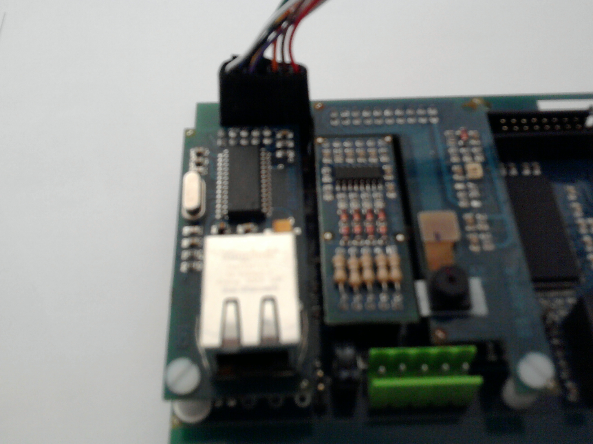
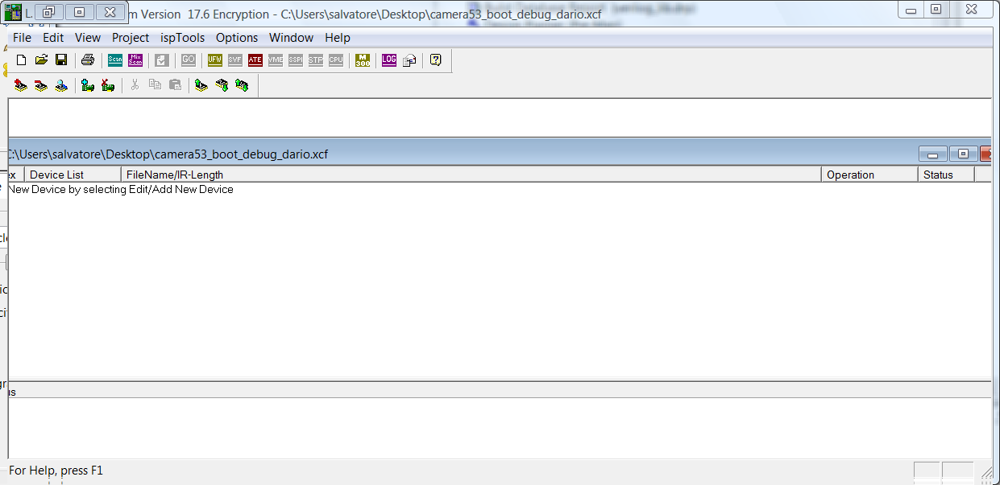
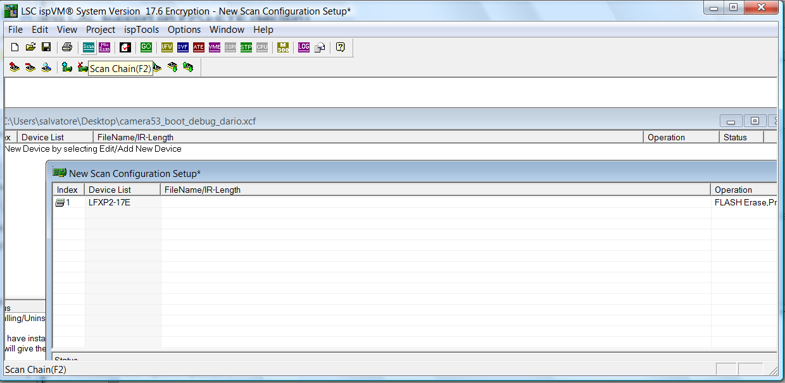
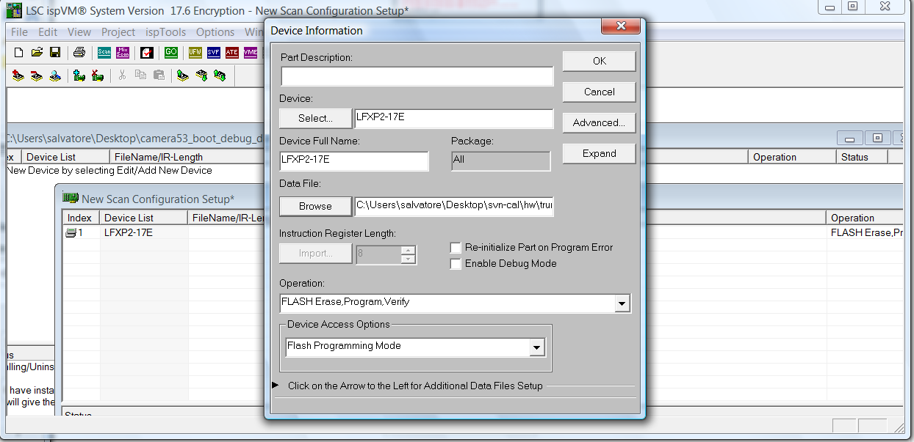
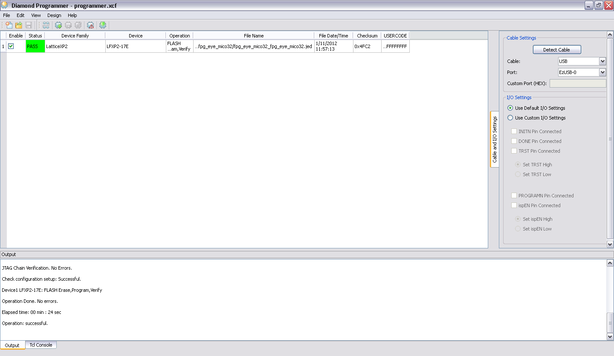

# Programming the FPG-EYE board

**JEDEC** is a ASCII text files containing programming information that can be used to configure a FPGA device. **JEDEC** is generated from [ispLever](http://www.latticesemi.com/products/designsoftware/isplever/isplever/index.cfm?source=sidebar) or [Diamond](http://www.latticesemi.com/products/designsoftware/diamond) when a logic circuit is synthesized.
It can be downloaded in the [Lattice](http://www.latticesemi.com/) device through the [JTAG](http://en.wikipedia.org/wiki/Joint_Test_Action_Group) port . To do this two things are necessary:

- Programming Cable.
- Software: ispVM System or Diamond Programmer.

### Programming Cable

After completion of the logic design and creation of a programming file with the [ispLever](http://www.latticesemi.com/products/designsoftware/isplever/isplever/index.cfm?source=sidebar) software, is necessary a *programming cable* for programming the devices directly on the PC board. There are a lot of compatible Lattice *programming cable*. This is very simple and low cost [programming cable](http://www.latticesemi.com/products/developmenthardware/programmingcables.cfm).

### ispVM System

The [*ispVM*](http://www.latticesemi.com/products/designsoftware/ispvmsystem/index.cfm) software is default installed together [ispLever](http://www.latticesemi.com/products/designsoftware/isplever/isplever/index.cfm?source=sidebar) or [Diamond](http://www.latticesemi.com/products/designsoftware/diamond) software. The default directory is (installation directory Lattice)/Accessories/ispVM System

- The *programming cable* must be connected to the FPG-EYE [JTAG](http://en.wikipedia.org/wiki/Joint_Test_Action_Group) board connector and PC port (can be Usb, serial or parallel).

Jtag connector

- Turn on the power of the FPG-EYE board, and launch [ispVM](http://www.latticesemi.com/products/designsoftware/ispvmsystem/index.cfm) software.

Open ispVM software

- Push **Scan** button, the software should find the Fpga model. If it don't be sure then the [JTAG](http://en.wikipedia.org/wiki/Joint_Test_Action_Group) cable is connected and/or the FPG-EYE is powered.

Scan on ispVM software

- Aftre click on **FileName/IR-Lenght** field will show the *Chair Configuration* window. With **Browes** button select **jed** file in local repository.

Select jed file

- Click on **OK** button and return on The [*ispVM*](http://www.latticesemi.com/products/designsoftware/ispvmsystem/index.cfm) main page. Click on **GO** and start the programming configuration in the FPGA. At end the board is ready for use.

### Diamond Programmer

- The *programming cable* must be connected to the FPG-EYE JTAG board connector and PC port (can be Usb, serial or parallel).
- Turn on the power of the FPG-EYE board, and launch Diamond Programmer software.
- Push **Detect Cable** button, the software should find the cable.
- Select the Lattice Mico32 device and the JEDEC file as shown in the next figure.
- From the menu, select 'Design -> Program' to load the platform on the device. At end the board is ready for use.

Diamond Programmer

---

## Archive provenance

- [Original page](http://erika.tuxfamily.org/wiki/index.php?title=Programming_the_FPG-EYE_board) · [Archived source revision 4290](http://erika.tuxfamily.org/wiki/index.php?oldid=4290)
- Last source edit: 2012-01-12T14:00:15Z. Source retrieved on 2026-11-06; Markdown conversion completed on 2026-11-07.
- Original contributors recorded in exported history: Salva, Erikadds.
- [Original MediaWiki source](../source/wikitext/1799.mediawiki) · [Original editing history](../source/history/batch-009.xml)
- [Attribution and licensing notice](../NOTICE.md). Original file-specific notices, where present, remain applicable.
