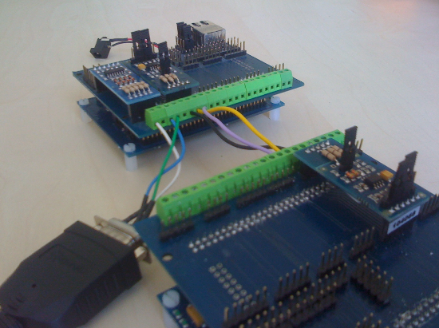

# RS485 on FLEX

## RS485 on FLEX

This pages reports the experiences on using RS485 devices on the FLEX Multibus boards and demo boards.

A big thanks to [CESI Ricerca SPA, Italy](http://www.cesiricerca.it/), for providing the base text for this page.

### Tests using FLEX DEMO DAUGHTER BOARD

HW:

- JMP 4, 5, 6 on the daughter board are in position 1-2, 2-3, 2-3
- JMP2 and JMP3 of RS485 module in position 1-2
- the demo board is connected to UART2

in eeuart.h:

- U2MODEbits.UEN=0 (if CTRL\_FLOW)

in code.c, test with RF13:

- UART2\_INIT with CTRL\_FLOW
- before Send: PORTFbits.RF12=0 and PORTFbits13=1
- after Send: PORTFbits.RF12=0 and PORTFbits13=0
- testing pin levels with oscilloscope:
  - RF13.PIN39 on the Flex = OK
  - TXEN in the 485 module (pin 3) = KO
  - Transmit=OK Receive=KO

in code.c, test with RF12:

- UART2\_INIT with CTRL\_FLOW
- before Send: PORTFbits.RF12=1 and PORTFbits13=0
- after Send: PORTFbits.RF12=0 and PORTFbits13=0
- testing pin levels with oscilloscope:
  - RF12.PIN39 on the Flex = OK
  - TXEN in the 485 module (pin 3) = KO
  - Transmit=OK Receive=KO

The pin3 is NOT connected to RF12 when using RS485 on the daughter board,
so TXEN is not activated.
The pin5 is connected to RF13 and is activated when PORTFbits.RF13=1,
so by soldering a jumper between pin3 and pin 5 on the RS485 module we get
TRANSMIT=OK and RECEIVE=OK and all works fine!

### Tests using FLEX MULTIBUS BOARD

HW:

- JMP2 and JMP3 of RS485 module in position 1-2

#### module 485 in the first UART slot of multibus (the first from the right)

in eeuart.h:

- U1MODEbits.UEN=0 (if CTRL\_FLOW)

in code.c:

- UART1\_INIT with CTRL\_FLOW
- before Send: PORTDbits.RD14=0 and PORTDbits.RD15=1
- after Send: PORTDbits.RD14=0 and PORTDbits.RD15=0
- testing pin levels with oscilloscope:
  - RD15.PIN48 on the Flex = OK
  - TXEN in the 485 module (pin 3) = OK
  - Transmit=OK Receive=OK

if module 485 in the second slot (connected to UART2, second from the right) and using the same SW above (referencing UART1): ALL KO!!

#### module 485 in the second UART slot of multibus (the second from the right)

in eeuart.h:

- U2MODEbits.UEN=0 (if CTRL\_FLOW)

in code.c:

- UART2\_INIT with CTRL\_FLOW
- before Send: PORTFbits.RF12=0 and PORTFbits.RF13=1
- after Send: PORTFbits.RF12=0 and PORTFbits.RF13=0
- testing pin levels with oscilloscope:
  - RF13.PIN39 on the Flex = OK
  - TXEN in the 485 module (pin 3) = OK
  - Transmit=OK Receive=OK

if module 485 in the first slot (connected to UART1, first from the right) and using the same SW above (referencing UART2): ALL KO!!

The image below show how to connect two FLEX multibus-boards for a RS485 based communication. Please, note that the RS485 modules are in the second UART slot of the multibus board.

---

## Archive provenance

- [Original page](http://erika.tuxfamily.org/wiki/index.php?title=RS485_on_FLEX) · [Archived source revision 3142](http://erika.tuxfamily.org/wiki/index.php?oldid=3142)
- Last source edit: 2011-06-23T14:30:58Z. Source retrieved on 2026-11-06; Markdown conversion completed on 2026-11-07.
- Original contributors recorded in exported history: Paolo.gai, Cesiricerca, Erikadds.
- [Original MediaWiki source](../source/wikitext/1429.mediawiki) · [Original editing history](../source/history/batch-009.xml)
- [Attribution and licensing notice](../NOTICE.md). Original file-specific notices, where present, remain applicable.
