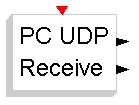
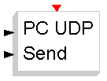
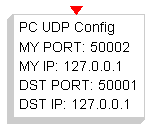
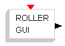

# RT Data Exchange

The **RT Data Exchange** palette:

| Symbol | Description |
| --- | --- |
|  | This block receive data through a UDP protocol. It can be used also to receive data sent by the FLEX-FULL USB port. The internal parameter specifies the number of output lines. |
|  | This block send data through a UDP protocol. It can be used also to send data to the FLEX-FULL USB port. The internal parameter specifies the number if input lines. |
|  | This block configures UDP sockets used to send and receive data. The internal parameters specify IP-address and port for both PC and board. |
|  | This block opens a GUI with rollers. It can be used to tune, in real-time, the parameters of your algorithm during the program execution. |

---

## Archive provenance

- [Original page](http://erika.tuxfamily.org/wiki/index.php?title=RT_Data_Exchange) · [Archived source revision 4048](http://erika.tuxfamily.org/wiki/index.php?oldid=4048)
- Last source edit: 2011-11-07T12:26:51Z. Source retrieved on 2026-11-06; Markdown conversion completed on 2026-11-07.
- Original contributors recorded in exported history: WikiSysop, Erikadds, Eguidieri.
- [Original MediaWiki source](../source/wikitext/1538.mediawiki) · [Original editing history](../source/history/batch-009.xml)
- [Attribution and licensing notice](../NOTICE.md). Original file-specific notices, where present, remain applicable.
