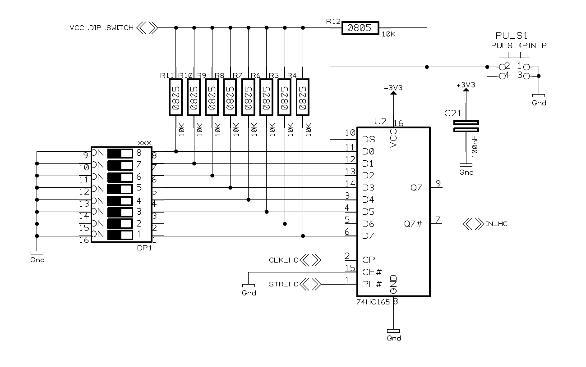
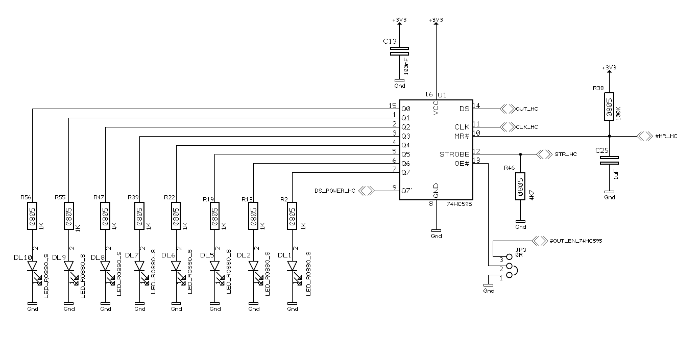

# Sample code for serialpar io

We are going to see how program the *serialpar\_io* component. The *serialpar\_io* component drives shift register in output and input. On the *FPG-EYE* board there is a

[](../files/File_74hc165.png--2149.md)

Switches connected on 74hc165 parallel to serial converter

as input shift register and a

[](../files/File_74hc595.png--2150.md)

LEDs connected on 74hc595 serial to parallel converter

as output shift register. the serialpar\_io can be used together In this session the code reads the switches status from *SW1* component and every time this value is changed the code increment the the LEDs value: *DL1*, *DL2*, *DL5*, *DL6*, *DL7*, *DL8*, *DL9* and *DL10*.
<a id="Read_switches_value_by_serialpar_io"></a>

### Read switches value by serialpar\_io

In the figure shown a portion of the circuit of the FPG-EYE.

[](../files/File_74hc165.png--2149.md)

Switches connected on 74hc165 parallel to serial converter

The input shift register [74hc165](http://www.nxp.com/documents/data_sheet/74HC_HCT165.pdf) is drived by *serialpar\_io* component in serial mode. The serial data is latched

<a id="Write_a_switches_value_by_serialpar_io"></a>

### Write a switches value by serialpar\_io

In the figure is shown a portion of the circuit of the FPG-EYE.

[](../files/File_74hc595.png--2150.md)

LEDs connected on 74hc595 serial to parallel converter

The component [74hc595](http://www.nxp.com/documents/data_sheet/74HC_HCT595.pdf) is connected on *serialpar\_io* component.

<a id="Example_code"></a>

### Example code

Everytime we change the state on the switches the LEDs value is incremented:

```
#define EE_LED_COUNT 10
#define EE_SERIO_ALL_LEDS ((1 << EE_SERIO_LED_COUNT) - 1)
#define EE_SERIO_SWITCH_MASK(n) (1 << (n))

/* register structure of the serialpar_io component */
typedef struct
{
   /* Register to read state of switches and button (RO) */
   volatile unsigned long data_in;
   /* Register to control leds & transistors (R/W) */
   volatile unsigned long data_out;
   /* Status register (R/W) */
   volatile unsigned long status;
} serialpar_io_t;

/* SERIAL_BASE_ADDRESS is from system_conf.h */
static serialpar_io_t * const serpario = (SerParIO_t *)SERPARIO_BASE_ADDRESS;

/*
   This function reads the status of switches and button.
   return: the status of switches and button (data_in register).	
*/
unsigned long serio_read(void)
{
   return serpario->data_in;
}

/*
   This function reads a particular switch of the XP2-CAMERA board.
   param n: the number of the switch to read			
   return: the status of the switches
*/
unsigned long serio_switch_read(unsigned int n)
{
   return (serio_read() & EE_SERIO_SWITCH_MASK(n)) != 0;
}

/*
   This function reads data_out, the register to control leds & transistors.
   return: the status of leds & transistors (data_out register).
*/
unsigned long serio_get_data_out(void)
{
   return serpario->data_out;
}

/*
   This function writes data_out, the register to control leds.
*/
void serio_write(unsigned long data)
{
   serpario->data_out = data;
}

/*
   This function sets the state of the leds of the XP2-CAMERA board.
   state: Bitmap of the new led state
*/
void led_set_all(unsigned long state)
{
   unsigned long old = serio_get_data_out();
   serio_write((old & ~EE_SERIO_ALL_LEDS) | (state & EE_SERIO_ALL_LEDS));
}

int main(void) {
   
   unsigned long state_old, state;
   unsigned long value;

   /* All LEDs off */
   led_set_all(0);

   state_old = state;

   while(1) {

       state = serio_read();
       if (state_old != state) {

           state_old = state;
           led_set_all(++value);
       }
   }

   return 0;
}
```

---

## Archive provenance

- [Original page](http://erika.tuxfamily.org/wiki/index.php?title=Sample_code_for_serialpar_io) · [Archived source revision 3994](http://erika.tuxfamily.org/wiki/index.php?oldid=3994)
- Last source edit: 2011-10-28T12:30:28Z. Source retrieved on 2026-11-06; Markdown conversion completed on 2026-11-07.
- Original contributors recorded in exported history: Salva.
- [Original MediaWiki source](../source/wikitext/2148.mediawiki) · [Original editing history](../source/history/batch-010.xml)
- [Attribution and licensing notice](../NOTICE.md). Original file-specific notices, where present, remain applicable.
