# ScicosLab Course October 2010 - Florence

This page contains online material, notes and photos about the topics presented in the ScicosLab Training course in Florence.

## Course material

### Brochure

- [ScicosLab course october 2010 - Course Brochure](../assets/linked/scicoslab_Florence_2010_brochure_r4--276d587859675e64.pdf)

### ScicosLab

- [ScicosLab - day 1 slides](../assets/linked/Florence_2010_D1_r7--d9618dba50cadcd4.pdf)
- [ScicosLab - day 1 examples](../assets/linked/examples_day1--6743507eb9d04131.zip)
- [ScicosLab - day 2 slides](../assets/linked/Florence_2010_D2_r6--7979d891a4e74a6b.pdf)
- [ScicosLab - day 2 examples](../assets/linked/examples_day2--dbfd73723a111ce6.zip)

### ERIKA Enterprise

- [Real-time systems, OSEK/VDX standard](../assets/linked/rtos_osek_reduced--8cfc50f6861ac3d1.pdf)
- [ERIKA Enterprise OSEK/VDX API examples](../assets/linked/rtos_osek_examples--41a7e611f7faeecb.pdf)
- [FLEX boards, difference with the various EE kernels](../assets/linked/ee--4cc486c5b4774775.pdf)

### RTAI, CANOpen

- [CANOpen implementation on RTAI](../assets/linked/canOpen--a89fa8b619a931bc.pdf)
- [RTAI examples, CANOpen examples on RTAI](../assets/linked/examples--6eb4a00c51e91cc9.zip)
- [Furuta pendulum controller](../assets/linked/controller--6495e9ff43fc2f86.pdf)

### RTSS - The Robotics Toolbox for Scicoslab

(link updated on 2010/10/28)

- [RTSS course slides available here](http://rtss.sourceforge.net/docs/index.html#slcourse10)
- [Slides about the Robotics Toolbox for ScicosLab](../assets/linked/Florence_2010_D3_rtss--4d4abb057ca9cc79.pdf)
- [Videos used in the presentation of the Robotics Toolbox](../assets/linked/Florence_2010_D3_rtss_videos--4379f6f5e3b70198.zip)

### SMPS controller - Switched Mode Power Supply digital controller and simulation

- [SMPS slides - simulation and control of SMPS using ScicosLab](../assets/linked/Florence_2010_D3_DM_r3--9035023c47538030.pdf)
- [SMPS examples - simulation and control of SMPS using ScicosLab](../assets/linked/examples--bdd9fd03b2b7d4f6.zip) (update 2010/10/27: update of this file now works)

## Photos

[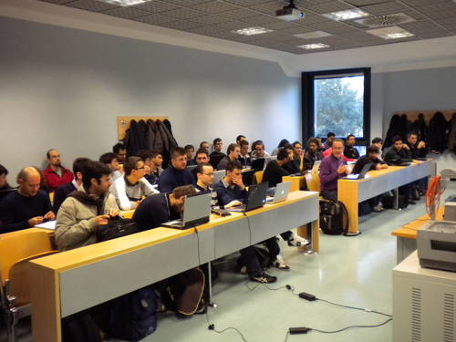](../files/File_Scicoslab2010_01_participants.jpg--1670.md)

The participants to the course...

[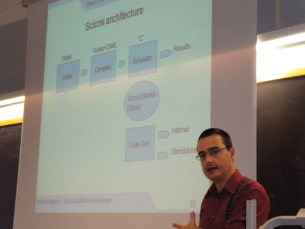](../files/File_Scicoslab2010_02_simone.jpg--1671.md)

Simone explaining Scicos architecture...

[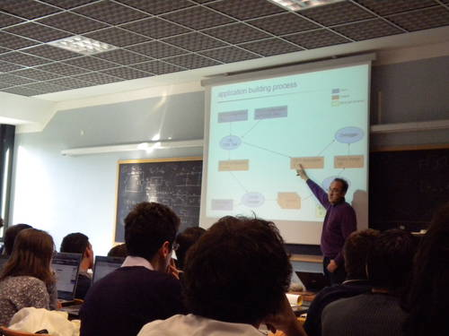](../files/File_Scicoslab2010_03_pj.jpg--1672.md)

PJ showing the ERIKA Enterprise workflow...

[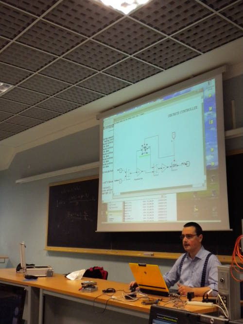](../files/File_Scicoslab2010_04_simone.jpg--1673.md)

Simone shows how to design a controller on ScicosLab...

[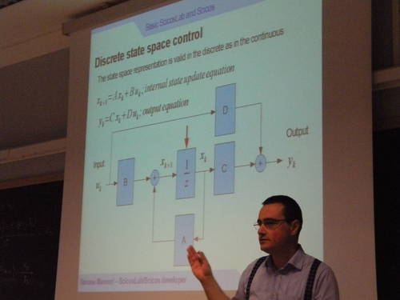](../files/File_Scicoslab2010_05_simone.jpg--1674.md)

Simone shows state space representation for discrete (sampled) systems...

[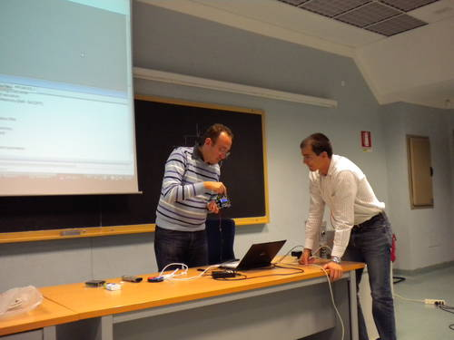](../files/File_Scicoslab2010_06_pj_daniele.jpg--1675.md)

PJ and Daniele trying an example on the FLEX boards...

[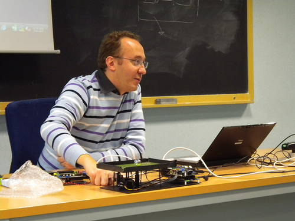](../files/File_Scicoslab2010_07_pj.jpg--1676.md)

PJ and the Amazing Ball...

[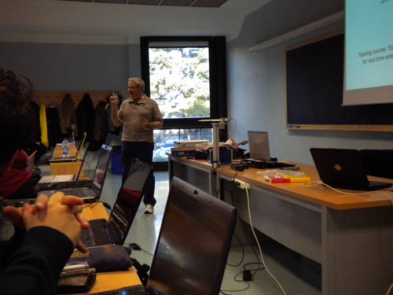](../files/File_Scicoslab2010_08_roby.jpg--1677.md)

Roberto "Robi" Bucher showing the SUPSI CAN bus board and the Inverted Pendulum made at SUPSI...

[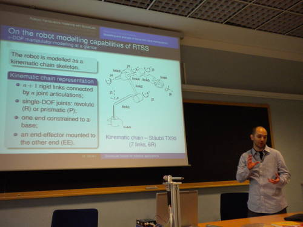](../files/File_Scicoslab2010_09_matteo.jpg--1678.md)

Matteo making a mimic of a robot...

[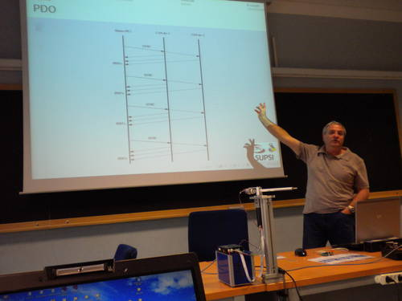](../files/File_Scicoslab2010_10_roby.jpg--1679.md)

Roby showing the CANOpen message exchange...

[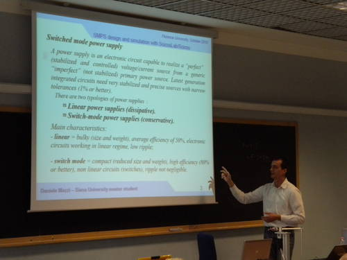](../files/File_Scicoslab2010_11_daniele.jpg--1680.md)

Daniele explaining switching mode power supply...

[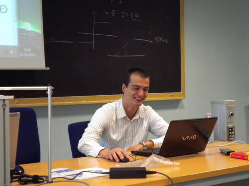](../files/File_Scicoslab2010_12_daniele.jpg--1681.md)

Daniele really happy about his first ScicoLab show...

[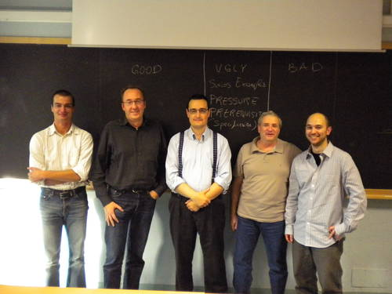](../files/File_Scicoslab2010_13_organizers.jpg--1682.md)

The organizers...

[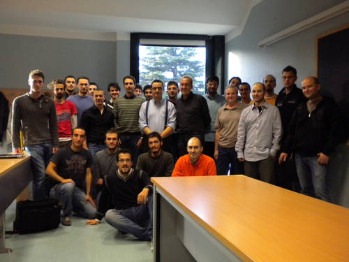](../files/File_Scicoslab2010_14_finalpicture.jpg--1683.md)

and last but not least... the final picture!

---

## Archive provenance

- [Original page](http://erika.tuxfamily.org/wiki/index.php?title=ScicosLab_Course_October_2010_-_Florence) · [Archived source revision 5091](http://erika.tuxfamily.org/wiki/index.php?oldid=5091)
- Last source edit: 2013-07-09T16:07:58Z. Source retrieved on 2026-11-06; Markdown conversion completed on 2026-11-07.
- Original contributors recorded in exported history: Paolo.gai, Simone.mannori, Hearme, Pj.
- [Original MediaWiki source](../source/wikitext/1669.mediawiki) · [Original editing history](../source/history/batch-010.xml)
- [Attribution and licensing notice](../NOTICE.md). Original file-specific notices, where present, remain applicable.
