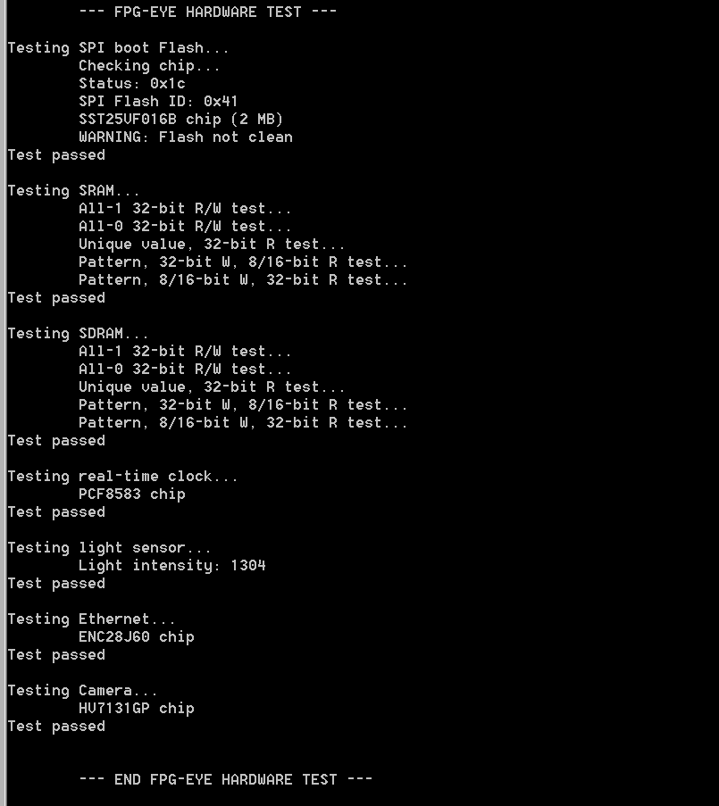
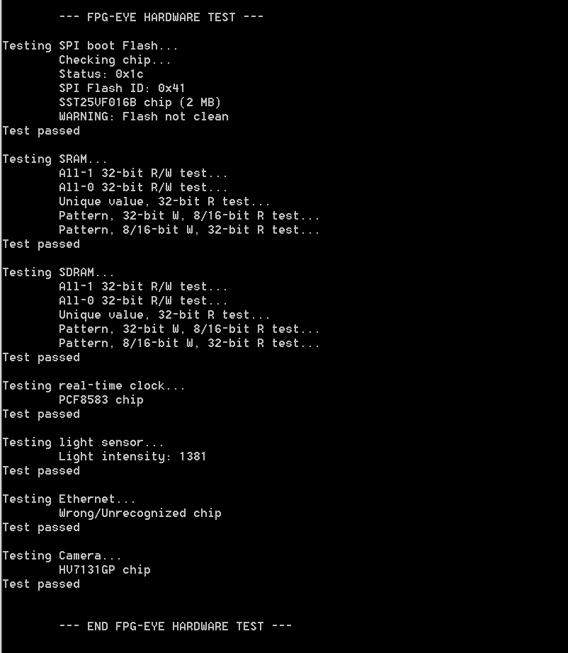

# Test hardware

In the [FPG-EYE software packet](../assets/linked/FPG-EYE_software_packet--117012d0f3aa1162.zip) you can find the *test\_hw.jed* file. With this file is possible test all hardware device present on the FPG-EYE board.

- leds
- boot flash
- sram
- sdram
- rtc
- light sensor
- ethernet
- camera

### Programming *test\_hw* in the FPG-EYE

Once the file is extracted from [FPG-EYE software packet](../assets/linked/FPG-EYE_software_packet--117012d0f3aa1162.zip) you have to program the *test\_hw.jed* in the board. The instructions are on [Programming the FPG-EYE board](Programming_the_FPG-EYE_board--1799.md "Programming the FPG-EYE board") section.

### FPG-EYE test

The result of the tests is written on the RS232 port. So the FPG-EYE must be connected via serial cable to a PC where is running a serial program communication like HyperTerminal, putty, GTerminal etc. The output of the test on working board is something like the follow figure:

FPG-EYE test ok

In this figure is present a hardware bug (we removed the ethernet module):

FPG-EYE test ok

Whenever the test of board reports an error you can try to turn off and then some minutes turn on the power supply. If the test reports again the bug please contact [Evidence S.r.l.](http://www.evidence.eu.com/).

---

## Archive provenance

- [Original page](http://erika.tuxfamily.org/wiki/index.php?title=Test_hardware) · [Archived source revision 3993](http://erika.tuxfamily.org/wiki/index.php?oldid=3993)
- Last source edit: 2011-10-28T10:15:19Z. Source retrieved on 2026-11-06; Markdown conversion completed on 2026-11-07.
- Original contributors recorded in exported history: Salva.
- [Original MediaWiki source](../source/wikitext/2152.mediawiki) · [Original editing history](../source/history/batch-010.xml)
- [Attribution and licensing notice](../NOTICE.md). Original file-specific notices, where present, remain applicable.
