# Tutorial: Building a Mico32 platform for FPG-EYE

## Introduction

This page explains how to build a configuration file for FPG-EYE's fpga from a source platform with binary camera.
Prerequisites:

- [Install Mico32/FPG-EYE development environment](Installation_of_Mico32_FPG-EYE_development_environment--2093.md "Installation of Mico32/FPG-EYE development environment")
- Get a local copy of Erika repository to have the platform projects.

For further info see this page: [ERIKA Enterprise and RT-Druid SVN Access instructions](ERIKA_Enterprise_and_RT-Druid_SVN_Access--1464.md#Anonymous.2C_readonly_access "ERIKA Enterprise and RT-Druid SVN Access").

- To download the platform JEDEC file, you need a **programming cable** connected to the JTAG port of the board, follow the instructions on [How programming the FPG-EYE board](Programming_the_FPG-EYE_board--1799.md).

## Import platform project in LatticeMico System IDE

Launch [*LatticeMico System*](http://www.latticesemi.com/products/designsoftware/micodevelopmenttools/index.cfm) software, and click on **MSB Perspective** button (as the following figure):

[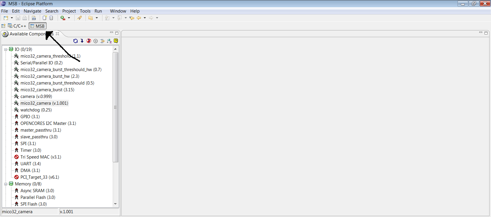](../files/File_Select_msb_from_msb_ide.png--2101.md)

**MSB** button

Open the **Open Platform form** by selecting the **File->Open Platform** menu item:

[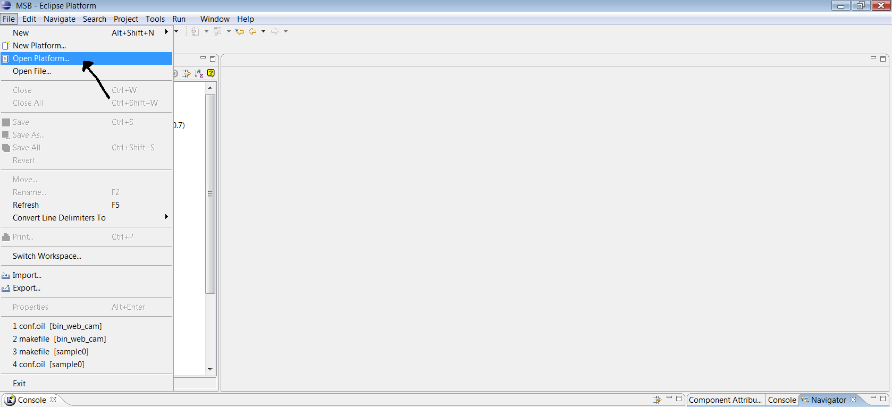](../files/File_Open_msb_from_msb_ide.png--2102.md)

Open **MSB** platform

Now if you are using the software ispLever click the **Browse** button and load **ee/trunk/ee/examples/mico32/demo/platforms/fpg\_eye\_isplever/msb/soc/fpg\_eye\_mico32.msb** while, if you are using the software Diamond click the **Browse** button and load **ee/trunk/ee/examples/mico32/demo/platforms/fpg\_eye\_diamond/msb/soc/fpg\_eye\_mico32.msb** file inside Erika repository local copy.

[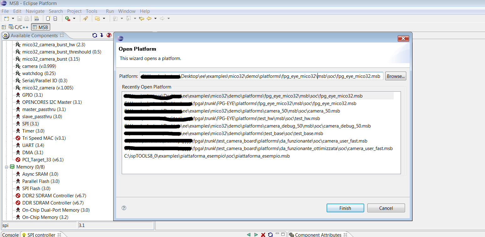](../files/File_Select_fpg_eye_mico32_msb_from_msb_ide.png--2162.md)

Select *fpg\_eye\_mico32.msb*

The platform's architecture is visible under **Sources in Project** window:

[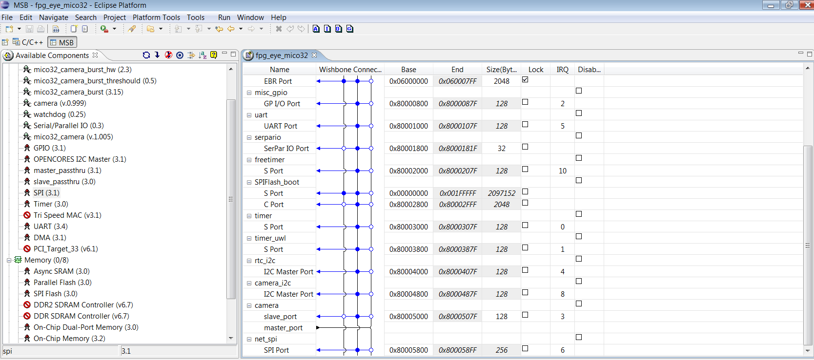](../files/File_Fpg_eya_mico32_from_msb.png--2163.md)

Select *fpg\_eye\_mico32.msb* platform architecture

Note: You don't need to make any changes to the platform.
And finally, generate the platform source by selecting the **Run Generator** menu item:

[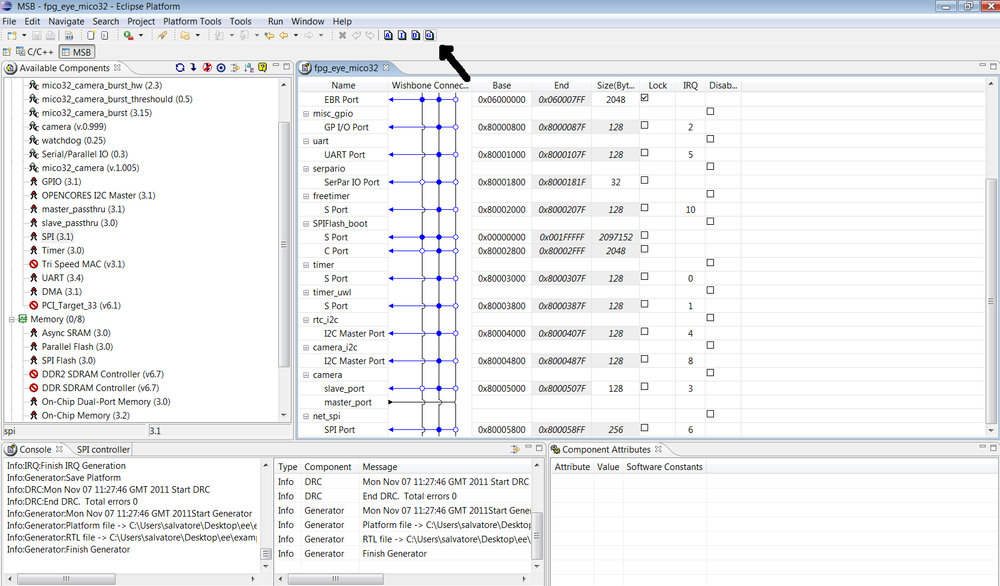](../files/File_Fpg_eya_mico32_from_msb_run.png--2164.md)

Clicking on **Run Generator** we have the platform source

The [mico32](http://www.latticesemi.com/products/intellectualproperty/ipcores/mico32/index.cfm) platform's Verilog source is generated. To use this platform in FPG-EYE, the source code must be compiled in binary format.
The next session explains how to compile the [Verilog](http://www.verilog.com/) platform's code with ispLEVER tool.

## Import hardware platform project in ispLever IDE

Open [ispLEVER](http://www.latticesemi.com/products/designsoftware/isplever/isplever/index.cfm?source=sidebar) and select *Open Project* under *File menu*:

[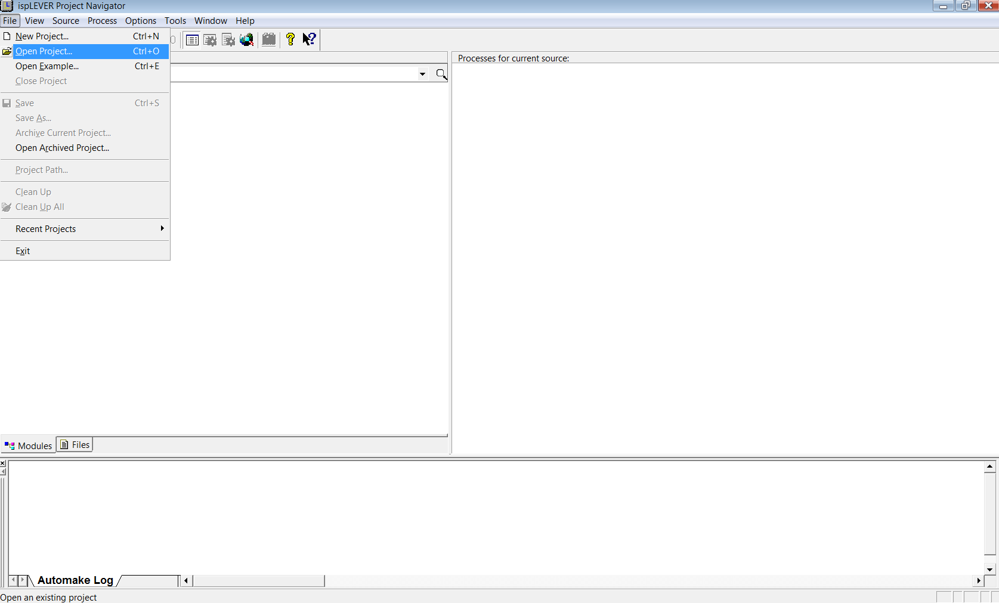](../files/File_Open_project_from_ispLever_ide.png--2106.md)

*Open project* from ispLever

Load **ee/examples/mico32/demo/platforms/fpg\_eye\_isplever/isplever/fpg\_eye\_mico32.syn** inside Erika repository local copy:

[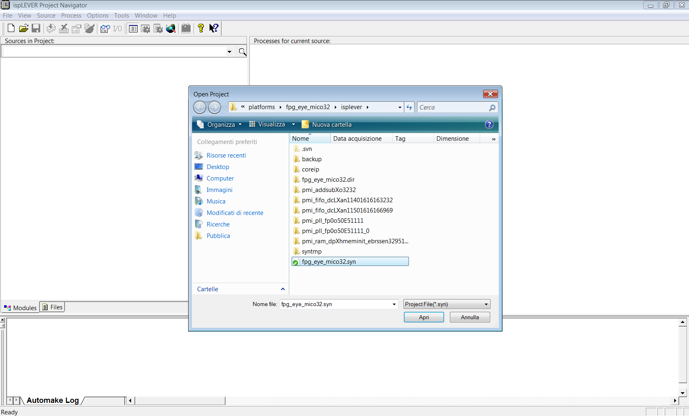](../files/File_Fpg_eya_mico32_from_ispLever.png--2166.md)

Load *fpg\_eye\_mico32.msb*

The hardware project structure is visible under *Sources in Project* window. Ensure that *fpg\_eye\_mico32\_wrapper.v* is selected and active:

[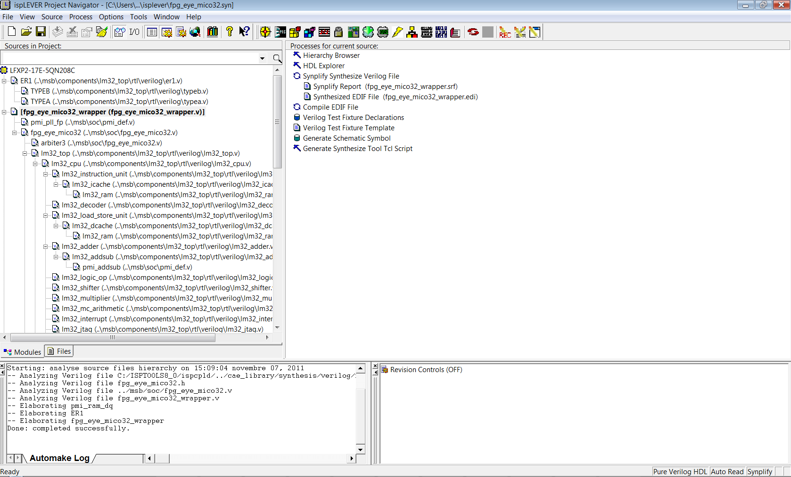](../files/File_Fpg_eye_mico32_wrapper_active.png--2168.md)

*ispLever* project structure

Before compiling the ispLever project, there are two more steps to perform (refer sections below).

### Importing *camera\_component\_mod.ngo* in the ispLever

The component camera installed in the platform *fpg\_eye\_mico32* is a binary version. So it is necessary to import in the ispLever the netlist of the camera. To do this, copy the file *camera\_component\_mod.ngo*, from the [FPG-EYE Software Packet](../assets/linked/FPG-EYE_software_packet--117012d0f3aa1162.zip) to the ispLever project directory.

[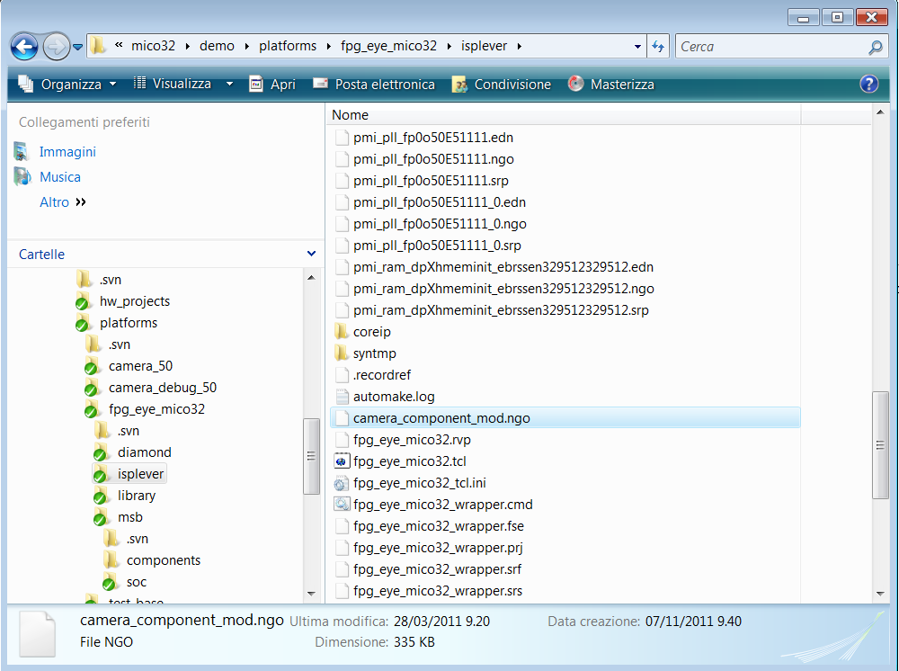](../files/File_Camera_component_ngo_in_ispLever.png--2167.md)

*camera\_component\_mod.ngo* in ispLever project directory

### *meminit\_ebr.mem* bootloader file in the ispLEVER

The file *meminit\_ebr.mem* is the compiled file. It is the program bootloader which will be placed in the XP2 EBR non volatile memory. For the bootloader reference guide, refer section [Tutorial: Running ERIKA on Mico32 and FPG-EYE](Tutorial_Running_ERIKA_on_Mico32_and_FPG-EYE--2113.md "Tutorial: Running ERIKA on Mico32 and FPG-EYE"). Be sure that the file is present in the ispLever project directory.

[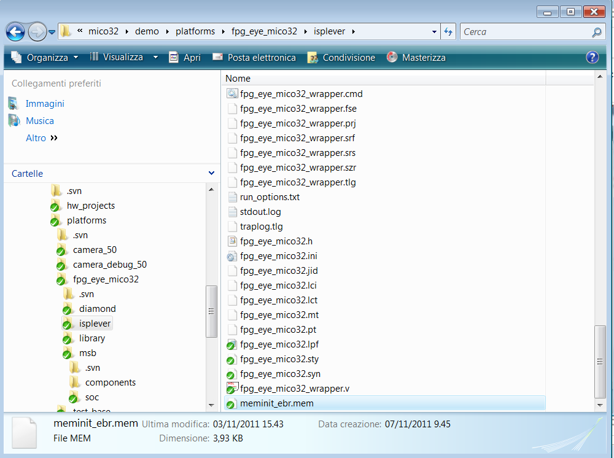](../files/File_Isp_lever_mem_file.png--2169.md)

*meminit\_ebr.mem* in ispLever project directory

### Build the platform with ispLEVER

On **Processes of current source** click and select **Generate Data File (JEDEC)** then right click and select **Force** :

[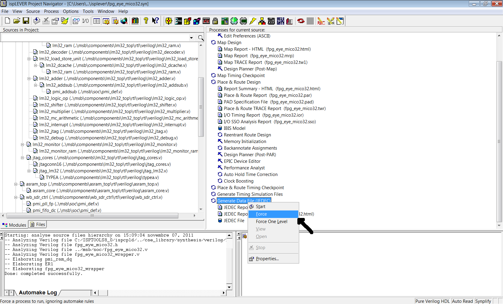](../files/File_Isp_lever_compile_fpg_eye_mico32.png--2170.md)

**Force** from **Generate Data File (JEDEC)** menu

When the process is complete the file the FPGA configuration file **JEDEC** is ready to use.

[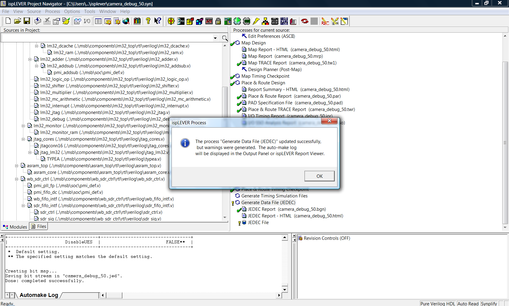](../files/File_Generate_data_file_jedec_from_isplever.png--2112.md)

**Generate Data File (JEDEC)**

## Import hardware platform project in Diamond IDE

Open [Diamond](http://www.latticesemi.com/products/designsoftware/diamond) and select *Open Project* under *File menu*:

[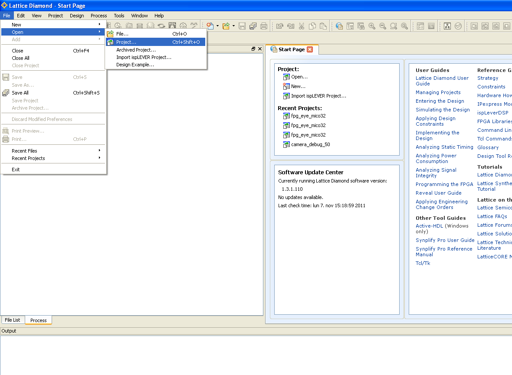](../files/File_Open_project_from_diamond_ide.png--2171.md)

*Open project* from Diamond

Load **ee/examples/mico32/demo/platforms/fpg\_eye\_diamond/diamond/fpg\_eye\_mico32.ldf** inside Erika repository local copy:

[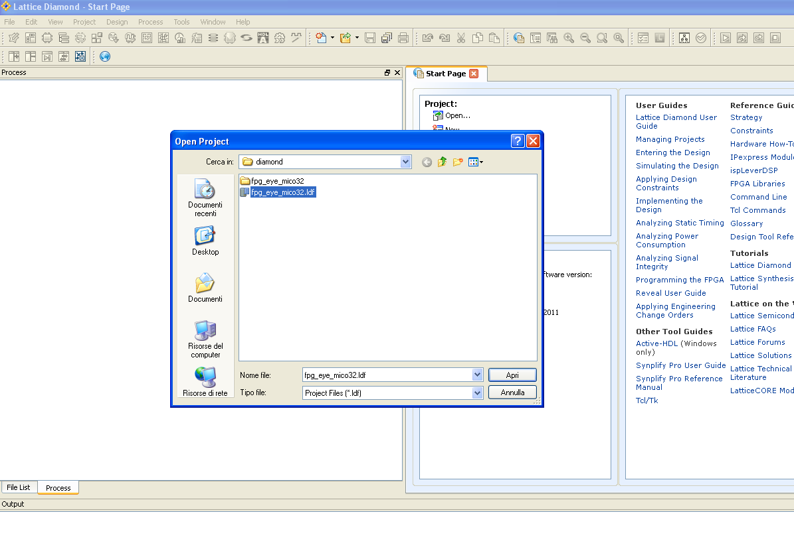](../files/File_Fpg_eya_mico32_from_diamond.png--2172.md)

Load *fpg\_eye\_mico32.msb*

The hardware project structure is visible under *Sources in Project* window. Ensure that *fpg\_eye\_mico32\_wrapper.v* is selected and active:

[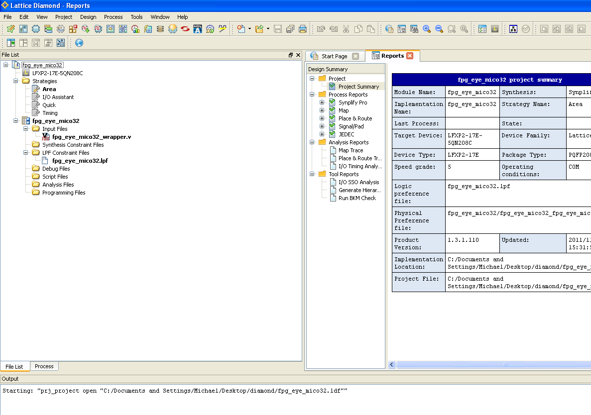](../files/File_Fpg_eye_mico32_wrapper_active_diamond.png--2173.md)

*Diamond* project structure

Before compiling the Diamond project, there are two more steps to perform (refer sections below).

### Importing *camera\_component\_mod.ngo* in the Diamond

The component camera installed in the platform *fpg\_eye\_mico32* is a binary version. So it is necessary to import in the Diamond the netlist of the camera. To do this, copy the file *camera\_component\_mod.ngo*, from the [FPG-EYE Software Packet](../assets/linked/FPG-EYE_software_packet--117012d0f3aa1162.zip) to the Diamond project directory.

[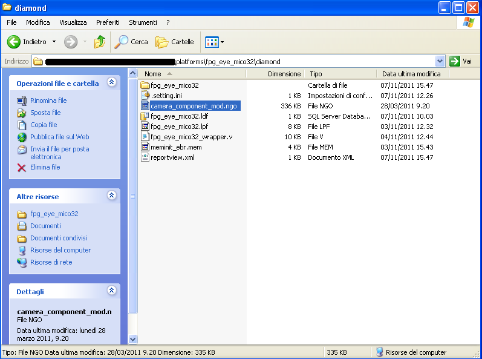](../files/File_Camera_component_ngo_in_diamond.png--2174.md)

*camera\_component\_mod.ngo* in Diamond project directory

### *meminit\_ebr.mem* bootloader file in the Diamond

The file *meminit\_ebr.mem* is a compiled file. It is the program bootloader which will be placed in the XP2 EBR non volatile memory. For the bootloader reference guide, refer section [Tutorial: Running ERIKA on Mico32 and FPG-EYE](Tutorial_Running_ERIKA_on_Mico32_and_FPG-EYE--2113.md "Tutorial: Running ERIKA on Mico32 and FPG-EYE"). Be sure than this file is present in the Diamond project directory.

[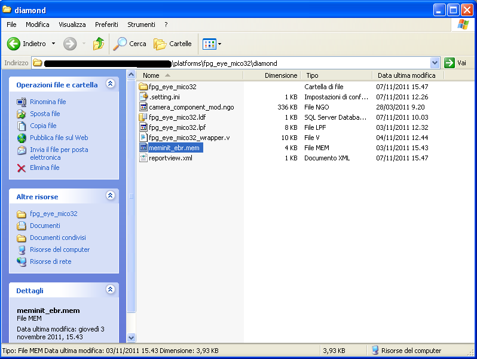](../files/File_Diamond_mem_file.png--2175.md)

*meminit\_ebr.mem* in Diamond project directory

### Build the platform with Diamond

On **Processes of current source** click and select **Generate Data File (JEDEC)** then right click and select **Return All** :

[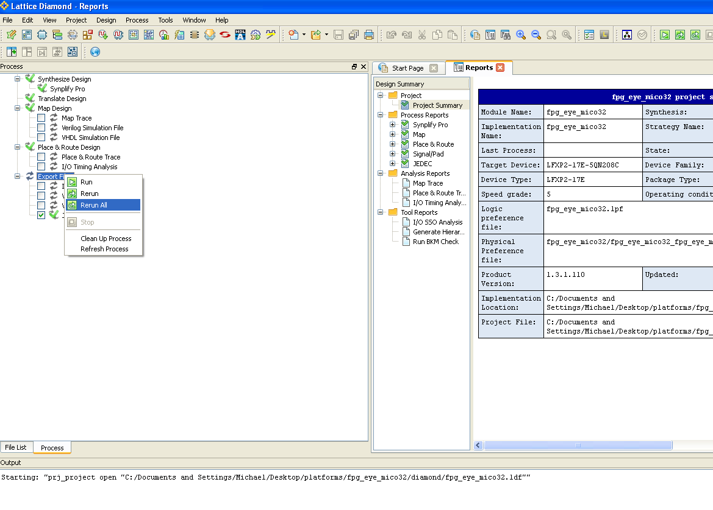](../files/File_Diamond_compile_fpg_eye_mico32.png--2176.md)

**Force** from **Generate Data File (JEDEC)** menu

When the process is complete the file the FPGA configuration file **JEDEC** is ready to use.

[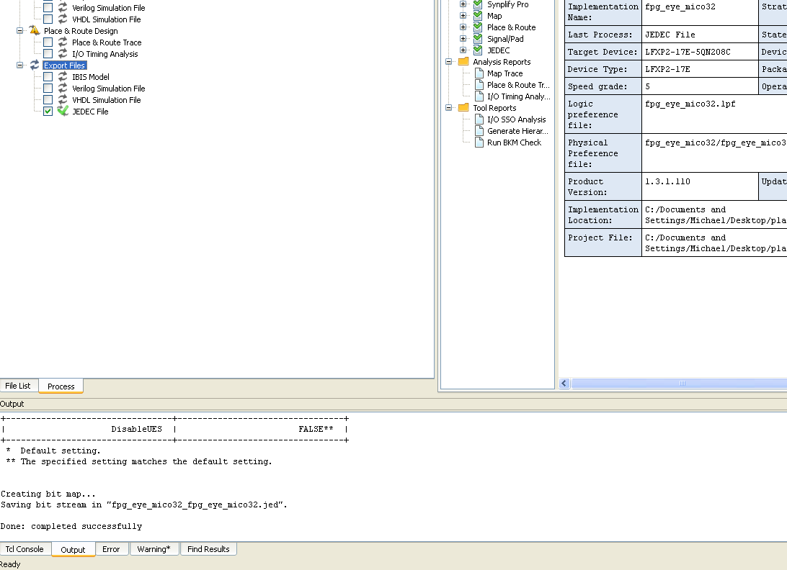](../files/File_Generate_data_file_jedec_from_diamond.png--2177.md)

**Generate Data File (JEDEC)**

## Programming the platform on FPG-EYE board

The last step is download the **JEDEC** file into *FPG-EYE*. Please follow the [Programming the FPG-EYE board](Programming_the_FPG-EYE_board--1799.md "Programming the FPG-EYE board") istructions.

---

## Archive provenance

- [Original page](http://erika.tuxfamily.org/wiki/index.php?title=Tutorial%3A_Building_a_Mico32_platform_for_FPG-EYE) · [Archived source revision 4314](http://erika.tuxfamily.org/wiki/index.php?oldid=4314)
- Last source edit: 2012-01-16T14:03:54Z. Source retrieved on 2026-11-06; Markdown conversion completed on 2026-11-07.
- Original contributors recorded in exported history: Salva, Eguidieri, Erikadds.
- [Original MediaWiki source](../source/wikitext/2100.mediawiki) · [Original editing history](../source/history/batch-011.xml)
- [Attribution and licensing notice](../NOTICE.md). Original file-specific notices, where present, remain applicable.
