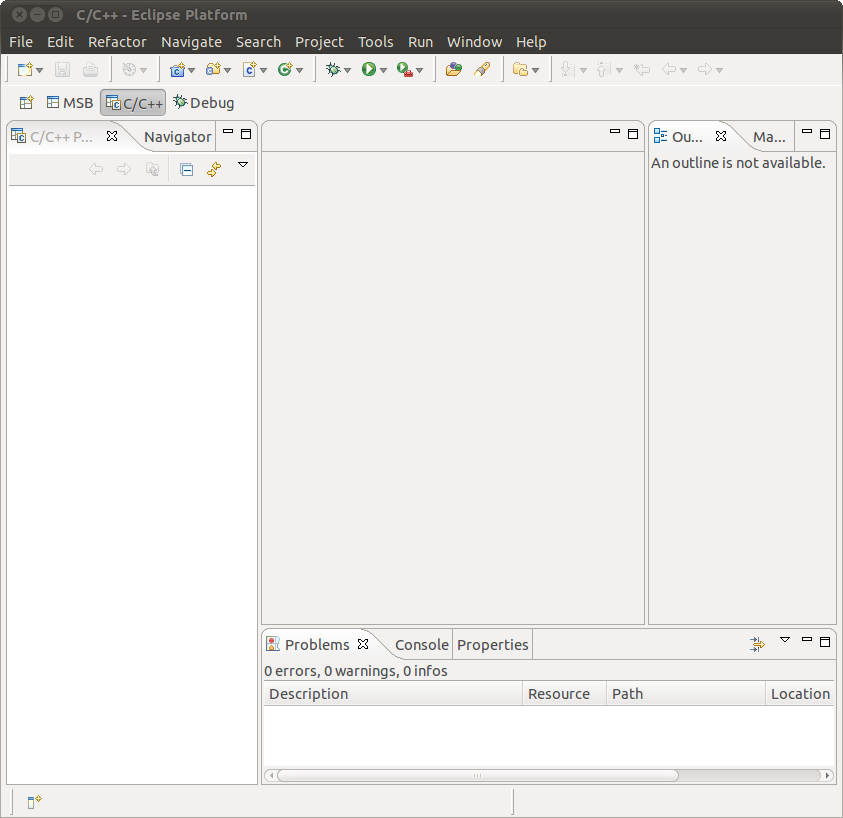
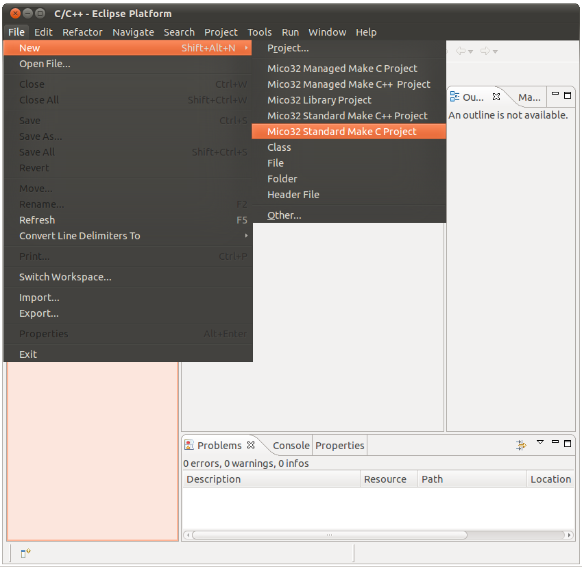
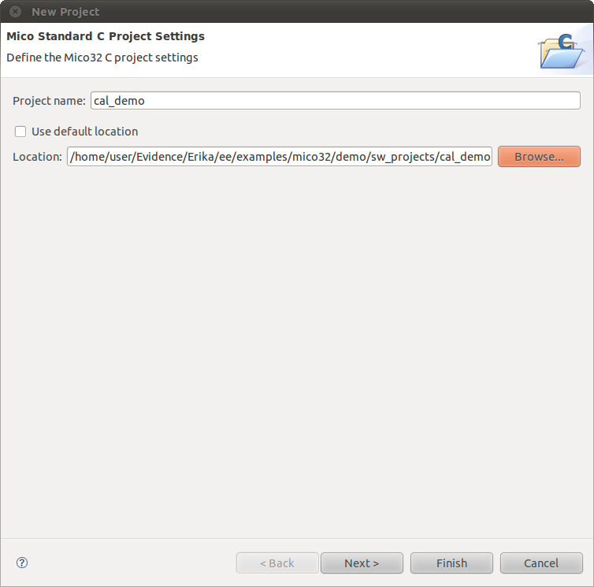
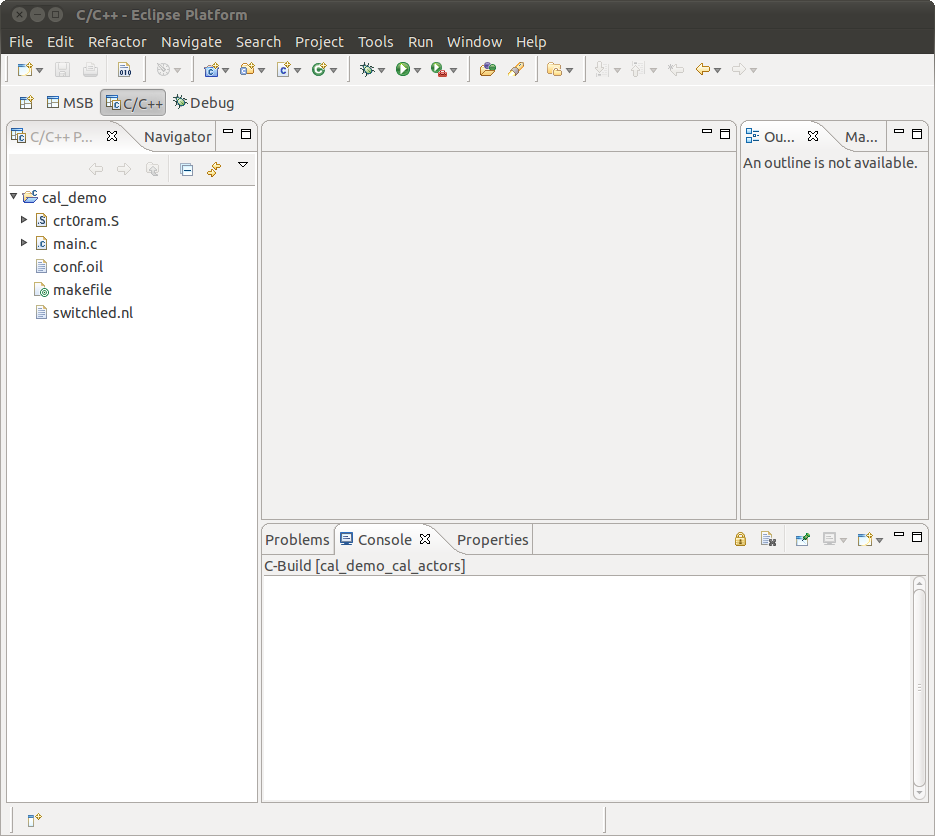
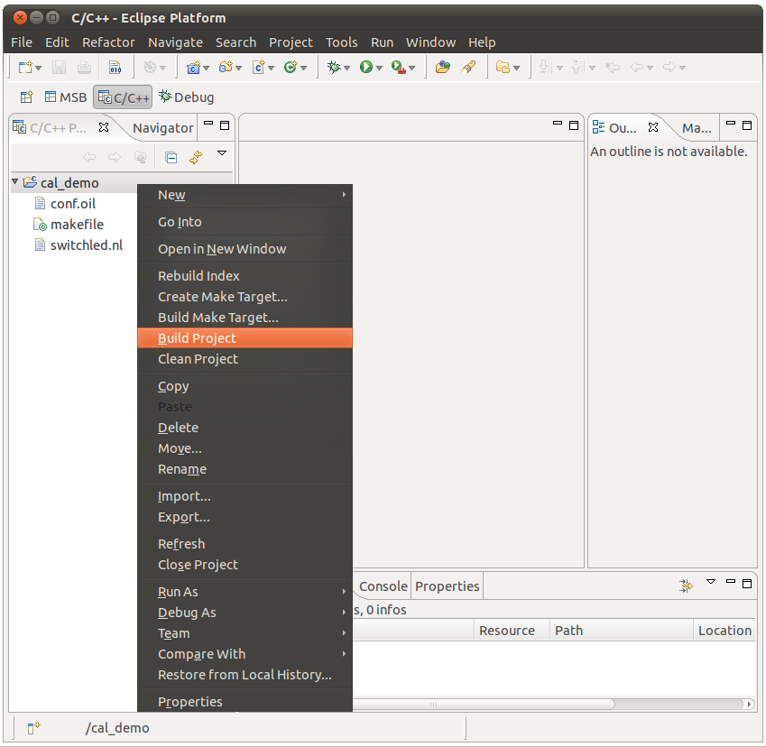
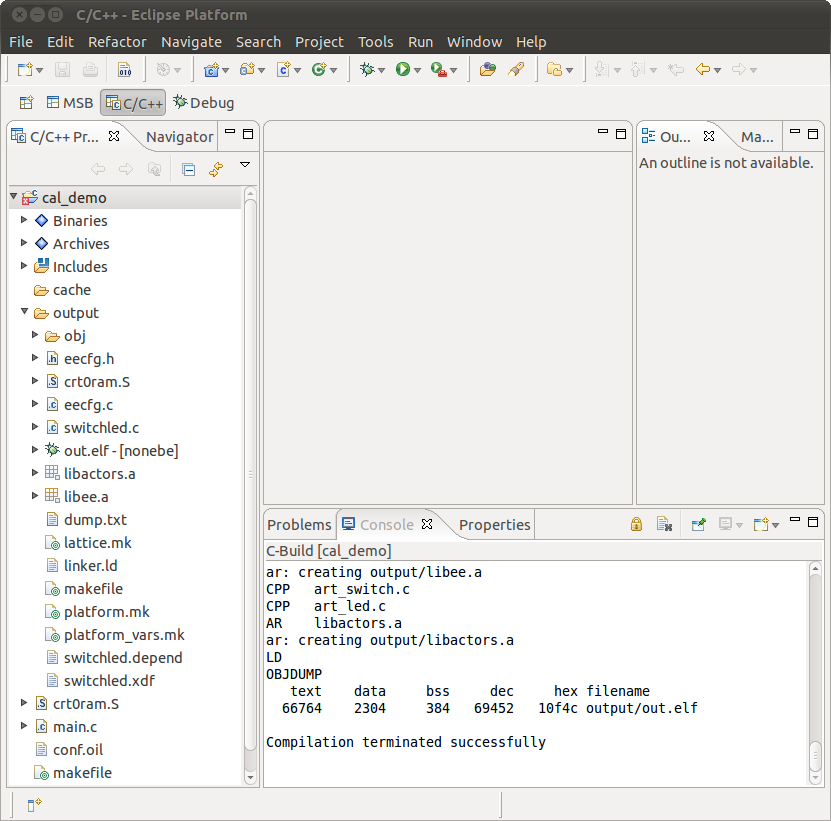
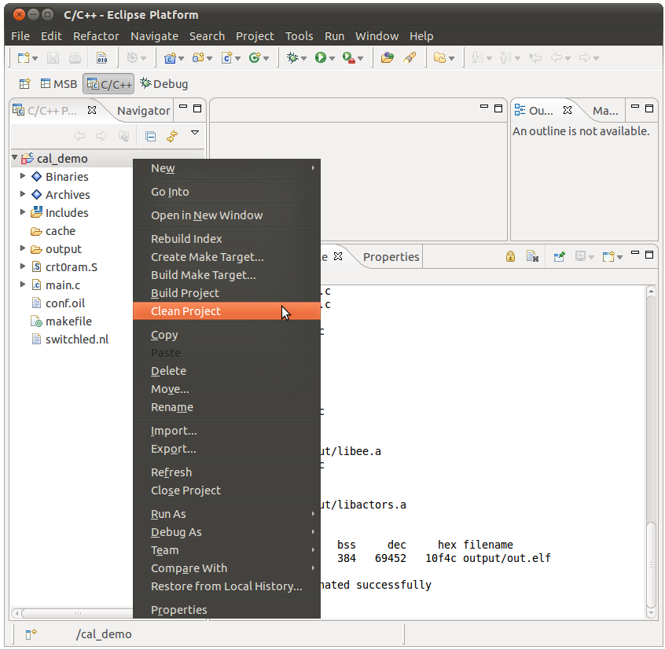
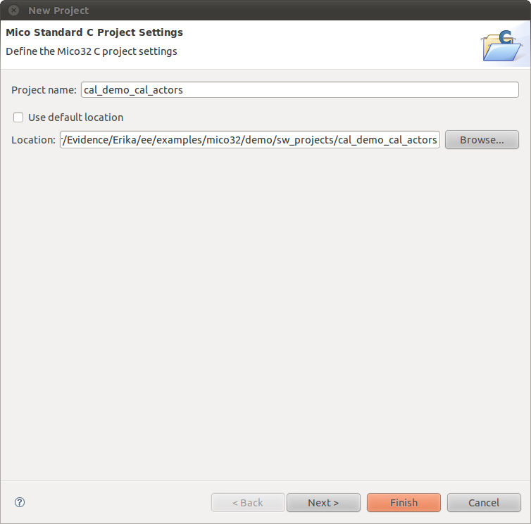
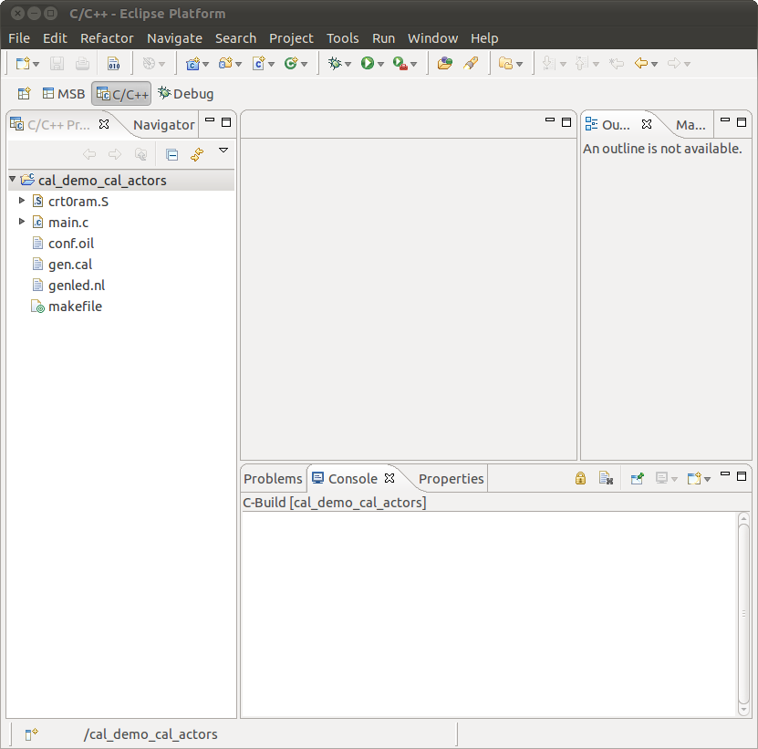
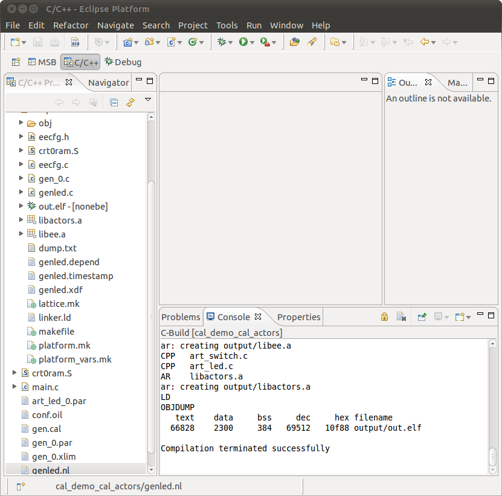

# Tutorial: Compiling a CAL application with ERIKA Enterprise

### Introduction

This small tutorial describes the steps to follow in order to create and compile two demo applications with CAL actors in Erika Enterprise using a Lattice Mico32 platform.

For a brief introduction to CAL language and CAL actors please refer to [Brief introduction to the CAL language](Brief_introduction_to_the_CAL_language--1768.md "Brief introduction to the CAL language")

### Prerequisites

Make sure you have correctly installed both LatticeMico32 System and ispVM System on your Linux machine and exported all the environment variables needed for compiling a project. For any help please have a look at [Tutorial: Installing CAL with ERIKA Enterprise](Tutorial_Installing_CAL_with_ERIKA_Enterprise--1755.md "Tutorial: Installing CAL with ERIKA Enterprise").

In order to compile a project it is essential to create a library for the Lattice Mico32 platform as explained in [Tutorial: Mico32 library for ERIKA](Tutorial_Mico32_library_for_ERIKA--1778.md "Tutorial: Mico32 library for ERIKA").

### Create your first project: cal\_demo

We are now ready to create our first project and compile it. This first demo, called cal\_demo, is composed of two system actors, a switch actor and a led actor called art\_switch.c and art\_led.c. These files are created in C language and can be found, along with the appropriate CAL files, into Erika's repository in: ~/Evidence/Erika/ee/contrib/cal/src.
The two system actors are combined in a netlist file named switchled.nl that you can find into cal\_demo's directory.
The purpose of this demo is to read the state of the switches and button residing on the FPG-EYE and produce it switching on/off the appropriate leds on the board itself.

Open the Lattice Mico32 System and press the C/C++ button on the status bar:

This screenshot shows the C/C++ button that must be pressed

Let's create a standard C project:

This screenshot shows the button which must be pressed to create a standard C project

Give the project a name you like (i.e. cal\_demo) and beware not to use the default location suggested by the program but the directory where resides the cal\_demo into the Erika's trunk:

This screenshot shows how to properly edit the project settings for the cal\_demo project

Press the Finish button and your project will be added to the list of C/C++ projects.

Here's how your newly created project appears:

This screenshot shows the files you will find once created a new cal\_demo project

The files present at this stage of the project are:

- main.c: main file project needed to initialize components of the FPG-EYE that will be used in the project. The user can place here it's own code.
- switchled.nl: the netlist file listing the actors present in our CAL project; it's because of netlist files that actors will be automatically included in the building process. To better understand where the system actors were injected into ERIKA's repository and where newly created CAL actors have to be saved have a look  [here](CAL_support_on_ERIKA_Enterprise--1767.md "CAL support on ERIKA Enterprise")
- conf.oil: configuration file, part of the OSEK/VDX standard, that is used for OS and application configuration. You will find here, as application sources, both main.c and switchled.nl files. For further explanation about oil files please have a look at [Tutorial: RT-Druid and OIL basics](Tutorial_RT-Druid_and_OIL_basics--1658.md "Tutorial: RT-Druid and OIL basics")
- makefile: makefile of our project
- crt0ram.S: file that implements boot-code and exception handlers

To build the project right click on the cal\_demo project and press the Build Project button:

This screenshot shows how to build the cal\_demo project

The result of the compilation is shown in the next screenshot:

This screenshot shows the results of a correct building process

As you can see in the previous screenshot there's a newly created folder named output/folder where object and dependency files are placed. Here you can find:

- switchled.depend and switchled.xdf: these files are automatically created by the ACTORS makefiles in the process of creating the switchled.c from the netlist file present in our project
- out.elf: the executable file

To clean the project right click on the cal\_demo project and press the Clean Project button:

This screenshot shows how to clean a project

### Create your second project: cal\_demo\_cal\_actors

The main point of this second demo is that we used a CAL actor named gen.cal, a counter, instead of the previously used art\_switch.c system actor; our counter is combined with the art\_led.c system actor by the genled.nl. Both the netlist and the CAL actor files are placed in the project's directory.
The purpose of this demo is to visualize the number produced by the counter switching on/off appropriately the leds placed into the FPG-EYE board

In order to create the project follow the steps described in the previous example, paying attention to the settings of the project:

This screenshot shows how to properly edit the project settings for the cal\_demo\_cal\_actors project

Here's how your newly created project appears:

This screenshot shows the files you will find once created a new cal\_demo\_cal\_actors project

Looking at the files present at this stage and comparing them with the previous cal\_demo example the main differences you will note are:

- gen.cal: this is the CAL actor
- genled.nl: this is the new netlist file. Please note the different nomenclature it to be used to address a system actor or a CAL one. To fully understand the meaning of the this nomenclature please refer to [CAL support on ERIKA Enterprise](CAL_support_on_ERIKA_Enterprise--1767.md "CAL support on ERIKA Enterprise")
- conf.oil: the application sources now present are main.c and genled.nl.

The result of a successful compilation (to be undertaken as explained in the previous example) is shown in the next screenshot:

This screenshot shows the results of a correct building process of the cal\_demo\_cal\_actors project

Looking at the newly created files you will notice some differences comparing with the previous example:

- output/obj: there is now gen\_0.c which is the C file created from the gen.cal CAL actor. In the process of obtaing gen\_0.c and genled.c files the ACTORS makefiles created also gen\_0.xlim, gen\_0.par and art\_led\_0.par files that are stored into the project's directory.

### Create and compile a CAL project from scratch

You have now the basic knowledge to create your own CAL project from scratch. In the following you will find the steps to follow and the main points to be aware of:

- create a directory for your project and copy into it the crt0ram.S, makefile conf.oil files. The latter will be opportunely modified in a secon moment.
- create in the project's directory your main.c file and insert here your code
- create CAL actors and/or system actors and a netlist file combining all the actors together. Please note that:
  - CAL actors are created in CAL language and have to be placed in the project's directory.
  - system actors have to be written in C language and placed in contrib/cal/src directory as explained in [CAL support on ERIKA Enterprise](CAL_support_on_ERIKA_Enterprise--1767.md "CAL support on ERIKA Enterprise").
- edit the conf.oil file in order to add as applications sources your main C file and your netlist. Moreover pay attention to link correctly your platform library according to where it is placed on your system. For further explanation about oil files please have a look at [Tutorial: RT-Druid and OIL basics](Tutorial_RT-Druid_and_OIL_basics--1658.md "Tutorial: RT-Druid and OIL basics")

Now build your CAL application following the previous examples.

---

## Archive provenance

- [Original page](http://erika.tuxfamily.org/wiki/index.php?title=Tutorial%3A_Compiling_a_CAL_application_with_ERIKA_Enterprise) · [Archived source revision 2622](http://erika.tuxfamily.org/wiki/index.php?oldid=2622)
- Last source edit: 2011-02-15T15:39:09Z. Source retrieved on 2026-11-06; Markdown conversion completed on 2026-11-07.
- Original contributors recorded in exported history: Ryosab81.
- [Original MediaWiki source](../source/wikitext/1757.mediawiki) · [Original editing history](../source/history/batch-011.xml)
- [Attribution and licensing notice](../NOTICE.md). Original file-specific notices, where present, remain applicable.
