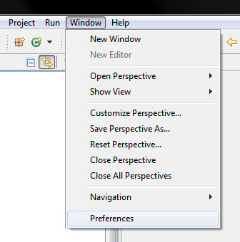
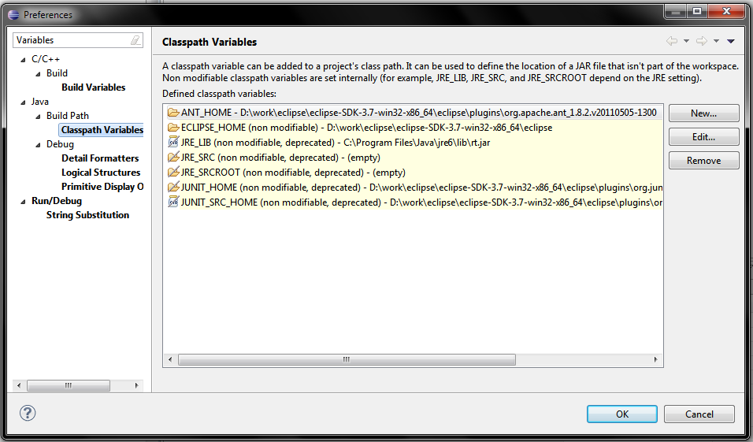
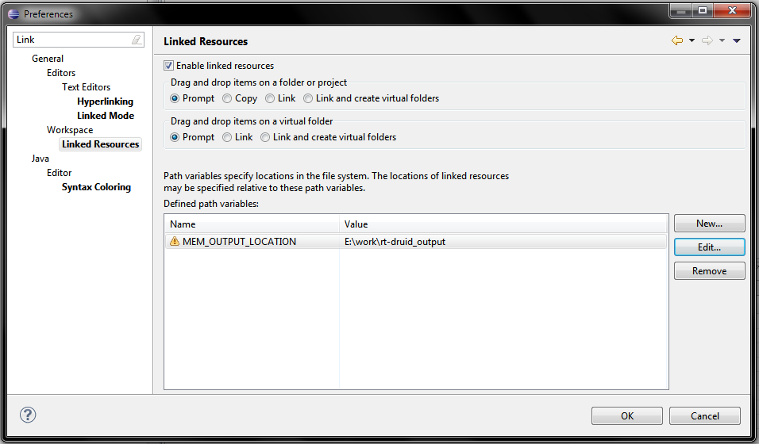
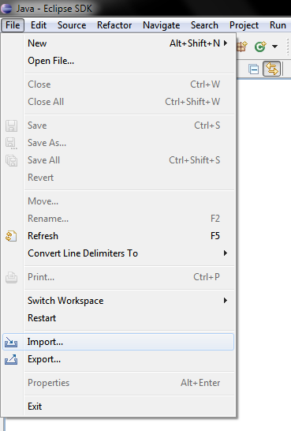
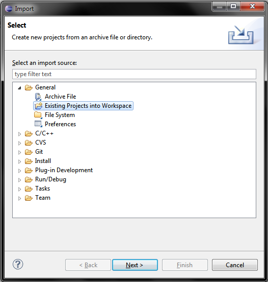
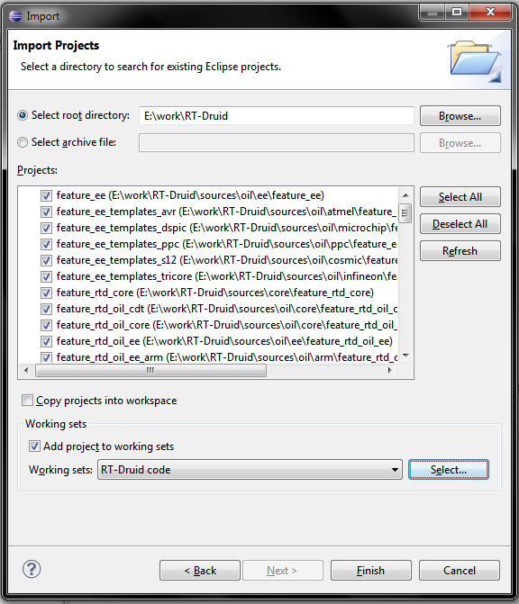
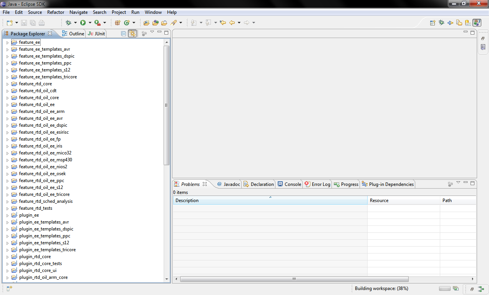

# Tutorial: Develop RT-Druid plugins

First of all, you need the RT-Druid code. To get it, please  [check it out from the Svn repository](ERIKA_Enterprise_and_RT-Druid_SVN_Access--1464.md "ERIKA Enterprise and RT-Druid SVN Access").
Then you need an editor. There are two options:

- use your preferred one
- use Eclipse

This page contains a few hints in case you are going to use Eclipse.

```
Note that you need some Eclipse plugins to compile RT-Druid even if you compile it by hand,
i.e. not using Eclipse build environment.
We strongly suggest to use Eclipse environment to build and debug RT-Druid plugins.
```

<a id="Code_structure"></a>

### Code structure

RT-Druid source code is organized in several Eclipse projects; most of them correspond to a feature or a plugin.
These projects are organized in the repository in few categories:

- **Products**: contains Eclipse projects related to the packaging of the RT-Druid distributions
- **Source**: the source code of RT-Druid
  - **Core**: the main part
  - **Analysis**: plugins related to the schedulability analysis of a system
  - **Oil**: OIL language support
- **Testing**: all plugins related to the test of RT-Druid code

<a id="Setting_up_Eclipse"></a>

### Setting up Eclipse

What you need to develop RT-Druid plugins is:

- **java sdk**: i.e., the compiler. We suggest to use the Oracle jdk 1.6 ([here is the Java SE download page](http://www.oracle.com/technetwork/java/javase/downloads/index.html))
- **Eclipse sdk**: if you do not have preferences or something already installed, take the ["classic" package of Eclipse](http://www.eclipse.org/downloads/packages/eclipse-classic-37/indigor). Then you need to add few plugins, if you do not already have them:
  - **Emf**: emf update site is <http://download.eclipse.org/modeling/emf/updates/releases/>. Suggested selection is Emf.sdk (it contains the code and more than what you need, but it is the fastest way)
  - **Gef**: gef update site is <http://download.eclipse.org/tools/gef/updates/releases/>. Again we suggest the SDK pack: gef.sdk
  - **CDT**: cdt update site is <http://download.eclipse.org/tools/cdt/releases/indigo/>. Also here we suggest the SDK pack.

Even if they are not required, you can install also plugins for versioning like [subversive](http://www.eclipse.org/subversive/downloads.php), or for bug reporting like [mylyn](http://www.eclipse.org/mylyn/downloads/).

```
Note: here you can find some instruction about how install the plugins using the Eclipse Update Manager.
```

```
Note: We suggest to use Eclipse 3.7 (Indigo). Today RT-Druid works with all versions of Eclipse since 3.4,
but future development may break this compatibility.
```

<a id="Setting_Ant_and_output_paths"></a>

### Setting Ant and output paths

In order to easily move RT-Druid plugins through various versions and installations of Eclipse, we use two variables ANT\_HOME and MEM\_OUTPUT\_LOCATION.
We can set both using the Eclipse preference window, opened through the **Preferences** command in the **Window** menu

[](../files/File_Rtd_prefs.png--2059.md)

Preferences location in the Eclipse menu

- **ANT\_HOME** points to the Ant plugin in the current installation of Eclipse

[](../files/File_Rtd_ant_home.png--2060.md)

An example of ANT\_HOME variable

- **MEM\_OUTPUT\_LOCATION** is the place where store binary files generated during the Eclipse build. (Note that this path is not used during the building of the update site and other RT-Druid products). This allows to separate the source from the binary, with some useful effects like:
  - it is possible to put the output files in a ram-disk (to speed up compilation...)
  - you can compile the same code files with more than one version/instance of Eclipse at the same time
  - the source code directories are kept clean

[](../files/File_Rtd_mem_output.png--2061.md)

An example of MEM\_OUTPUT\_LOCATION variable

<a id="Importing_projects"></a>

### Importing projects

To import RT-Druid projects into your Eclipse workspace, you have to select **Import...** from **File menu**

[](../files/File_Rtd_import_01.png--2062.md)

Import command

Then select "Existing projects into workspace"

[](../files/File_Rtd_import_02.png--2063.md)

Select import Existing projects

The window requires the path on your filesystem containing RT-Druid source projects (in this example, the path is **E:\work\RT-Druid**). If the path is correct you should see the list of the available RT-Druid projects, and you can select the ones to import in your workspace.
The **Copy project** flag allows you to copy all the files in your workspace, otherwise Eclipse will read and write directly in the path you specified.
Working set is useful to quickly select a group of projects.

[](../files/File_Rtd_import_03.png--2064.md)

Import Existing projects wizard

If you set "ant" and "output" paths, and if you have autobuild enabled (true by default), you should see Eclipse starting to compile all RT-Druid projects you just imported.

[](../files/File_Rtd_import_04.png--2065.md)

Import result

---

## Archive provenance

- [Original page](http://erika.tuxfamily.org/wiki/index.php?title=Tutorial%3A_Develop_RT-Druid_plugins) · [Archived source revision 4715](http://erika.tuxfamily.org/wiki/index.php?oldid=4715)
- Last source edit: 2012-03-29T09:32:57Z. Source retrieved on 2026-11-06; Markdown conversion completed on 2026-11-07.
- Original contributors recorded in exported history: WikiSysop, Paolo.gai, Dibbe, Nicola.
- [Original MediaWiki source](../source/wikitext/2058.mediawiki) · [Original editing history](../source/history/batch-011.xml)
- [Attribution and licensing notice](../NOTICE.md). Original file-specific notices, where present, remain applicable.
