# Tutorial: Installing ERIKA and RT-Druid on a Linux host

<a id="Introduction"></a>

## Introduction

This small tutorial describes the steps needed to download, compile and run a simple application showing the main features of Erika Enterprise and RT-Druid for the Microchip dsPIC DSC platform. However many parts of this tutorial can be easily applied to other architectures.

This tutorial has been tested on a FLEX board produced by Evidence and Embedded Solutions. Moreover, the needed software has been installed and tested on an Ubuntu 10.10 maverick but the installation process should be adapted to almost all other releases.

Even if all the steps needed to run an application will be depicted, a preliminary knowledge on the Microchip MPLAB X IDE and its debug environment should be useful to the reader.

<a id="Note_for_Linux_Users"></a>

## Note for Linux Users

If you are using a Linux distribution please look carefully at the following warnings:

1. The Evidence package installation path should NOT contain directory name with spaces. e.g. use ~/Evidence.
2. The Scilab package installation path should NOT contain directory name with spaces: e.g. use ~/Evidence/scicoslab-4.4b7.
3. It is strongly encouraged to adopt real paths instead of using symbolic links and aliases.
4. Please install all the Microchip compilers into their default directory (/opt/XXXX).

<a id="Prerequisites"></a>

## Prerequisites

Before proceeding with the installation process it should be useful to completely update the packages installed in you system to the latest version. To update all the packages open a Terminal window and execute the following commands:

```
sudo apt-get update
sudo apt-get upgrade
```

To execute the MPLAB X IDE a 32bit JRE have to be installed.
Before to proceed with the JRE installation you need to check the multiverse repository enabled. You can perform this step from the Ubuntu Software Center and select "Edit -> Software Sources...", after inserting you password you must check the "Software restricetd by copiright or legal issues (multiverse)" option; otherwise you can enable this repository by editing the source.list, to do that in a Terminal window execute:

```
sudo gedit /etc/apt/sources.list
```

Then on the gedit window uncomment the line:

deb <http://archive.canonical.com/ubuntu> maverick partner

by removing the "#" character, then save the file and close gedit.

Finally to install the JRE on a Terminal window insert:

```
sudo apt-get update
sudo apt-get install sun-java6-jre sun-java6-plugin sun-java6-fonts
```

Please notice that by installing a 64bit JRE RT-Druid will not work properly.

<a id="Installing_MPLAB_X_IDE"></a>

## Installing MPLAB X IDE

To download the the MPLAB X IDE in a Terminal window execute:

```
cd ~

mkdir mplab_temp
cd mplab_temp

wget http://ww1.microchip.com/downloads/mplab/X_Beta/mplabx-ide-beta50-linux-32-bit-installer.bin
wget http://ww1.microchip.com/downloads/mplab/X_Beta/mplabc18.bin
wget http://ww1.microchip.com/downloads/mplab/X_Beta/mplabc30.bin
wget http://ww1.microchip.com/downloads/mplab/X_Beta/mplabc32.bin


chmod a+x *.bin

sudo ./mplabx-ide-beta50-linux-32-bit-installer.bin
sudo ./mplabc32.bin
sudo ./mplabc30.bin
sudo ./mplabc18.bin
```

Please notice that this step can require few minutes depending on the downloading speed.  
You can speedup this process by downloading and installing only the compilers needed by your platform.
Please remember to reboot you system after the installation of the last compiler.

At the end of the installation process either the directory and the bin files can be removed:

```
cd ~
rm -r mplab_temp
```

To enable the correct execution of the MPLAB X IDE you have to assign the correct owner to the Desktop shortcut. In a Terminal window insert:

```
sudo chown user:user ~/Desktop/MPLAB\ X\ IDE\ beta5.desktop
```

please notice that "user" must be substituted with your username on the Linux host. Moreover, the location of the file depends on the language of your installed OS, e.g. for Italian people the file could be located on  ~/Scrivania/MPLAB\ X\ IDE\ beta5.desktop.

Moreover, to enable MPLAB X IDE to connect with the supported programmers you must set the execution flag to the file dorun.sh

```
sudo chmod +x /opt/microchip/mplabx/mplab_ide/ide/bin/nativeexecution/dorun.sh
```

For further information on MPLAB X IDE and its supported programmers please visit  
<http://ww1.microchip.com/downloads/mplab/X_Beta>  
and/or download  
<http://ww1.microchip.com/downloads/mplab/X_Beta/Getting_Started_with_MPLAB-X.pdf>

<a id="Installing_ERIKA_Enterprise_and_RT-Druid_on_Linux"></a>

## Installing ERIKA Enterprise and RT-Druid on Linux

To download RT-Druid you can select the correct file from the webpage:  
<http://erika.tuxfamily.org/erika-for-multiple-devices.html>  
or simply insert in a Terminal window

```
cd ~
mkdir eclipse_temp
cd eclipse_temp

wget http://download.tuxfamily.org/erika/webdownload/eeb_gpl/EE_160_Linux.zip
unzip EE_160_Linux.zip
mkdir ../Evidence/
mv eclipse ../Evidence
```

Please notice that the download process can require few minutes depending on the downloading speed.

You can now remove the downloaded file by

```
cd ~
rm -r eclipse_temp
```

To enable a desktop shortcut to the ~/Evidence/eclipse/eclipse file you can insert in a Terminal window

```
ln -s ~/Evidence/eclipse/eclipse eclipse
```

<a id="First_RT-Druid_startup_and_configuration"></a>

## First RT-Druid startup and configuration

By opening Eclipse you will be prompted with a window asking for the directory containing your workspace.

[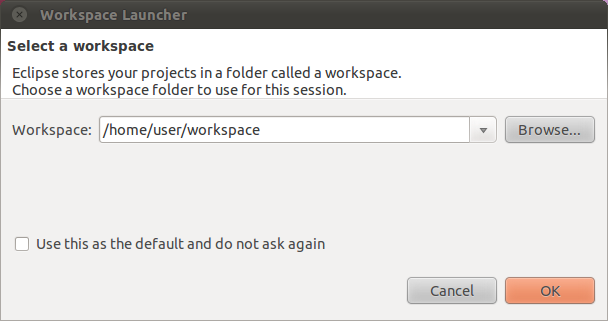](../files/File_RT-druid.1.6.0-workspace.png--1735.md)

This screenshot shows how to select the workspace directory.

It should be noticed that instead of "user" your username on the linux box will be displayed.
You can simply click on "Ok" and the directory "workspace" will be created in your home.

After few seconds you will be prompted with a "Welcome" screen

[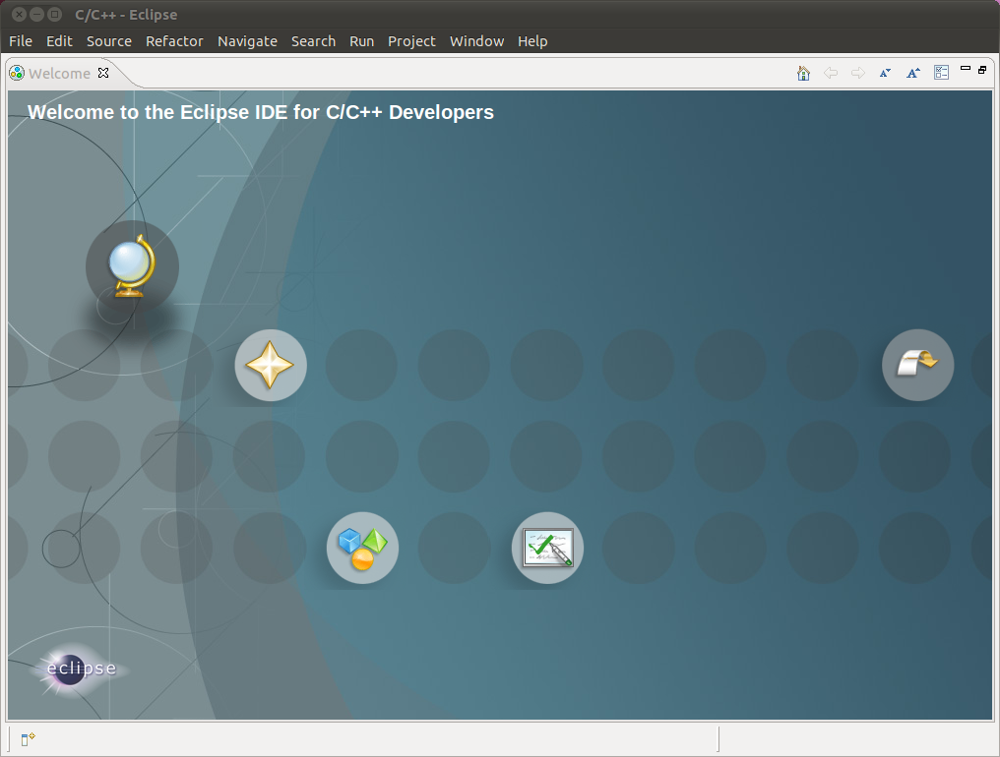](../files/File_RT-druid.1.6.0.welcome.png--1722.md)

This screenshot shows the Eclipse welcome window.

At this point can be useful to check for updates. See [Tutorial: Update ERIKA and RT-Druid](Tutorial_Update_ERIKA_and_RT-Druid--2049.md "Tutorial: Update ERIKA and RT-Druid")

Before to be able to compile you first application you have to select the correct compiler path. As this tutorial is devoted to enable programming a Flex Demo application, the correct compiler for C24 and dsPIC must be selected. Select "Window -> Preferences"

[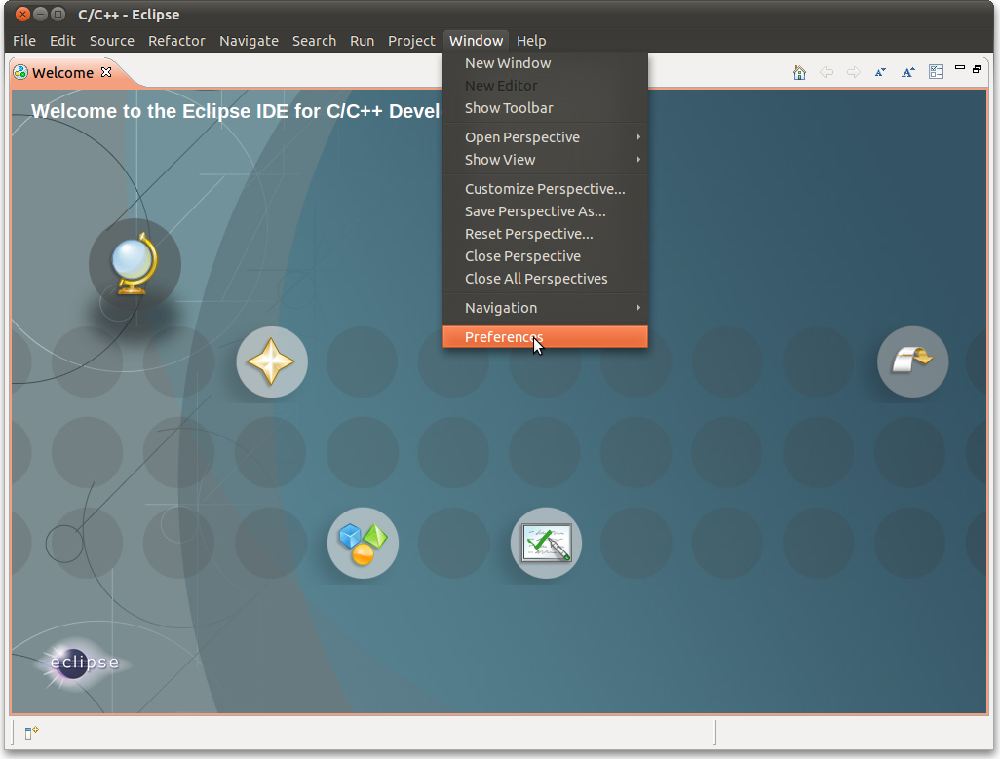](../files/File_RT-druid.1.6.0-preferences.01.png--1729.md)

This screenshot shows where find the preferences menu.

On the "preference" window you have to select "RT-Druid -> Oil -> dsPIC" and then insert the path of the C and ASM compilers (/opt/microchip/mplabc30/v3.24/)

[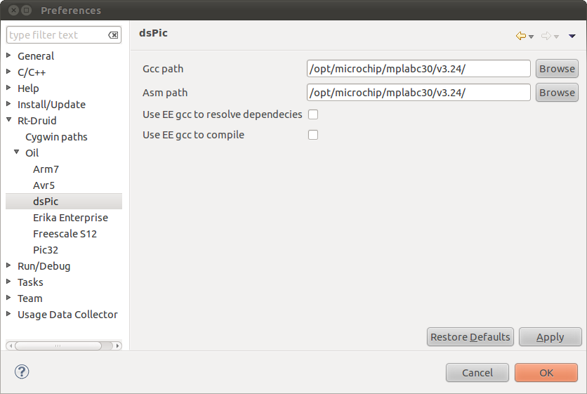](../files/File_RT-druid.1.6.0-preferences.02.png--1730.md)

This screenshot shows how to select the PIC24, PIC30 and dsPIC compiler.

You can now close the "Welcome" screen by selecting "Workbench" icon

[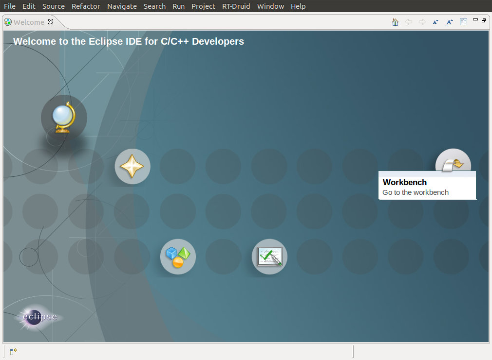](../files/File_RT-druid.1.6.0-nowelcome.png--1727.md)

This screenshot shows how close the "Welcome" screen.

then to remove the autobuild you can uncheck "Project -> Build Automatically"

[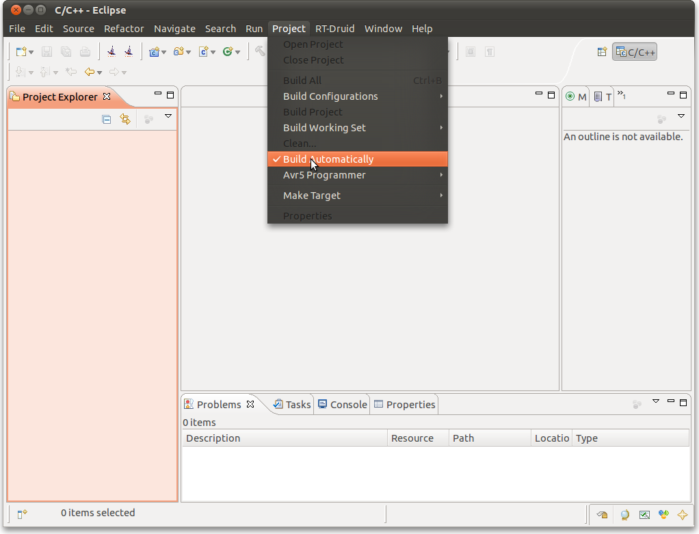](../files/File_RT-druid.1.6.0-noautobuild.png--1728.md)

This screenshot shows how to disable the auto build option.

<a id="Create_and_Compiling_your_first_ERIKA_Enterprise_demo"></a>

## Create and Compiling your first ERIKA Enterprise demo

By opening Eclipse you will be now prompted with an empty screen

[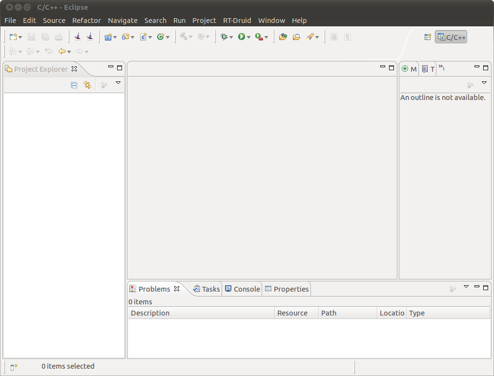](../files/File_RT-druid.1.6.0-empty.png--1731.md)

This screenshot shows an Ecplise empty screen.

to create your fist project select "File -> New -> Rt-Druid Oil and C/C++ Project"

[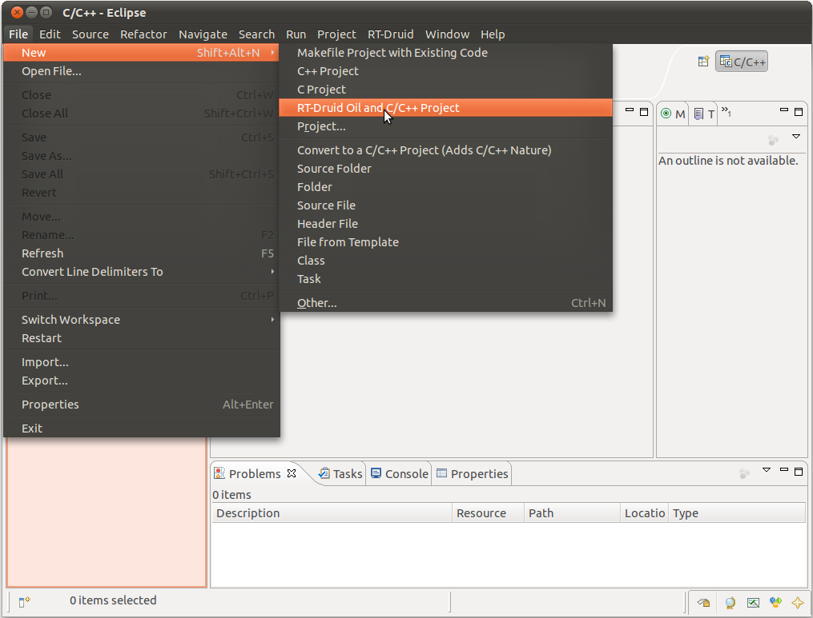](../files/File_RT-druid.1.6.0-newproject.01.png--1732.md)

This screenshot shows how to open the "C Project" window.

then on the "C Project" window, insert the name of you project, e.g. my\_first\_project.

[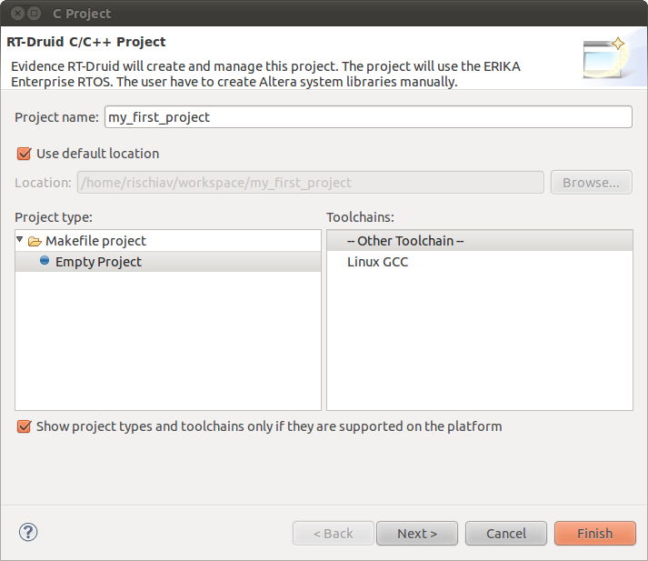](../files/File_RT-druid.1.6.0-newproject.02.png--1733.md)

This screenshot shows how to assign the project name.

then click on "Next". After checking "Create a project using one of these template", select "pic30-> FLEX Demo Board -> OO examples -> Task Demo" and click on "Finish".

[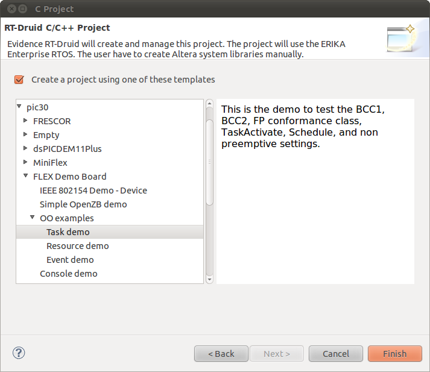](../files/File_RT-druid.1.6.0-newproject.03.png--1734.md)

This screenshot shows how to select a project template.

You will now be prompted with a screen containing all the existing project in the workspace

[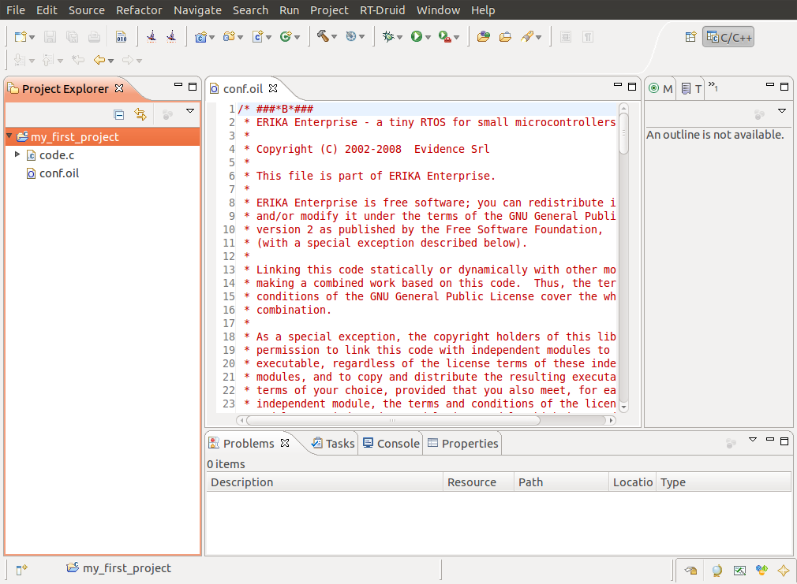](../files/File_RT-druid.1.6.0-newproject.04.png--1736.md)

This screenshot shows a new template based project.

To build the project you can right-click on the project name and select "Build Project" from the context menu

[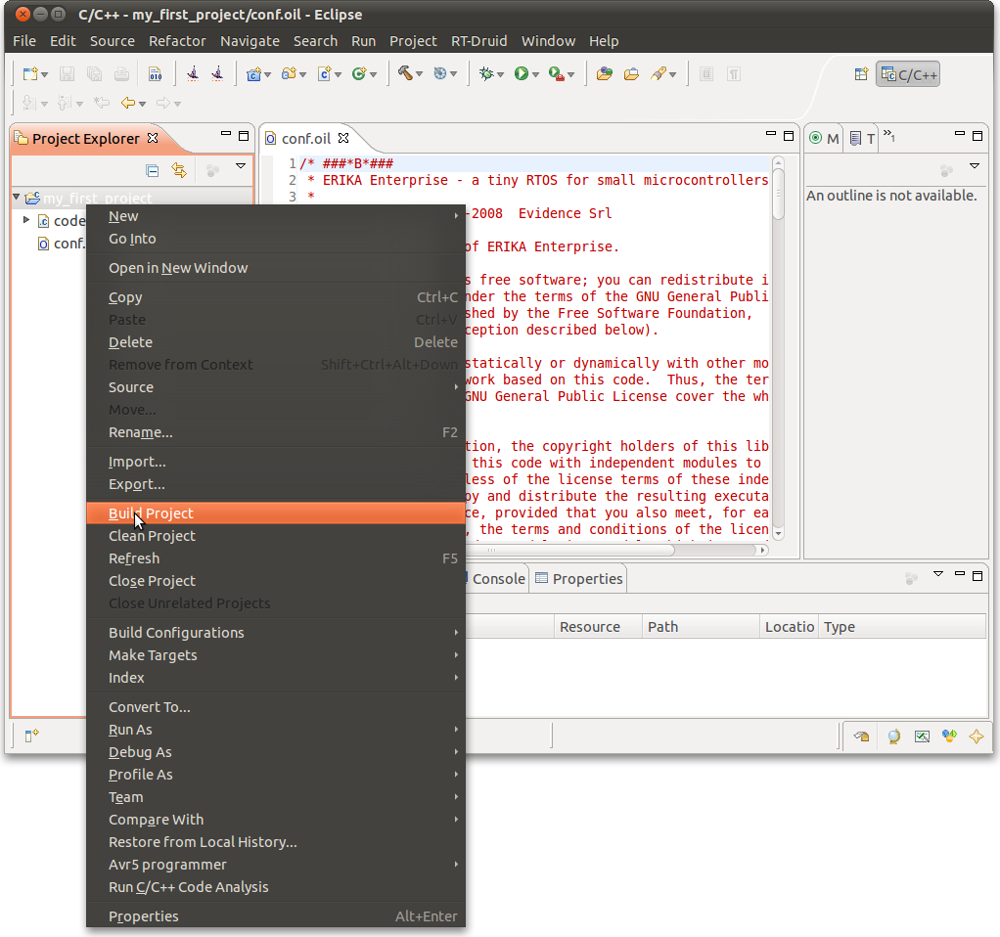](../files/File_RT-druid.1.6.0-newproject.05.png--1737.md)

This screenshot shows hot to build a project.

at the end of the building process Eclipse will signal the creation of the executable file and on the left panel a "Debug" subfolder contining all the files generated will be prompted

[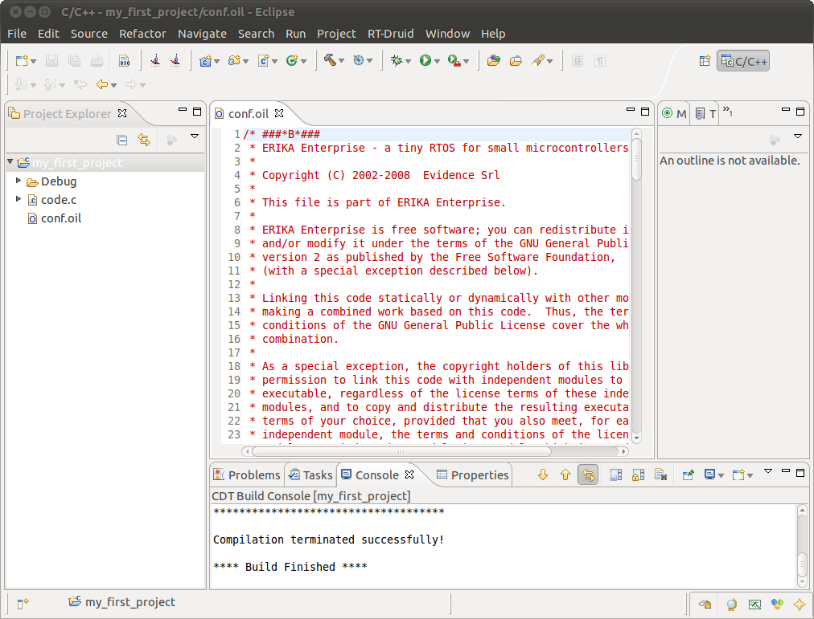](../files/File_RT-Druid.1.6.0-newproject.06.png--1738.md)

This screenshot shows the results of a correct building process.

<a id="Running_your_first_ERIKA_Enterprise_demo"></a>

## Running your first ERIKA Enterprise demo

MPLAB X IDE is used in this tutorial to run and debug the application on the FLEX DEMO board.

By opening MPLAB X IDE you will be prompted by a "Welcome" screen

[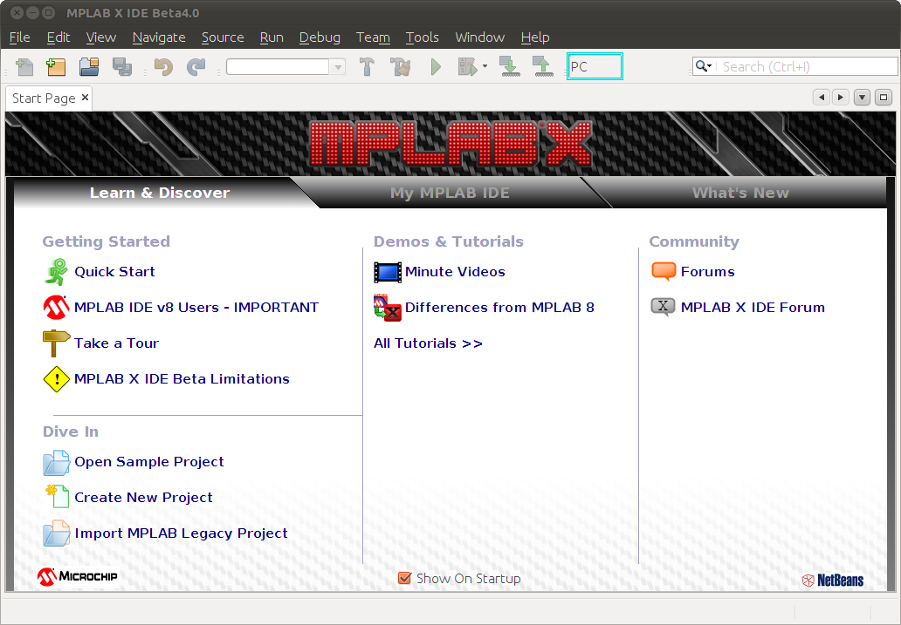](../files/File_Mplabx.beta4-welcome.01.png--1740.md)

This screenshot shows the MPLAB X IDE "Welcome" screen.

To open a new project select "File -> New Project"

[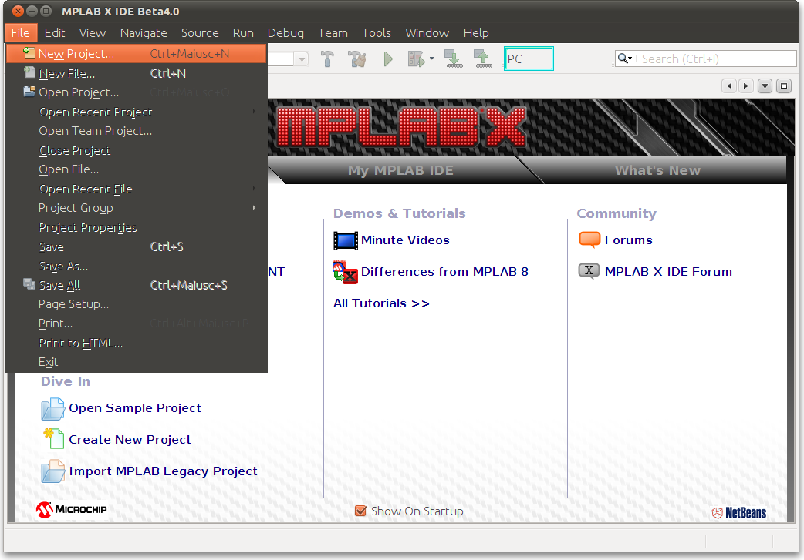](../files/File_Mplabx.beta4-newproject.01.png--1739.md)

This screenshot shows how to open the "New Project" screen.

in the "New Project" window you have to select "Microchip Embedded" and "Prebuilt (Loadable Image) Project", and click "Next".

[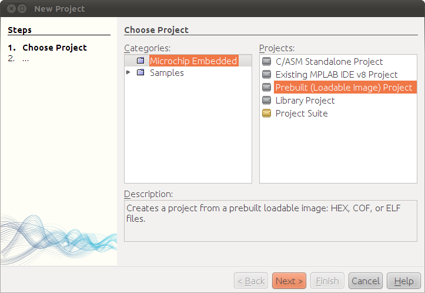](../files/File_Mplabx.beta4-newproject.02.png--1741.md)

This screenshot shows how to chose the project.

on the "Import Image File" you have to select the file produced by the compiling process previously executed, in this case it is located in  ~/wokspace/my\_first\_project/Debug\_pic30.elf, by clicking on "Next"

[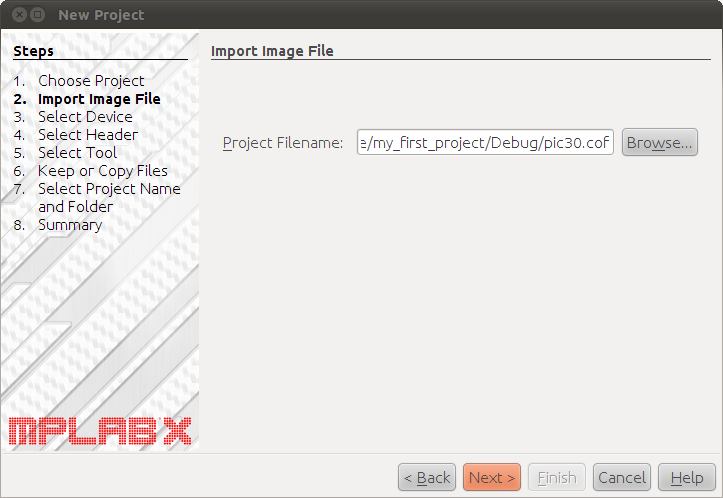](../files/File_Mplabx.beta4-newproject.03.png--1742.md)

This screenshot shows how to select the image file to be imported.

you joint the "Select Device" window, where you have to select the correct Family and Device to be programmed. For the FLEX Demo board you have to select "DSPIC33" and "dsPIC33FJ256MC710".

[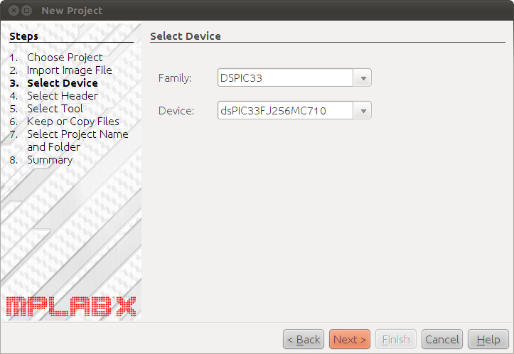](../files/File_Mplabx.beta4-newproject.04.png--1743.md)

This screenshot shows how to select the DEvice and Family to be programmed.

To retrieve those informations you can open Eclipse, in the main project folder you can open the conf.oil. In this file you have to find the MODEL field on the MCU\_DATA section.

[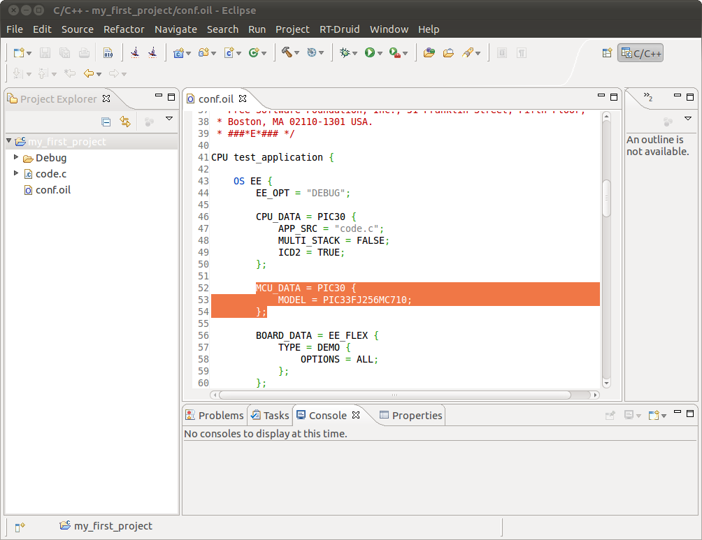](../files/File_RT-Druid.1.6.0-PICModel.01.png--1744.md)

This screenshot shows how to find the PIC related informations on the conf.oil file.

The same information can be retrieved from the board by looking at the installed micro.  
On the "Select Tool" you have to select the programmer you will use lather.

[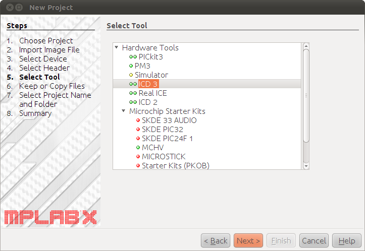](../files/File_Mplabx.beta4-newproject.05.png--1745.md)

This screenshot shows how to select the programmer.

Even if we are selecting the ICD3, you have to select the programmer you are equipped with.
It should be noticed that we have correctly tested the ICD2, ICD3, and PICkit3.  
In the next screen you will be asked for using a link to the loadable image or keeping the original file. As we are using an ELF file, we have to select "Copy files" and clic "Next".

[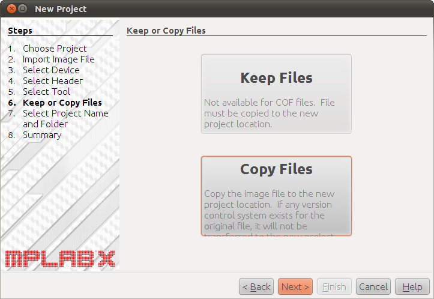](../files/File_Mplabx.beta4-newproject.06.png--1748.md)

This screenshot shows how to use a copy of the image file.

Finally we have to select the project name and folder, in this case we are using the default values, and click on "Next".

[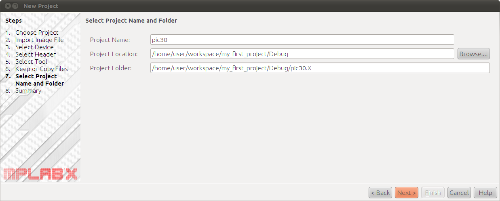](../files/File_Mplabx.beta4-newproject.07.png--1746.md)

This screenshot shows how to select the project name and folder.

Please notice that the default "Project Location" and "Project Folder" are in the Debug directory of Eclipse. If you use the default values the MPLAB X IDE will be deleted if you select "Clean Project" in Eclipse.  
Finally bu clicking on "Finish" the project will be created.

[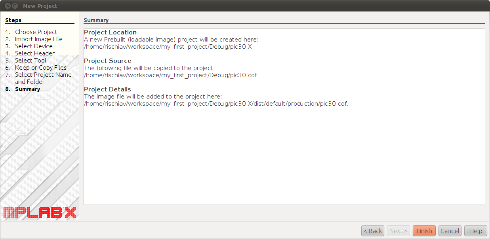](../files/File_Mplabx.beta4-newproject.08.png--1747.md)

This screenshot shows the summary of the project creation process.

The project creation process can take a very long time depending on your PC and loadable image file type. We have experienced more than 20 minutes while loading the cof version of the example proposed in the tutorial with a PC with a 2.8 GHz Pentium IV and 512 MB of RAM, on the other hand HEX and COFF files will need a shorter time to be loaded.

At the end of the project creation process you can find the pic30 project loaded in the MPLAB X IDE main window.

[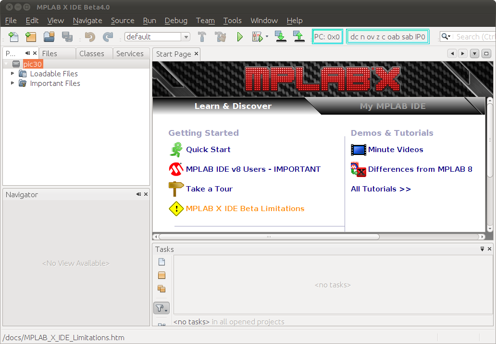](../files/File_Mplabx.beta4-newproject.09.png--1749.md)

This screenshot shows the pic30 project loaded by MPLAB X IDE.

To be able to program the board you must connect the programmer to the Linux host and to the board, that have to be powered by an external supply, you can then right click on the pic30 project and select "Properties",

[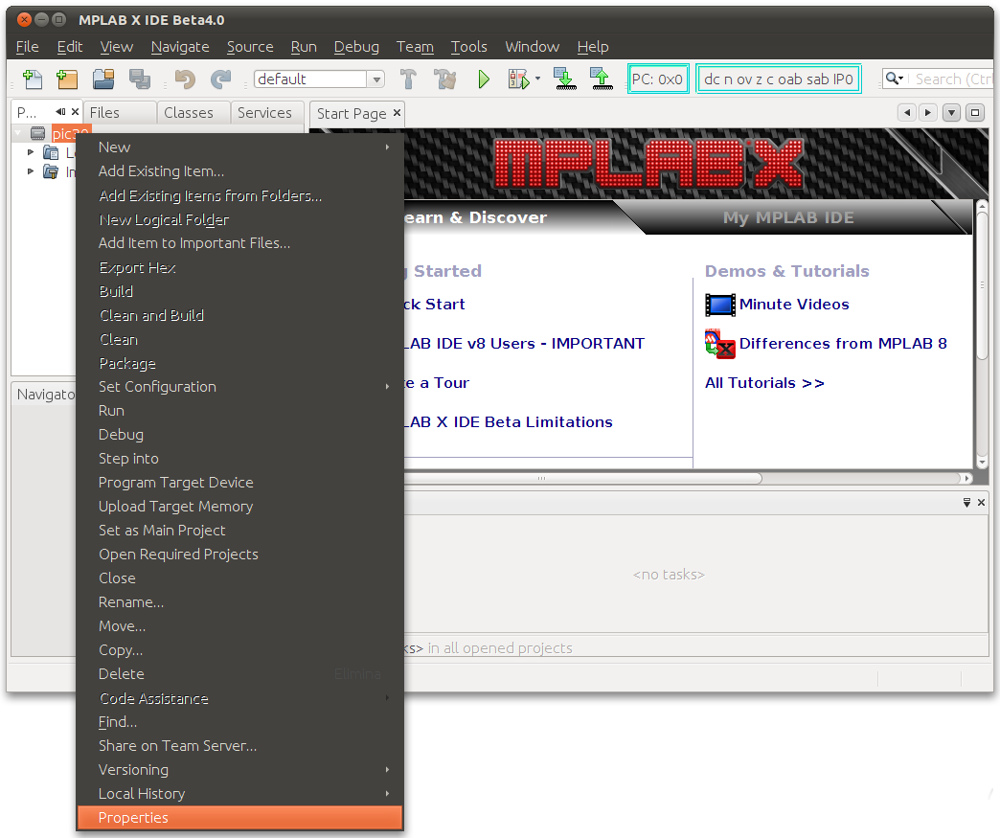](../files/File_Mplabx.beta4-newproject.10.png--1750.md)

This screenshot shows how to select the project properties.

in the "Project Properties" window you can now select the "default" category. On the right side of the window the installed programmer and its serial number will by displayed, you have to select the serial number of the programmer you are using and click on "Ok".

[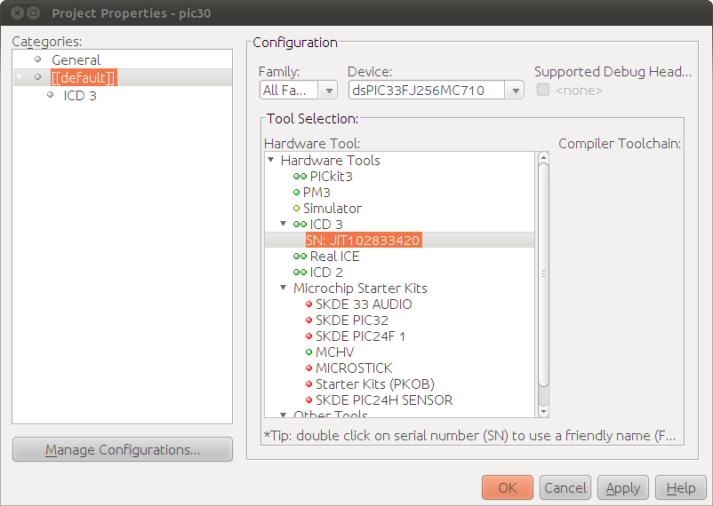](../files/File_Mplabx.beta4-newproject.11.png--1751.md)

This screenshot shows how to select the installed programmer serial number.

You have now imported the ELF file inside MPLAB X IDE and select the right programmer; by right clicking on the project and select "Run" in order to program the application on the board

[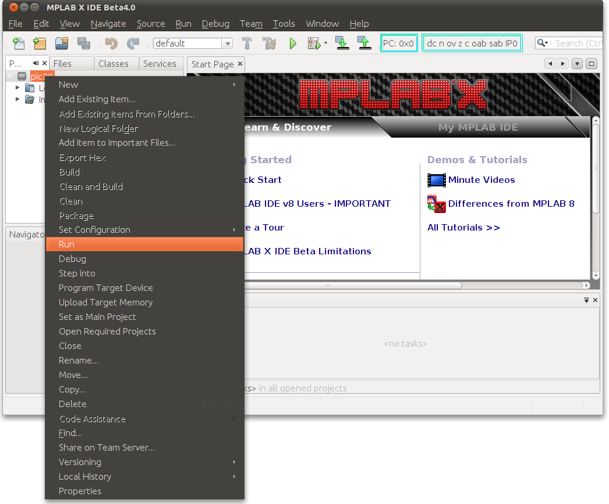](../files/File_Mplabx.beta4-newproject.12.png--1753.md)

This screenshot shows how to select the run command.

After few time, depending on your Pc and on the type of the loadable image file type (cof, hex etc.), you will be prompted by a screen reporting the correct execution of the programming process.

[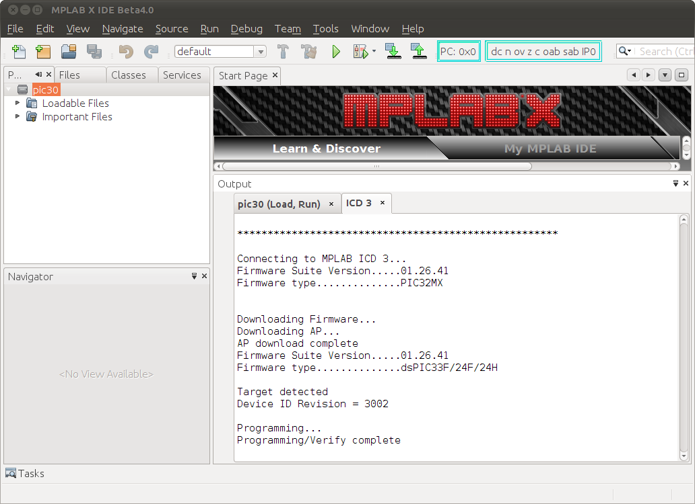](../files/File_Mplabx.beta4-newproject.13.png--1752.md)

This screenshot shows the end of a successful programming process.

<a id="How_to_use_ERIKA_sources_from_svn"></a>

## How to use ERIKA sources from svn

While developing an application it should be useful to use the SVN version of ERIKA Enterprise to be aligned to the last version of the OS sources. In this tutorial we will use the the anonymous read only access to the SVN, please refer to [ERIKA Enterprise and RT-Druid SVN Access](ERIKA_Enterprise_and_RT-Druid_SVN_Access--1464.md "ERIKA Enterprise and RT-Druid SVN Access") for other access type.

If you don't have the svn tool installe din your Linux host you have to select and install the package. Before to proceed sould be usefull to update the pakages in your system to the last version. In a Terminal window insert:

```
sudo apt-get update
sudo apt- get upgrade

sudo apt-get install subversion
```

You now need to create a folder to store the ERIKA Enterprise repository; in a Terminal window insert:

```
cd ~
mkdir Erika
cd Erika

svn co svn://svn.tuxfamily.org/svnroot/erika/erikae/repos/ee/trunk/ee ./
```

After few minutes, depending on your Internet connection, you will have the last version of ERIKA Enterprise in the ~/Erika folder. You can now setup the environmental variables needed to enable Eclipse compiling with an external ERIKA Enterprise version.

<a id="Eclipse_from_Terminal"></a>

### Eclipse from Terminal

To enable an Eclipse session launched by a shell to compile with the previously uploaded ERIKA sources you can open the ~/.bashrc file by inserting a Terminal window

```
gedit ~/.bashrc
```

then, at the end of the file you can put the following lines:

```
# ERIKA Enteprise location for Eclipse
export ERIKA_FILES="$HOME/Erika"
```

You can now save the file and close the editor. To try compiling with the new ERIKA sources you can open a new Terminal window and insert

```
~/Evidence/ecipse/eclipse
```

It should be noticed that only the Terminal windows opened after saving the .bashrc file will contain the ERIKA\_FILES variable.

Using an Eclipse session started by a shell enable the user to receive a lot of info on the compiling process and on the actions executed by Eclipse (e.g. by using the -consoleLog parameter). On the other hand many users would like to use a shortcut to start Eclipse.

<a id="Eclipse_from_gnome"></a>

### Eclipse from gnome

To enable an Eclipse started by gnome to compile with the previously downloaded ERIKA sources you can open the ~/.gnomerc by inserting in a Terminal window

```
gedit ~/.gnomerc
```

and insert at the end of the file the lines

```
# ERIKA Enteprise location for Eclipse
export ERIKA_FILES="$HOME/Erika"
```

If the file doesn't exist you can simply create it.
Before to be able to use the previously downloaded ERIKA sources you have to log out from the current session and start a new session.

<a id="Eclipse_from_kde"></a>

### Eclipse from kde

**In progress**

<a id="Notes_from_the_Forum:_ERIKA2_2.8_on_Ubuntu_18"></a>

## Notes from the Forum: ERIKA2 2.8 on Ubuntu 18

(Original text from: <http://www.erika-enterprise.com/forum/viewtopic.php?f=4&t=1249&sid=f59ff95f19adb9d478cc4aabbd6e811d>)

Setting up Erika2 2.8 on Ubuntu 18:

1. Download JDK 1.7\_80 from Oracle
2. Extract it to a local directory and move it to /usr/lib/jvm:

   sudo cp ./jdk1.7.0\_80 /usr/lib/jvm
3. Setup Java alternatives so you can switch between 7 and the system default (normally 11)

   sudo update-alternatives --install "/usr/bin/java" "java" "/usr/lib/jvm/jdk1.7.0\_80/bin/java" 1

   sudo update-alternatives --install "/usr/bin/javac" "javac" "/usr/lib/jvm/jdk1.7.0\_80/bin/javac" 1

   sudo update-alternatives --install "/usr/bin/javaws" "javaws" "/usr/lib/jvm/jdk1.7.0\_80/bin/javaws" 1
4. Select your Java version with:

   sudo update-alternatives --config java
5. Install some pre-requisites

   sudo apt-get install build-essential li32ncurses5 lib32z1
6. Install ARM cross compiler

   <https://launchpad.net/gcc-arm-embedded/4.9/4.9-2015-q3-update>
7. Don't forget to set the compiler PATH in Windows/Preferences/RT-Druid/Oil/Cortex
8. Then I launched eclipse Juno and created a project from one of the demo templates.

   For task aware debugging in Lauterbach TRACE32, add a new line at line 70 of conf.oil, which reads:

   /\* Enable ORTI debug symbols \*/

   ORTI\_SECTIONS = ALL;

---

## Archive provenance

- [Original page](http://erika.tuxfamily.org/wiki/index.php?title=Tutorial%3A_Installing_ERIKA_and_RT-Druid_on_a_Linux_host) · [Archived source revision 6133](http://erika.tuxfamily.org/wiki/index.php?oldid=6133)
- Last source edit: 2019-05-02T12:03:31Z. Source retrieved on 2026-11-06; Markdown conversion completed on 2026-11-07.
- Original contributors recorded in exported history: Rischiav, Nicola, Dibbe, Ryosab81, WikiSysop, Pj.
- [Original MediaWiki source](../source/wikitext/1721.mediawiki) · [Original editing history](../source/history/batch-011.xml)
- [Attribution and licensing notice](../NOTICE.md). Original file-specific notices, where present, remain applicable.
