# Tutorial: Installing scicoslab and generating code from a Scicos diagram

This is the Wiki page dedicated to the Scicos code generator originally developed by Roberto Bucher from SUPSI Lugano.

The code of the code generator is distributed under GPL2. The project is currently lead by Roberto Bucher, from SUPSI Lugano, and is hosted on the Evidence web site.

<a id="Scicoslab_4.4.1_and_ScicosLab_Pack_10.0:_code_generator_for_FLEX_-_Installation_procedure"></a>
<a id="Scicoslab_4.4.1_and_ScicosLab_Pack_10.0:_code_generator_for_FLEX_and_EasyLab_boards-_Installation_procedure"></a>

## Scicoslab 4.4.1 and ScicosLab Pack 10.0: code generator for FLEX and EasyLab boards- Installation procedure

Steps to set up the Scicoslab code generation for FLEX and EasyLab boards

1. Download and install Cygwin from the [Cygwin site](http://www.cygwin.com/). Here is a [minimal installation pack](../assets/linked/eeCygwin_1_7_9--eb026434b036e317.zip). Cygwin is required to compile the code generated from your Scicos diagram.
2. Download Microsoft Visual C++ 2008 from the [Microsoft Visual C++ site](http://www.microsoft.com/it-it/download/details.aspx?id=29) ([or use this link](http://www.microsoft.com/express/Downloads/#2008-Visual-CPP))and install it. It is required from the Evidence Scicoslab pack.
3. Download ScicosLab 4.4.1 from the [ScicosLab site](http://erika.tuxfamily.org/scilabscicos.html) and install it.
4. Download Microchip MPLAB IDE from the [MPLAB IDE site](http://www.microchip.com/stellent/idcplg?IdcService=SS_GET_PAGE&nodeId=1406&dDocName=en019469) and install it. It is required to program the dsPIC microcontroller mounted on the FLEX board or EasyLab board. Then download a C30 compiler, for example from the [Microchip MPLAB C30 compiler site](http://www.microchip.com/stellent/idcplg?IdcService=SS_GET_PAGE&nodeId=1406&dDocName=en010065&part=SW006012) and install it. A compiler is required to compile your control application. To program the dsPIC on the Flex board you need a programmer. You can buy a programmer for dsPIC from Microchip site. Programmers suggested are: Microchip MPLAB ICD2 or Microchip MPLAB ICD3. See Microchip for more informations:[Microchip programmers site](http://www.microchip.com/stellent/idcplg?IdcService=SS_GET_PAGE&nodeId=1406&dDocName=en010046). While for the EasyLab board the programmer is not required because it is equipped with one on board.
5. Download the latest Scicoslab pack from the [ScicosLab pack download page](http://erika.tuxfamily.org/scilabscicos.html). Unzip the pack and install it. To install the pack execute the installer.sce script file in ScicosLab (File -> Exec...). (If needed, run ScicosLab with administrator privileges). At the end of the installation restart ScicosLab for the changes to take effect.

   **Note for Windows 64 bit users**: On some Windows 64 bit machines, the Scicos Pack fails to load at startup. This is due to the failure to load two DLLs. The issue can be solved temporarily commenting a few lines as expleined below.
6. Create and compile your first Scicos diagram (as shown here: [An example of code-generation](Amazing_Ball_Control_System_An_example_of_PID_control_and_UDP_communication--1613.md)), flash the microcontroller, test your application and ... enjoy!

Please note, this version of the ScicosLab pack includes a stand-alone version of RT-Druid and a full version of Erika Enterprise.
If you have any problem please contact us using the [Erika Forum](http://erika.tuxfamily.org/forum/)

<a id="Note_for_Windows_64_bit_users"></a>

### Note for Windows 64 bit users

Some Windows 64bit machines seems to fail loading the Scicos Pack. The problem is related to the loading of two DLLS (Roller and FLEX Demo Board Simulator).

We propose in this case to disable the loading of these two DLLs by commenting out the following two files:

- In the file:

  ```
  scicoslab-4.4.1\contrib\scicos_ee\scicos_flex\dspic\Flex-Roller\loader.sce
  ```

  comment the following two lines as below:

```
//folder_path=get_absolute_file_path('loader.sce');
```

//roller\_link\_num = link(folder\_path+'RollerGui.dll',['EvidenceRollers'],'c');
</pre>

- and in the file:

  ```
  scicoslab-4.4.1\contrib\scicos_ee\scicos_flex\dspic\Flex-Sim\loader.sce
  ```

  comment the following lines at the bottom:

```
// Link to import the selected modules of the library
// Flex Demo Board simulation (QT executable)
//[x_x_x,dmbexe_err] = fileinfo(SCI + '/contrib/scicos_ee/bin/FlexDemoBoard.exe');
//if dmbexe_err == 0
//	flexsim_link_num = link(flexsim_path + 'Release\libflexsim.dll', comp_fun, 'c');
//else
//	flexsim_link_num = link(flexsim_path + 'Release_fake\libflexsim.dll', comp_fun, 'c');
//end
```

These changes will make the startup procedure run, and as a result you will be able to run the UDP demos.

The Roller and the Flex demo board simulator will not work, as their respective DLLs are not loaded, so do not try to use these blocks on a Windows 64 bit machine.

<a id="Your_first_Scicos_application"></a>

## Your first Scicos application

This Chapter will guide you to the creation, compilation and execution
of a first simple Scicos example on a FLEX Demo board (or EasyLab board). The example
created in this tutorial can be found in the directory
scicos\_ee/examples/scicos\_flex/Led\_sin
(scicos\_ee/examples/scicos\_easylab/Led\_sin).

inside scicos pack base directory.

If you are looking for a pre-built example, go directly to the next Section.

<a id="Creating_the_Scicos_example_files"></a>

### Creating the Scicos example files

(Note the screenshow may refer to old versions of ScicosLab or Scilab 4.1.2).

1. Please start ScicosLab from the Start menu. The ScicosLab window appears.
2. Type scicos(); as showed below in the Figure, and press Enter.

   [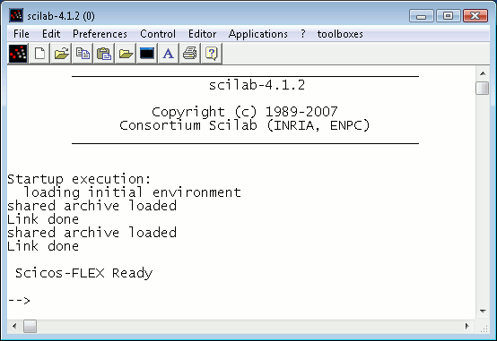](../files/File_Scilab_splash.png--1802.md)

   The Scilab splash screen. Type scicos(); to start Scicos.
3. The Scicos windows appears, as showed in Figure

   [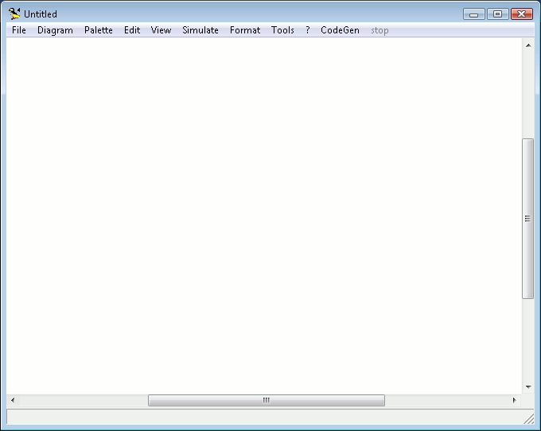](../files/File_Scicos_splash.png--1803.md)

   The Scicos splash screen.
4. You need to compile the Scicos blocks, if you didn't do it yet, in order to get the system working. To do that type these commands in ScicosLab window:

   cd ("%SCICOSLAB\_HOME%\contrib\dspic"); // (%SCICOSLAB\_HOME% means the installation path of ScicosLab...)

   exec ("builder.sce");

   **IMPORTANT NOTE**: please check the correctness of this path. Newer Scicos Packs are installed under ...\scicoslab-4.4.1\contrib\scicos\_ee\scicos\_flex\dspic (...\scicoslab-4.4.1\contrib\scicos\_ee\scicos\_easylab\dspic)
5. Select *Palettes* from the *Palette* menu, as showed in Figure

   [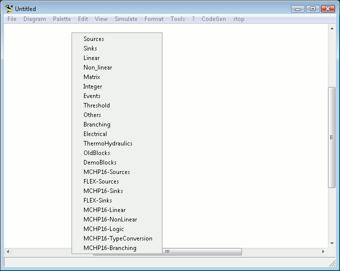](../files/File_Palette_menu.png--1804.md)

   The Palettes.
6. A little list appear in place of the menu. Select *FLEX* (*Easylab*), as showed in Figure

   [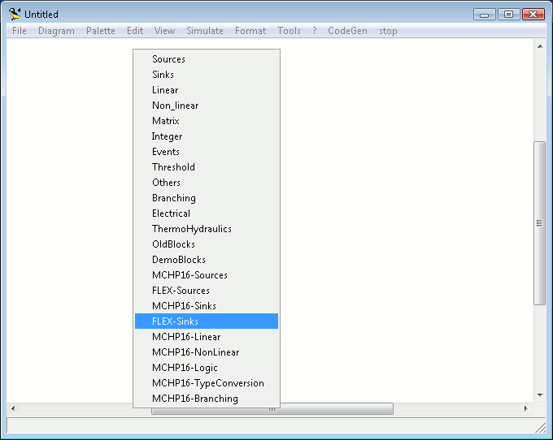](../files/File_Palette_menu2.png--1805.md)

   The Palette list.
7. A windows appears, with some sink blocks specific for the FLEX boards (EasyLab board)

   [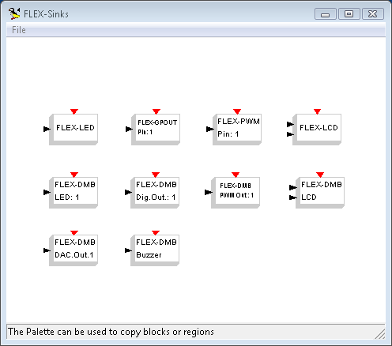](../files/File_Palette.png--1806.md)

   The dsPIC Palette.
8. Single click on the FLEX-LED (EASYLAB-LED) block. The window selection moves to the Scicos window. The mouse now becomes a white rectangle of the dimension of the LED block. Single click somewhere in the white part of the window. A LED block is dropped in the diagram, like in Figure

   [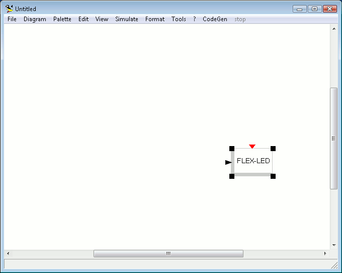](../files/File_Led.png--1807.md)

   The LED block is dropped in the design window.

   - **Note**: If you need to move a block, go over it with the mouse, press *m*, then move the block and click on the new position!
   - **Note**: If you need to delete a block or a line, go over it with the mouse, then press *d*!
   - **Note**: If some garbage appears on the diagram windos, don't panic! Just press *r*!
9. Open the MCHP16-Sources palette, and repeat the same with the Sine block, placing it on the left of the LED block, as in Figure

   [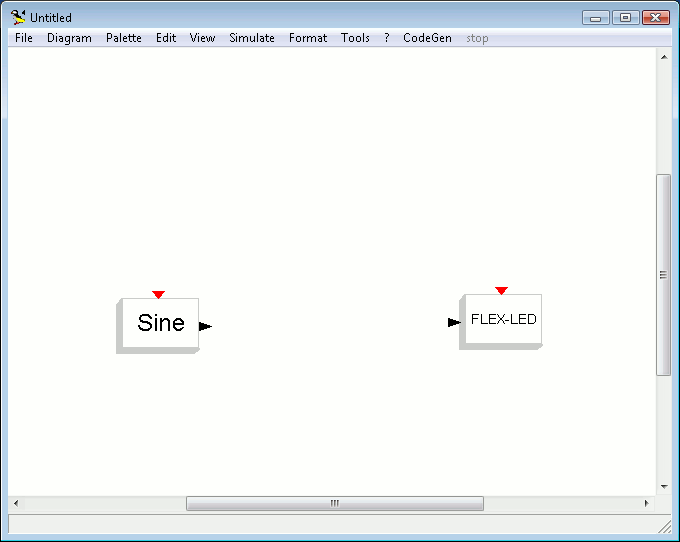](../files/File_Sineled.png--1808.md)

   Place the Sine block to the left of the LED block.
10. Link the black triangle of the Sine block to the black triangle of the LED block. To do that, press *l*, then single click on the triangle of the Sine block (the *source*), then click again on the triangle of the LED block (the *sink*). See Figure

    [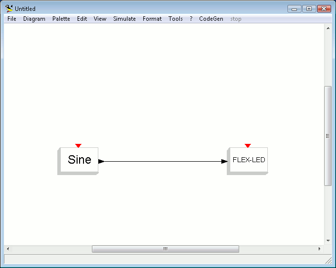](../files/File_Link.png--1809.md)

    Sine and LED are now linked.
11. From the MCHP16-Sources Palette, which can be found il the palette list, choose the red clock, and put it on the diagram as shown in Figure

    [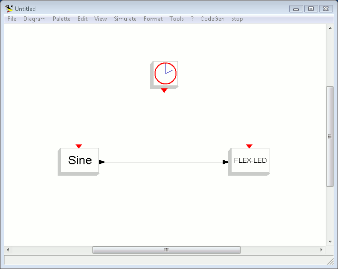](../files/File_Clock.png--1810.md)

    Put the Clock block over the Sine and LED blocks.
12. Now connect the clock signal to the two blocks. To do that, single click on the red triangle of the clock block, then single click below it, then single click over the Sine block, then click on the red triangle of the Sine block. After that, single click on the line below the clock block, hit the key 'L' of keyboard, then over the LED block, then on the red triangle of the LED block. The result is shown in Figure

    [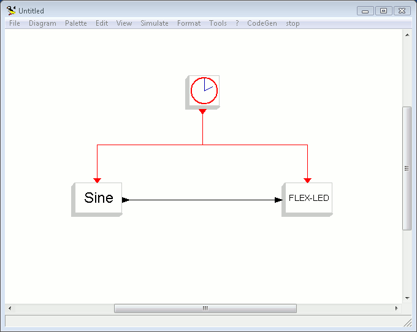](../files/File_Redlink.png--1811.md)

    The Clock block is connected to the Sine and LED blocks.
13. Single click on the Clock block. Its properties window appears. Leave them untouched, and press OK. You can do the same on the Sine block. The two Figures below show these windows.

    [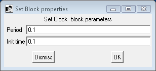](../files/File_Clockproperties.png--1812.md)

    The Clock block properties.

    [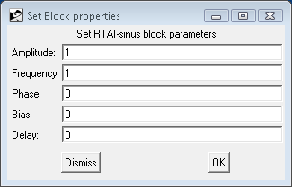](../files/File_Sineproperties.png--1813.md)

    The Sine block properties.
14. The code generator can produce code which only comes from a special block named *Super Block*. For this reason, we need to create a Super Block enclosing the Sine and the LED blocks. To do that, select the *Region to Super Block* menu item from the *Diagram* menu (see Figure below).

    [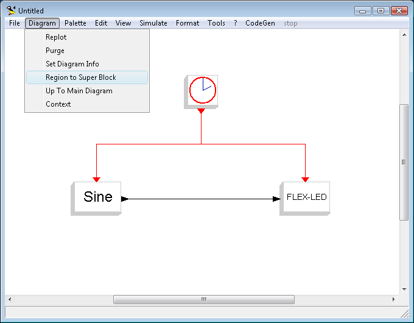](../files/File_Region2sb.png--1814.md)

    The Region to Super Block menu item.
15. Then, draw a selection which includes the Sine, the LED, and the red lines in a way that only *one* red line exits the selection, as shown in Figure

    [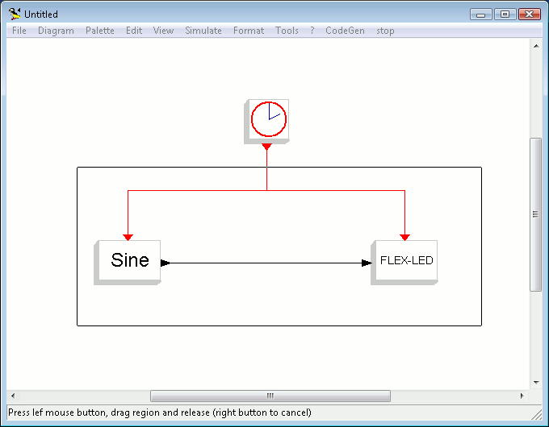](../files/File_Sb.png--1815.md)

    The selection made to create a Super Block.
16. As a result, a Super Block is created (see Figure)

    [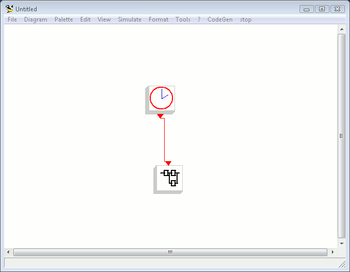](../files/File_Sb1.png--1816.md)

    The Super Block.

    Which contains the Sine and LED blocks. To see these blocks, just single click on the Super Block, and another window will appear (see Figure).

    [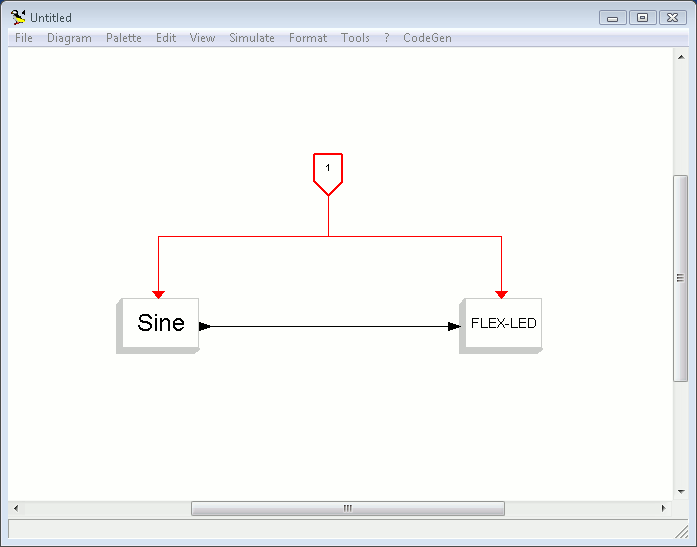](../files/File_Sb2.png--1817.md)

    The contents of the Super Block.
17. Please note that this window is very similar to the previous one except that the clock object is substituted by a placeholder signed with the number 1.
    - **Note**: The Diagram containing the Super Block is disabled when the Super Block diagram is displayed. Only one window can be enabled at a time in Scicos. The limitation will be removed in the next version of Scicos.
18. It is now time to save the two diagrams. From the *File* menu, choose *Save as*. Save the diagram containing the Super Block as led\_sin.cos.

<a id="Generating_dsPIC_code_from_a_Scicos_Diagram"></a>

### Generating dsPIC code from a Scicos Diagram

It is now time to generate the code for the example we just created.

**Note**: A copy of the file created in the previous steps is included inside the scicos\_examples/led\_sin directory. To open it, double click on the scicos\_examples/led\_sin/led\_sin.cos file.

1. Select *Set Target* from the *CodeGen* menu (see Figure).

   [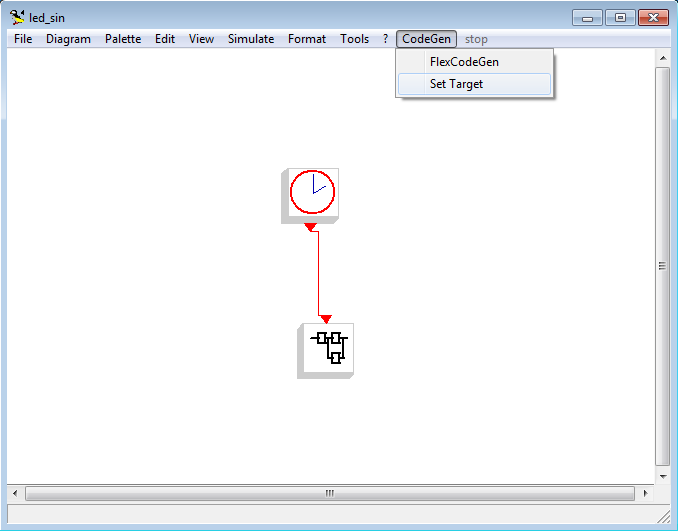](../files/File_Codegen0.png--2178.md)

   The CodeGen menu - Set target.
2. A window appear, like the one in Figure

   [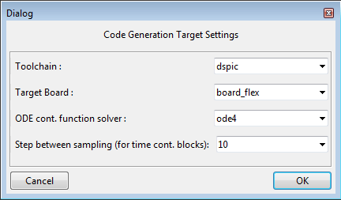](../files/File_Codegen3.png--2179.md)

   The SetTarget dialog box.
3. You can specify the target board (board\_flex or board\_easylab) using the second textbox. Please leave the other options unchanged.
4. Select *FlexCodeGen* from the *CodeGen* menu (see Figure).

   [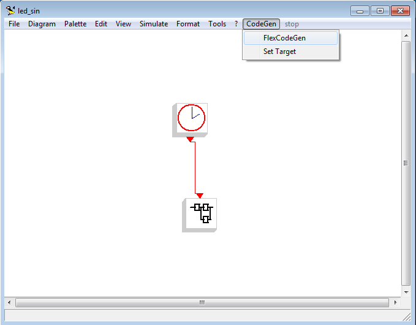](../files/File_Codegen1.png--1818.md)

   The CodeGen menu - Flex code generator.
5. A window appear, like the one in Figure

   [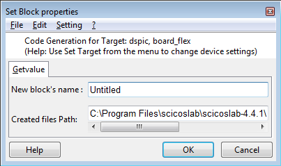](../files/File_Codegen2.png--1819.md)

   The FlexCodeGen dialog box.
6. You can specify the block name by modifying the New block's name textbox and the directory where all the files will be created by modifying the Created files Path textbox.
   - **IMPORTANT NOTE FOR WINDOWS USERS**: Choose a location where you have write permission. If you start 'ScicosLab' with administrator privileges there are no limitations in the choice of the destination folder.
7. Press *Ok*. As a result, a set of files are generated in the output directory.
8. Then, Scicos automatically opens a console window, running in it the following commands:
   - the RT-Druid template generator to instantiate the Scicos template application;
   - the RT-Druid standalone code generator to produce the ERIKA Enterprise configuration files from the generated OIL file;
   - the *make* application to compile the code.
9. The result of the code generation process is depicted in Figure \ref{fig:console}.

   [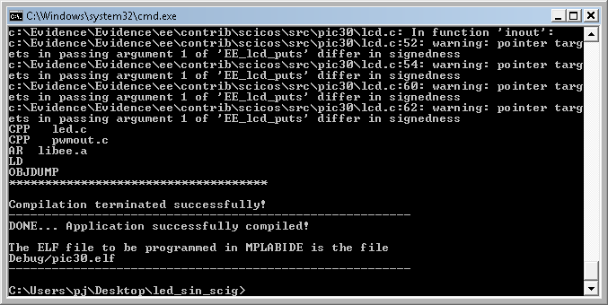](../files/File_Console.png--1820.md)

   The compilation console.
10. The executable file is named pic30.cof (older versions of the Scicos-FLEX toolsed had it named pic30.elf) and it is located inside the Debug directory as usual for all the ERIKA Enterprise applications.
11. You can now program your application on your FLEX board. To do that, you need to open MPLABIDE as you usually do to program other ERIKA Enterprise applications. Please refer to the ERIKA Enterprise tutorial for dsPIC for more information.
12. Running the code on your FLEX board has the following behavior: the system led on the board flashes with a period of 20 seconds, and a duty cycle of around 6 seconds over 20. The explanation is the following:
    - The system works like a synchronous control system, with a sampling frequency of 0.1 secs
    - The *Sine* block output is a sinus with a frequency of 0.05, which correspond to a period of 20 s
    - The LED block is directly linked to the system led, and is programmed to put on the system led when its input is greater than 0.5.
    - Looking at the Figure below, it is clear that the sinus has a value greater than 0.5 for around a third of its period. Given that, the system led is on for around 6 seconds over 20.

    [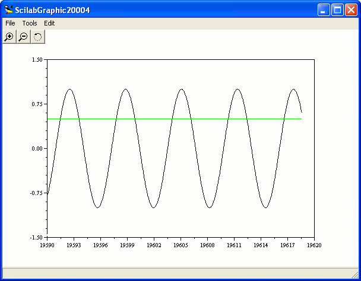](../files/File_Graphic.png--1821.md)

    A graphic of a Sine and of a constant value 0.5.

<a id="Internals_of_the_genareted_code"></a>

## Internals of the genareted code

<a id="Templates_and_customization_of_the_generated_application"></a>

### Templates and customization of the generated application

The default application wich is generated by the Scicos embedded code generator for dsPIC generates a basic application which uses ERIKA Enterprise with the FP kernel, a periodic task and an Alarm triggered by a timer interrupt to activate it.

In general, it is likely that advanced users would like to customize the application which is generated by the code generator, to add other activities to be executed concurrently with the code generated from the Scicos design. Examples of this activities could be for example background activities for reporting, supervision, display, debug, and so on.

Implementing such variations is very easy, because the application scheleton used by the code generator is contained inside a RT-Druid template. In particular, the default template is the pic30\_empty\_scicos template stored inside the examples/pic30/pic30\_scicos directory under the dsPIC examples plugin in the Eclipse installation. The user can add a new template using the following steps:

1. Copy the examples/pic30/pic30\_scicos directory in another location under the examples directory;
2. Change the ID of the template by modifying the template.xml file contained inside the directory. The ID is specified in the second line of the XML file as follows:

   ```
    <evidence_example version="1" ID="pic30_empty_scicos">
   ```
3. Change the files included in the new template. If you need to add a new file, please remember to add it in the corresponding list in the template.xml file.

Finally, specify the new template when generating the code in the Template textbox.

<a id="Assumptions_of_the_default_template"></a>

### Assumptions of the default template

The code generated by the Scilab/Scicos code generator for FLEX uses the template named pic30\_empty\_scicos, and has the following symplifing assumptions:

1. There is a single sampling time T\_s in the system;
2. T\_s is forced to 1 ms;
3. Every sampling time specified by the user under the Scicos design will be rounded to a multiple of a millisecond;
4. An ERIKA Enterprise counter is linked to the a periodic timer;
5. The periodic timer used in the dsPIC hardware is set to raise an interrupt every 1 ms;
6. An ERIKA Enterprise alarm is attached to the counter, to periodically activate a task;
7. The task body just calls the routines generated by the Scicos code generator. Which executes the functions you specified in the design;
8. The PWM object has a fixed period of 1 ms. This means that if the sampling period is a multiple of T\_s, then the PWM will repeat the same duty cycle until the PWN value is changed;
9. The A/D converter always works *on demand*, meaning it always executes the following steps:
   - selects a channel;
   - starts the conversion;
   - waits for the end of the conversion (typically max 10 usec)
   - it converts the result in a value from 0.0 V and 3.3 V

<a id="Installer_Key_Features"></a>

### Installer Key Features

The ScicosPack installer is a ScicosLab script executed by users to install/uninstall the ScicosPack.
Key features:

- automatic copy of files (please note, the user has to run ScicosLab with administrator privileges to install the toolbox)
- automatic check of prerequisites
- SMCube compiler configuration
- License check
- Microchip compiler support for Erika\RT-Druid project (certified OSEK micro-kernel)
- automatic build of the ScicosPack sources
- automatic creation of palettes
- automatic loading of blocks-specific help pages
- batch mode supported (for regression test with Jenkins)

<a id="External_libraries_linkage"></a>

### External libraries linkage

ScicosLab supports external DLL/SO linkage. This feature allows the user to link external C functions that are used to model new Scicos blocks for target-specific simulation and code generation.
ScicosLab supports also DLL/SO creation in Windows and Linux hosts.
To do this, ScicosLab automatically configure its environment by adding the required environment variables (MSVC variables in Windows).
Type help ilib\_for\_link for further info (the function path is ScicosLab\_441\macros\util\ilib\_for\_link.sci).
External libraries linkage is done by the ScicoLab incremental linker by calling the function link (type help link for further info).
As decribed in the link function's help page, the linkage needs also the C identifiers of the functions to be linked.
Please note, if you create a DLL/SO library starting from an external C++ project (for example using Qt or MSVC++) the
functions to be linked should have C names and not C++ names. This can be obtained using a construct like the following:
At the top of the header file:

```
 #ifdef __cplusplus
 extern "C" {
 #endif
```

At the bottom of the header file:

```
 #ifdef __cplusplus
 }
 #endif
```

An example of a block's computational function for simulation is reported below:

```
 __declspec(dllexport) void block_func(scicos_block *block, int flag) {
 if (flag == OutputUpdate){
   /* set output */
   block_in_out(block);
 }
 else if (flag == Ending){
   /* termination */ 
   block_end(block);
 }
 else if (flag == Initialization){
   /* initialization */
   block_init(block);
 } 
 }
```

For further info about the scicos-block structure look at:
ScicosLab\_441\routines\scicos\scicos\_block4.h

<a id="Code_Generation"></a>

### Code Generation

The reference folder is the following:
trunk\ee\_scicoslab\scicos\_flex\dspic\macros\codegen
The code-generation logic is in the file:
trunk\ee\_scicoslab\scicos\_flex\dspic\macros\codegen\FlexCodeGen\_.sci
The target selection logic is in the file:
trunk\ee\_scicoslab\scicos\_flex\dspic\macros\codegen\SetTarget\_.sci
Please note, the two logics save the code-generation user preferences in a specific field of the selected superblock.
The superblocks provide to fields, named void2 and void3, that can be used for generic purposes.
New targets and new boards can be added by changing the function SetTarget\_.
Code generation for embedded application is implemented in the function FlexCodeGen\_.
Also the code-generation logic may require some minor change to support some specific feature of the new board,
but normally changes are not required.
Each block, designed for code generation, needs a computational target function in addition to the one used for simulation.
The target function should have a prototype and a structure very similar to the computational function reported above.

<a id="How_to_add_a_new_Scicos_block"></a>

### How to add a new Scicos block

The first step is to write the interfacing function (.sci) of the block.
The interfacing function is a method that allows to define blocks settings, like the sizes and the types of the
input/output ports of the block , internal states, feed-through properties as well as the internal parameters.
The interfacing function defines also the graphics of the block and specifies the name of the block's
computational function (the C function called in simulation).
Then, the second step is to write the computational function and the target function as described above.
Finally, the last step is to build\link the DLL\SO and to load in Scicos the interfacing function of the block
(see commands like: "lib", "genlib", "exec", "getf", ...).
Refer to this [tutorial](How_to_add_a_new_Scicos_block_to_ERIKA_Enterprise--1283.md) for further information.

<a id="ScicosPack_toolbox_loader"></a>

### ScicosPack toolbox loader

The ScicosPack can be launched as an external toolbox starting form the ScicosLab menu. To do this, the ScicosPack folder
should contain two scripts:

- builder.sce (used to build the toolbox, not directly callable by the menu)
- loader.sce (called to load the toolbox when it is choosed from the menu)

<a id="Regression_test_framework"></a>

### Regression test framework

Each block is tested separately with a unit-test to verify no regression was introduced
for both simulation and code-generation. This is done with a regression test framework (in batch-mode).
Testcase SVN repository can be downloaded (read-only) from the following URL:
<svn://svn.tuxfamily.org/svnroot/erika/erikae/repos/scilab_codegen/trunk/testcase>

To launch testcase follow this procedure:

- edit the script run\_scicos\_test.sh to change the environment variables SCIBASE, TESTBASE and ZIPBASE in accord with the directories used on your PC. (Please note you can also modify the script to avoid installation of the ScicosPack if already installed or the SVN checkout if the testcase folder has been already downloaded from the server.)
- run the script to start tests execution

<a id="Linux_support"></a>

### Linux support

ScicosPack is also available on Linux hosts.
ScicosPack for Linux will be committed and released as soon as possible.
Contact us on the [FORUM](http://erika.tuxfamily.org/forum/) for further info.

<a id="Support_for_MSVC2010_and_MSVC2012_.28only_for_Windows.29"></a>

### Support for MSVC2010 and MSVC2012 (only for Windows)

ScicosLab 4.4.1 supports Microsoft Visual C\C++ 2010. The presence of the MSVC2010 compiler is automatically recognized and the
MSVC2010 environment is loaded during the ScicosLab initialization.
MSVC2010 is requured by the ScicosPack because it has a number of DLLs builded with MSVC2010 to be linked in the launching step.
ScicosLab doesn't support MSVC2012 directly.
MSVC2012 can be supported writing a new version of the MSVC configuration functions.
See ScicosLab\_441\macros\util\configure\_msvc.sci and similar for further informations.
Contact us on the [FORUM](http://erika.tuxfamily.org/forum/) for further info.

---

## Archive provenance

- [Original page](http://erika.tuxfamily.org/wiki/index.php?title=Tutorial%3A_Installing_scicoslab_and_generating_code_from_a_Scicos_diagram) · [Archived source revision 5988](http://erika.tuxfamily.org/wiki/index.php?oldid=5988)
- Last source edit: 2015-07-02T11:01:15Z. Source retrieved on 2026-11-06; Markdown conversion completed on 2026-11-07.
- Original contributors recorded in exported history: Paolo.gai, Erikadds, Eguidieri, WikiSysop, Salva, Pj.
- [Original MediaWiki source](../source/wikitext/1428.mediawiki) · [Original editing history](../source/history/batch-011.xml)
- [Attribution and licensing notice](../NOTICE.md). Original file-specific notices, where present, remain applicable.
