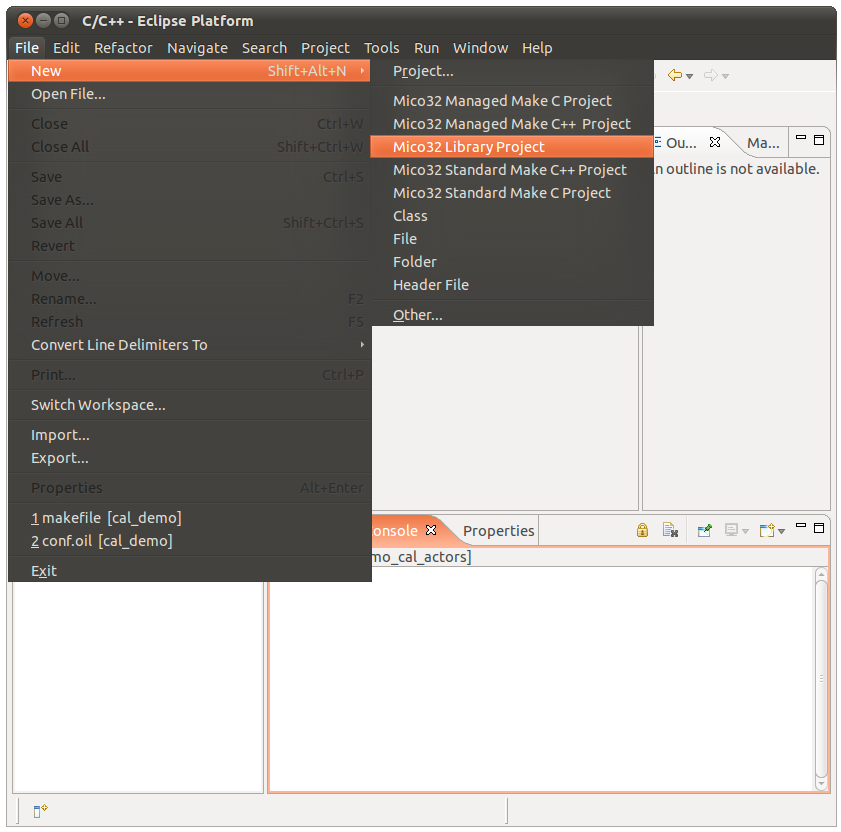
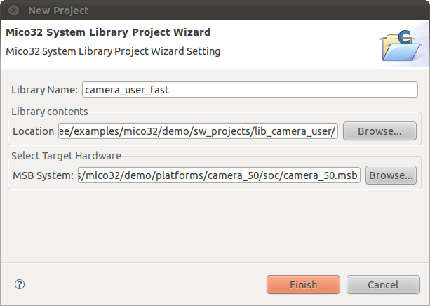
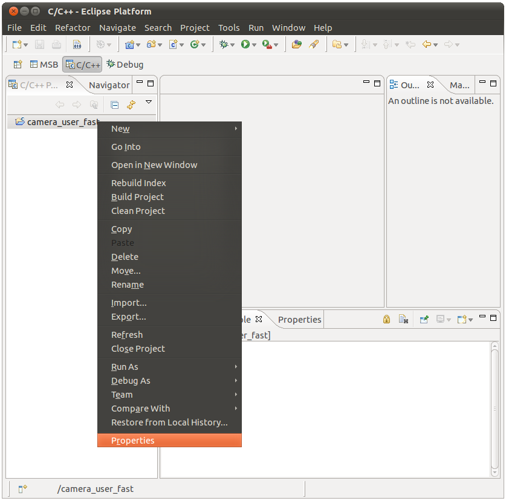
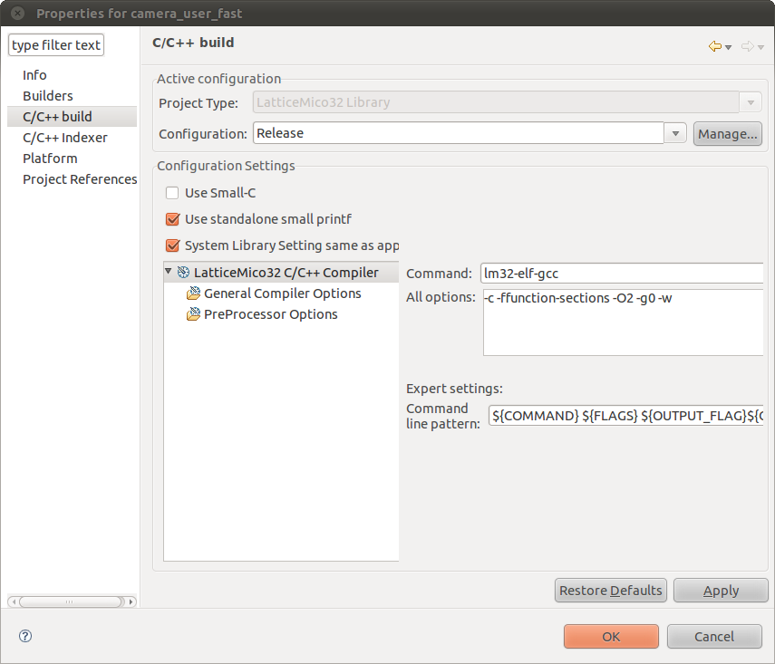
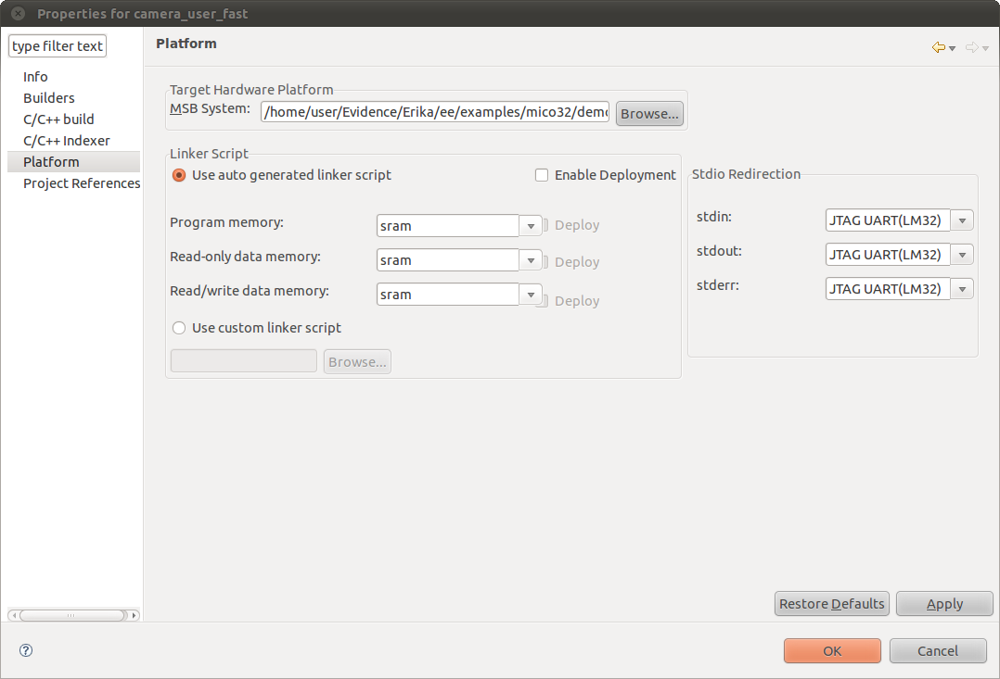
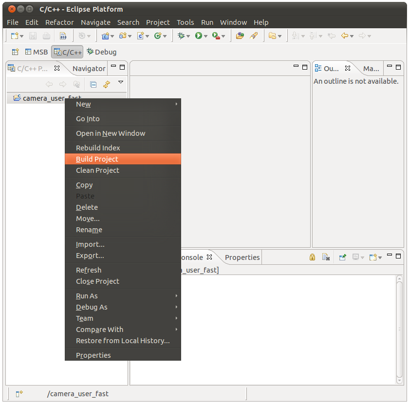

# Tutorial: Mico32 library for ERIKA

This tutorial quickly explains how to build a a library for the Lattice Mico32 platform. Please refer to the [LatticeMico32 Software Developer User Guide](http://www.latticesemi.com/dynamic/index.cfm?fuseaction=view_documents&document_type=35&sloc=01-01-08-11-48-02&source=sidebar), version 8.0, in the chapter "Standard-Make Projects" at page 262 to have further details on how this step has to be accomplished.

First of all it has to be chosen a suitable location for the library since this will have an impact on the creation of conf.oil files, as explained in [Tutorial: RT-Druid and OIL basics](Tutorial_RT-Druid_and_OIL_basics--1658.md "Tutorial: RT-Druid and OIL basics"); for our projects we have chosen the lib\_camera\_user directory under examples/mico32/demo/sw\_projects.
In order to create a library you first have to create a microprocessor platform as explained in detail in the User Guide linked above or take a msb file already present in the ERIKA's repository in examples/mico32/demo/platforms/camera\_50/soc/camera\_50.msb
Now launch the LatticeMico32 System as explained in [Tutorial: Installing CAL with ERIKA Enterprise](Tutorial_Installing_CAL_with_ERIKA_Enterprise--1755.md "Tutorial: Installing CAL with ERIKA Enterprise") and create a new Mico32 Library Project as shown below:

This screenshot shows which button has to be pressed to create a mico32 library project

In the project settings choose a Library Name (i.e. camera\_user\_fast), a Location and a Target Hardware in this way:

This screenshot shows how to properly edit the mico32 library project settings

Before compiling your library there are further adjustments to be arranged. First of all press the Properties button from your library project as shown below:

This screenshot shows which button has to be pressed to enter the mico32 library project properties

In the C/C++ build menu make sure that the Configuration is set to Release:

This screenshot shows the mico32 library project configuration panel

In addition in the Platform menu set all the options as shown below:

This screenshot shows how to set the Platform options

You can now build your library by pressing the Build Project button:

This screenshot shows how to build the mico32 library project

---

## Archive provenance

- [Original page](http://erika.tuxfamily.org/wiki/index.php?title=Tutorial%3A_Mico32_library_for_ERIKA) · [Archived source revision 2643](http://erika.tuxfamily.org/wiki/index.php?oldid=2643)
- Last source edit: 2011-02-15T17:14:07Z. Source retrieved on 2026-11-06; Markdown conversion completed on 2026-11-07.
- Original contributors recorded in exported history: Ryosab81.
- [Original MediaWiki source](../source/wikitext/1778.mediawiki) · [Original editing history](../source/history/batch-011.xml)
- [Attribution and licensing notice](../NOTICE.md). Original file-specific notices, where present, remain applicable.
