# Tutorial: PIC30 - Installing ERIKA and RT-Druid, and compile your first application

<a id="Introduction"></a>

### Introduction

This small tutorial describes a set of steps needed to compile a simple application that shows the main features of ERIKA Enterprise and RT-Druid for the Microchip dsPIC DSC platform. The information covered here should be quite basic, and applicable to most of the other platforms.

This tutorial has been tested on a FLEX board produced by Evidence and Embedded Solutions and on a Microchip Explorer 16 development board from Microchip.

We presume that the reader is familiar with the MPLAB IDE debug environment provided by Microchip.

<a id="Note_for_Windows_XP_and_Windows_Vista_users"></a>

### Note for Windows XP and Windows Vista users

If you are using Windows, and especially if you are using Windows Vista, please look carefully at the following warnings:

1. The Evidence package installation path should NOT contain directory name with spaces. For e.g. use

c:/Evidence

1. The Scilab package installation path should NOT contain directory name with spaces. For e.g. use c:/Evidence/scicoslab-4.4b7
2. If using Vista, be aware that directories like c:/Programmi, c:/Users/Documenti are not REAL directories but are aliases. DO NOT USE THEM. Put your RT-Druid workspace under c:/Users/yourusername/workspace.
3. Please install cygwin into its default directory, c:/cygwin.
4. Also if from the Windows Vista Explorer your Microchip compiler seems to be installed under c:/Programmi/Microchip/..., please remember to specify the REAL pathname. In particular, c:/Programmi **DOES NOT EXISTS**, whereas the correct name is c:/Program Files.
5. **IMPORTANT**: Always create directories under your User home directory. **DO NOT USE** other directories (such as C:\xxx), strange problems may happen. Note: If you are using Windows Vista, then the workspace directory c:/Users/<username>/workspace works.

<a id="Installing_ERIKA_Enterprise_and_RT-Druid_on_Microsoft_Windows"></a>

### Installing ERIKA Enterprise and RT-Druid on Microsoft Windows

This chapter will guide the developer on the installation procedure of ERIKA Enterprise and RT-Druid for the Microchip dsPIC DSC platform.

The installation of ERIKA Enterprise and RT-Druid is composed of following packages:

- The Eclipse development environment, which is used by RT-Druid to provide the basic development environment for ERIKA Enterprise applications.
- The Eclipse environment is based on the Java platform, so that a working Java Runtime Environment must be present for using RT-Druid.
- The RT-Druid plugins, which provide the code generation for ERIKA Enterprise for Eclipse.
- The ERIKA Enterprise source code, packaged as a set of eclipse Plugins.
- The Microchip MPLAB IDE.
- The Microchip C30 Compiler. **Please install the COMBO version, not the Lite version**. For example, MPLABC30ComboAcad\_v3\_12 works.
- A set of examples packaged as Eclipse plugins, which can be used to compile a first set of running examples for the FLEX boards, the Microchip Explorer 16 board, and others. These applications are organized in *templates*, available at project creation.
- A subset of the [Cygwin environment](http://www.cygwin.com), including a set of utilities like make, gawk, and few others, which are used during the compilation process of an ERIKA Enterprise application.

To install the software, execute the following steps:

- If you are using an old version see also: [#Old installer (before 1.6)](#Old_installer_.28before_1.6.29), otherwise download from [[Erika download page](http://erika.tuxfamily.org/erika-for-multiple-devices.html)] the RT-Druid zip file for your OS and decompress it where you want (we suggest to avoid paths with white spaces and this tutorial assumes you choose C:\Evidence\RT-Druid)

- Install your favourite Java runtime environment, which is needed to run RT-Druid; as RT-Druid is a plugin of the Eclipse editor, which requires Java to be executed. **We recommend to install the Oracle (previously SUN) Java Runtime Environment version 6 AT LEAST** (**not** update 21: see [[1]](http://wiki.eclipse.org/FAQ_How_do_I_run_Eclipse%3F))

- Install the latest version of the Microchip MPLAB IDE; you can use the default install directory. At the end of the install process, accept the system reboot.

- Install the Microchip C30 Compiler, available from the Microchip web site. Even in this case, you can use the default install directory. When it is asked to change the default environment, please do accept.

The rest of this tutorial assumes that the Microchip MPLAB IDE is installed within the C:\Programmi\Microchip directory and that, consequently, the GNU Assembler for Microchip dsPIC DSC is installed within
C:\Programmi\Microchip\MPLAB ASM30 Suite\bin. Please note that these values may be different from the settings you have chosen on your machine. Please also read the chapter with the Windows Vista recommendations.

<a id="Old_installer_.28before_1.6.29"></a>

#### Old installer (before 1.6)

- Run the ERIKA Enterprise and RT-Druid installer.

- The installer will prompt a list of packages which can be installed. Select all the packages you wish to install and continue the installation procedure.

  [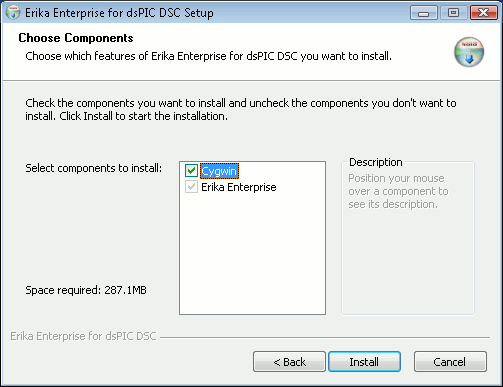](../files/File_Erikatutorial_installer_options.png--1636.md)

  This screenshot shows the dialog box with the available install packages.

- The installer will ask for a destination directory. If possible, please use c:/Evidence

  [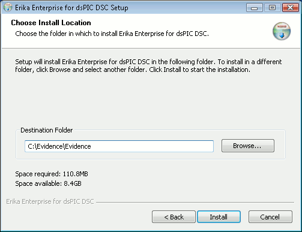](../files/File_Erikatutorial_installer_dir.png--1638.md)

  This screenshot shows the preferred destination dir for installing ERIKA Enterprise.

- If you are using an old version of RT-Druid installer, you should check the *first* line of the file evidencedir\bin\mymake\_cygwin.bat (where evidencedir is the directory you chose during the installation). For example, if Cygwin is installed inside C:\cygwin, then the first line of the file should look like the following one:

```
@set EE_BASH_PATH=C:\cygwin\bin\bash
```

...that is, the line contains the correct path to the bash.exe file in your Cygwin installation. If you accepted the default settings, the correct pathname should be C:\cygwin\bin\bash as specified in the example before.

- - **Note:** This check can be ignored if you are planning to use RT-Druid 1.5 or newer, otherwise it is useful to perform this check because it seems that on some Windows machines the Cygwin installer does not correctly set the registry keys used by the ERIKA Enterprise installer.

<a id="First_RT-Druid_startup_and_configuration"></a>

### First RT-Druid startup and configuration

After all the required packages have been installed, you are ready to start RT-Druid for the first time.

Please follow the next steps:

1. As the first step, run the Eclipse IDE from the path you choose during the install procedure, as example C:\Evidence\RT-Druid\eclipse.exe.
2. A dialog box will appear, prompting to choose the right workspace

   [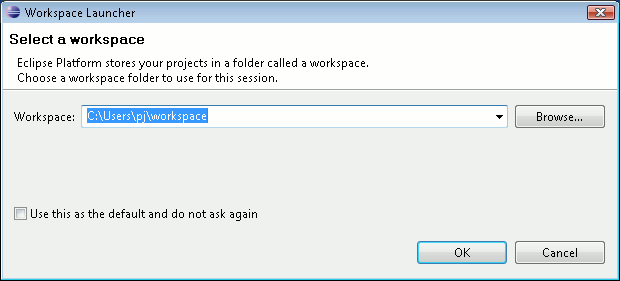](../files/File_Erikatutorial_select_workspace.png--1639.md)

   This screenshot shows the dialog box for the choice of the current workspace directory.

   Leave the default workpackage directory as it is, and proceed by pressing *OK*.

   **Warning:** The workspace pathname MUST NOT contain any blank space, otherwise ERIKA Enterprise and RT-Druid may not work properly.

   **Note:** If you are using Windows Vista, then the workspace directory c:/Users/<username>/workspace works.
3. The Eclipse Welcome screen appears. To go ahead you can click the *Go to the workbench* icon.

   [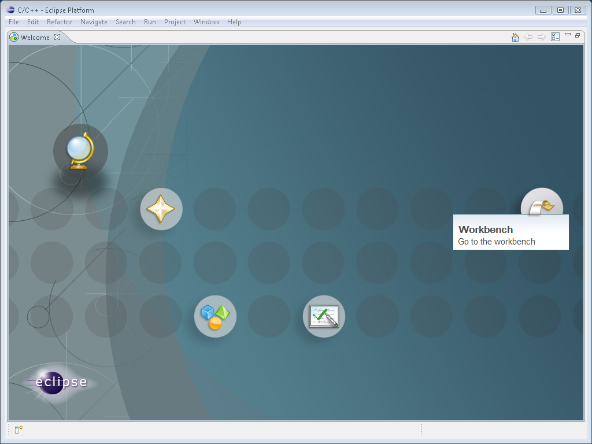](../files/File_Erikatutorial_welcome.png--1640.md)

   The Eclipse Welcome screen.
4. At this point can be useful to check for updates. See [Tutorial: Update ERIKA and RT-Druid](Tutorial_Update_ERIKA_and_RT-Druid--2049.md "Tutorial: Update ERIKA and RT-Druid")
5. Before being able to correctly build your application, you should set the path to the Microchip C30 compiler and the MPLAB ASM30 assembler programs. For doing so:
   - please go to the ``Preference *menu.

     [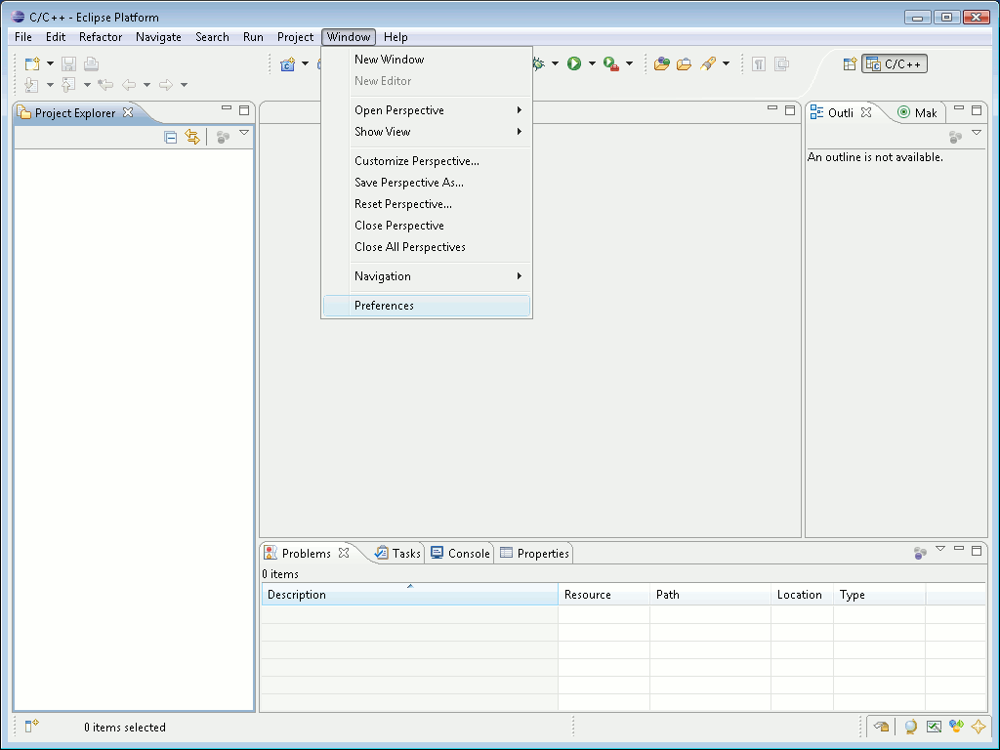](../files/File_Erikatutorial_preferences_menu.png--1641.md)

     Go to the ``Preference* menu.
   - find the *RT-Druid/Oil/PIC30 Configurator* form as depicted in Figure.

     [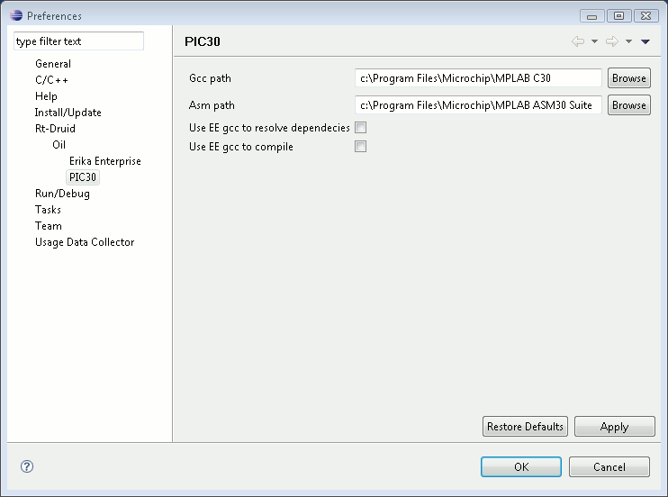](../files/File_Erikatutorial_preferences_pic30.png--1642.md)

     Select paths for compiler and assembler.
   - The first textbox, labeled *Gcc path*, refers to the installation directory of the Microchip C30 compiler. The second textbox, labeled *Asm path*, refers to the installation directory of the ASM30 assembler provided with the MPLAB IDE.
   - **Note:** The install directories specified in the two textboxes does *not* include the bin directory!
   - **Note:** That is, c:\Programmi\Microchip\MPLAB C30 is correct, whereas c:\Programmi\Microchip\MPLAB C30\bin is not.
   - **Note:** "Use EE .." options will be removed in RT-Druid 1.6 and should be disabled on all versions after RT-Druid and Erika 1.5.1
6. Before creating and building your application, please deselect the *Build Automatically* flag inside the *Project* menu.

   [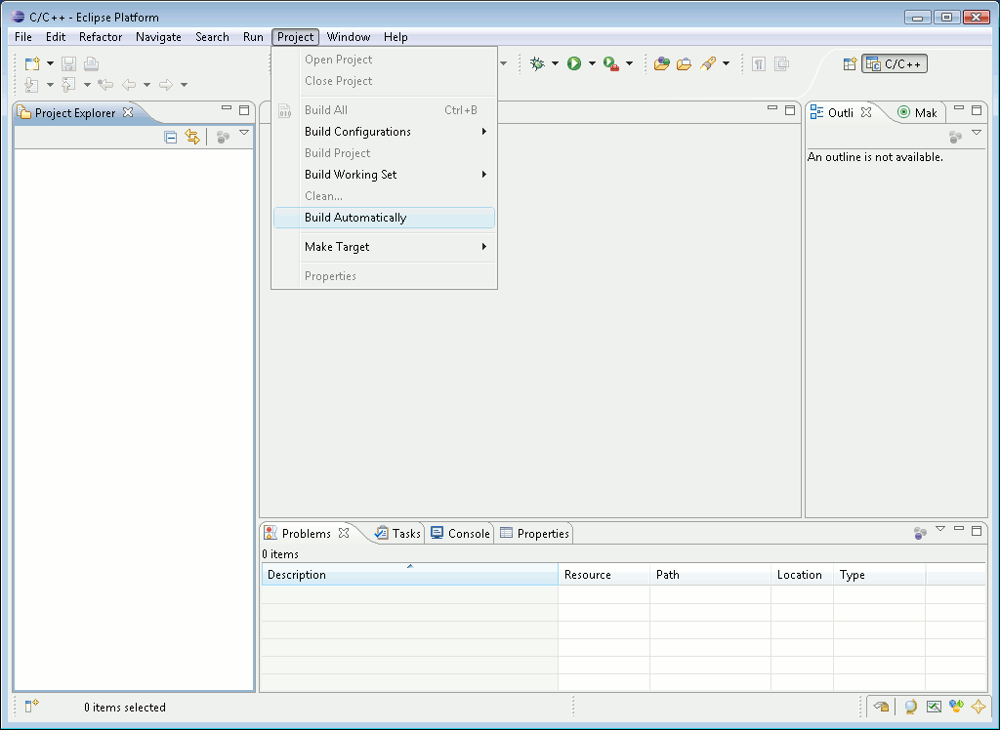](../files/File_Erikatutorial_build_automatically.png--1643.md)

   Deselect the *Build Automatically* flag in the *Project* menu.

<a id="Compiling_your_first_ERIKA_Enterprise_demo"></a>

### Compiling your first ERIKA Enterprise demo

You are now ready to compile your first ERIKA Enterprise demo. Please execute the following steps:

1. Please select *New Project*, then *RT-Druid Oil and c/c++ Project* from the *File menu*.

   [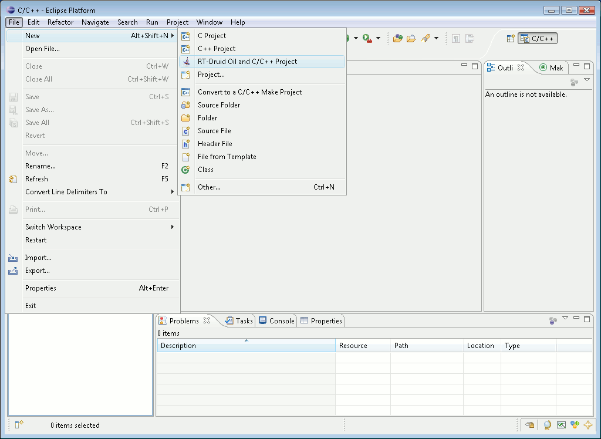](../files/File_Erikatutorial_newproject.png--1644.md)

   Select ``New project *from the* File *menu.*
2. A Dialog box appear. Please select a template for the new project.

   [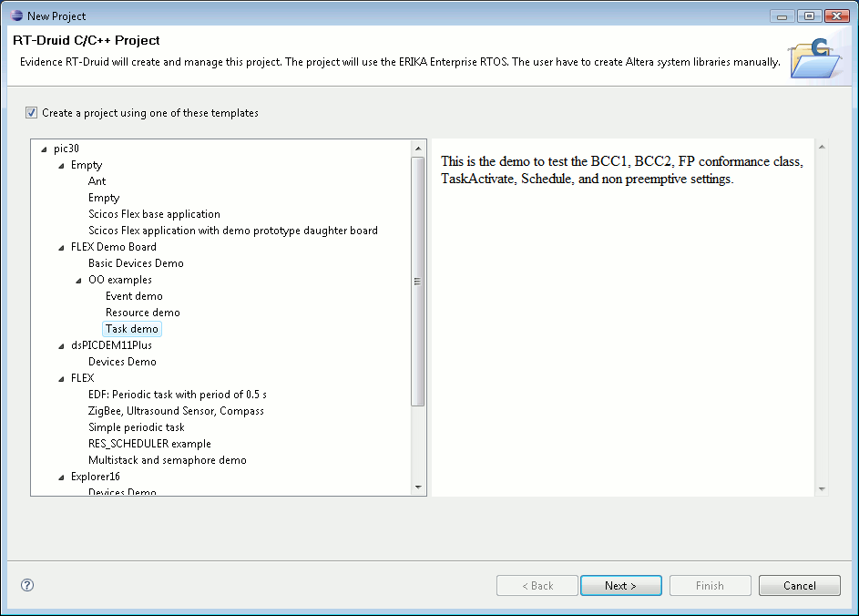](../files/File_Erikatutorial_newproject2.png--1645.md)

   Select a template for your project.
3. Press *Next*.
4. Insert the name of the new project. Please type taskdemo (you can choose other names of course). Then press the *Finish* button.

   [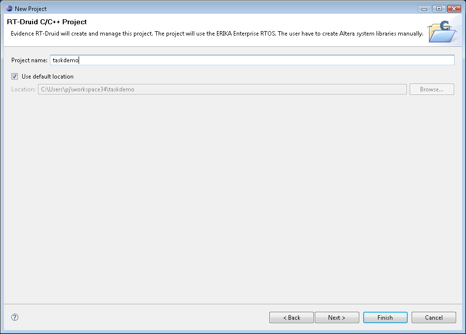](../files/File_Erikatutorial_projectname.png--1646.md)

   Type a name for the new project.
5. We are now ready to build the demo. Right click on the project name in the Eclipse navigation bar, and choose *Build Project*

   [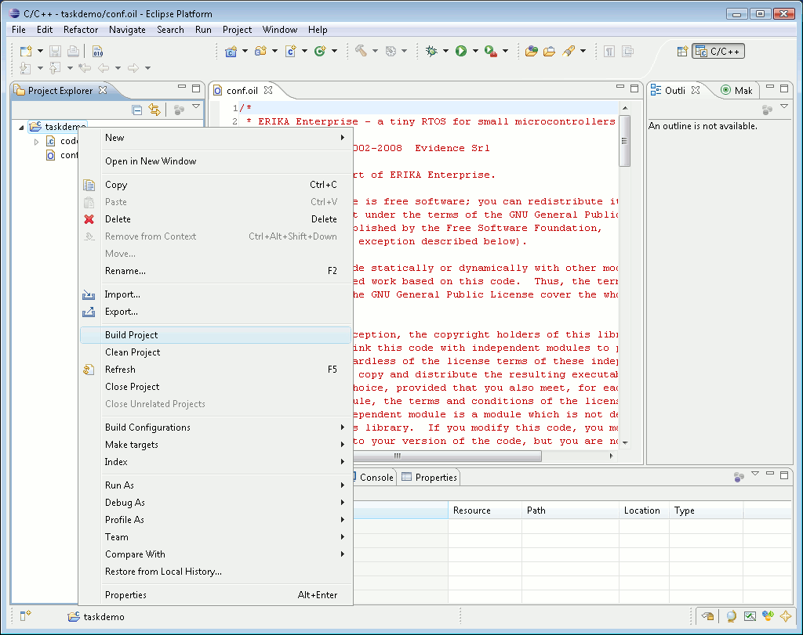](../files/File_Erikatutorial_build_project.png--1647.md)

   We are now able to build the project.

   - Note: *Build Project* only appears if the *Build Automatically* flag is not selected in the ``Project *menu.*
6. Then, the compilation process starts. Please note the message that appears when the compilation is successfull.

   [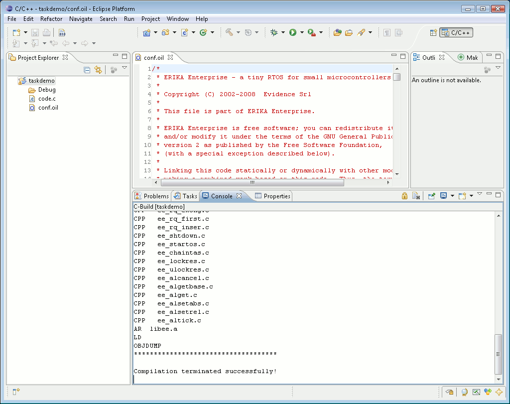](../files/File_Erikatutorial_compiling.png--1648.md)

   The compilation process.

   - If the error depicted in Figure appears (meaning that mymake\_cygwin.bat is unable to find a file), then please follow the instructions on the Cygwin installation.

     [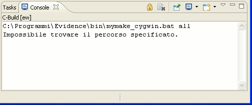](../files/File_Erikatutorial_mymake_cygwin_error.png--1649.md)

     An error that shows up on some Windows machines. Please check the mymake\_cygwin.bat file.

<a id="Programming_the_board_and_running_the_example"></a>

### Programming the board and running the example

1. At the end of the compiling process you will be able to find a file named pic30.cof inside the Debug directory inside the project.

   [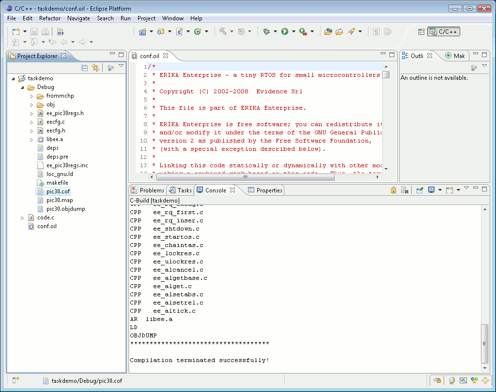](../files/File_Erikatutorial_cof_image.png--1650.md)

   The output file is ready to be programmed on the target board.
2. You are now ready to import the produced COFF file inside Microchip MPLAB IDE. To do that, open MPLAB IDE.

   [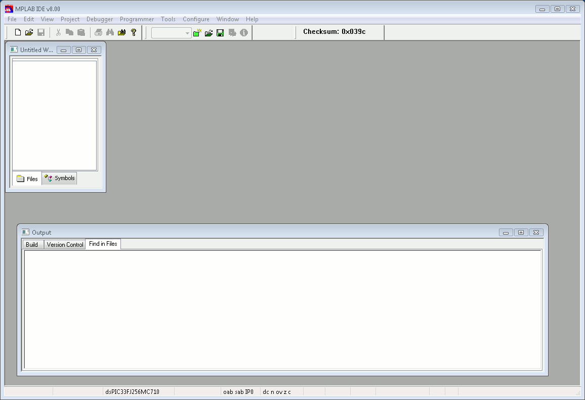](../files/File_Erikatutorial_mplab1.png--1651.md)

   The Microchip MPLAB IDE.
3. Choose *Import...* from the *File* menu.

   [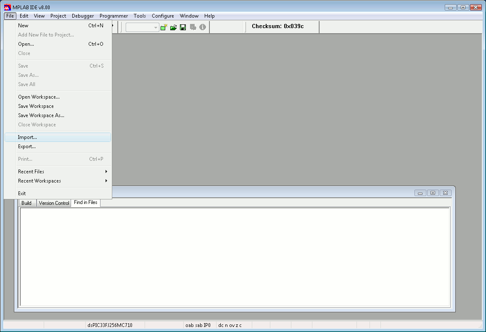](../files/File_Erikatutorial_mplab2.png--1652.md)

   Choose *Import...* from the *File* menu to import the coff file produced in Eclipse.
4. A dialog box appear. Please select the pic30.cof file that has been produced by the compilation process in Eclipse, as shown in Figure.

   [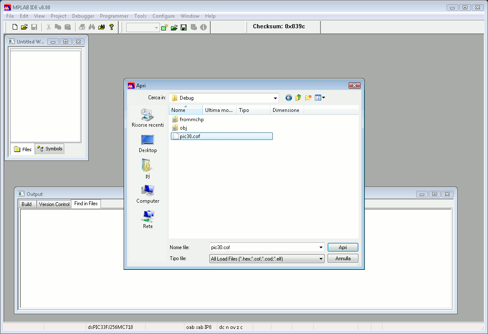](../files/File_Erikatutorial_mplab3.png--1653.md)

   Select the COFF file you want to import.

   You can find that file inside the Eclipse workspace you selected. In this example, the file is stored inside the directory c:\Programmi\Evidence\eclipse\workspace\pic30\_oo\_mono\Debug.
5. You have now imported the COFF file inside MPLAB IDE. There is no need to create a MPLAB IDE Project, because the compilation process is handled by Eclipse. The Figure shows the *Disassembly Listing* and the *Program Memory* window. Please note that MPLAB IDE correctly recognizes the debug symbols of the source code produced inside Eclipse.

   [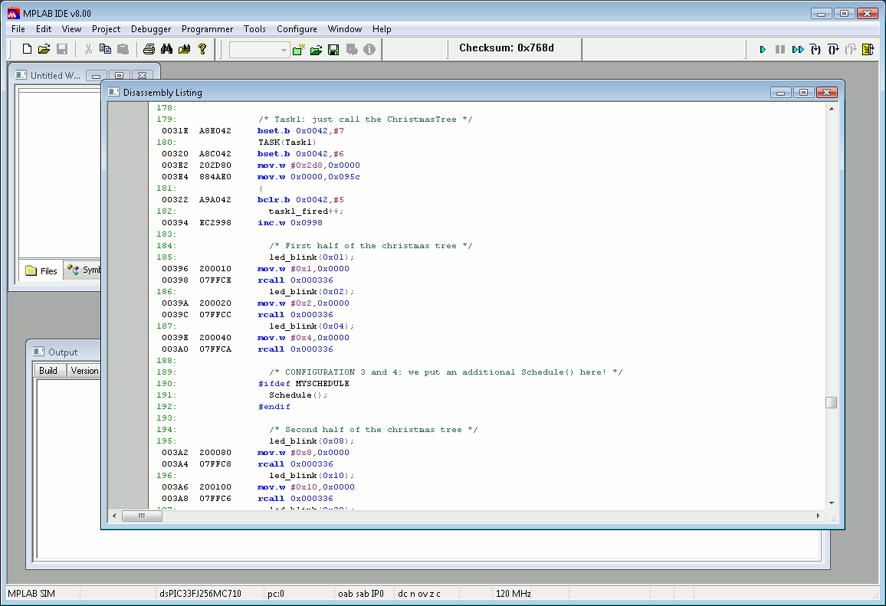](../files/File_Erikatutorial_mplab4.png--1654.md)

   Debug symbols are correctly recognized.
6. You can now start debugging the demo application using MPLAB IDE.

[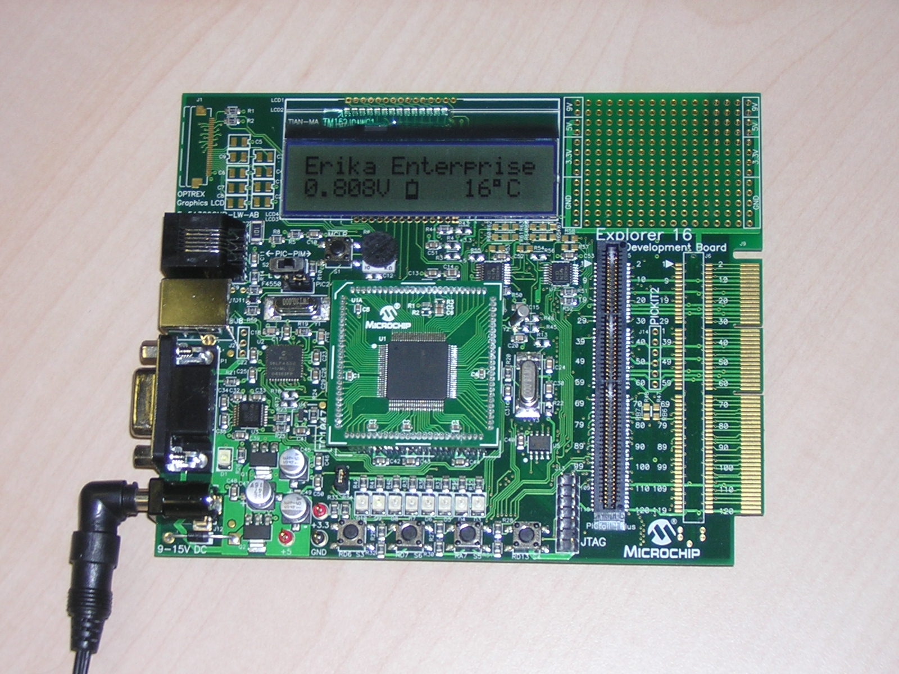](../files/File_Erikatutorial_explorer16running.jpg--1656.md)

The Explorer 16 board with the running demo program.

The Figure shows the Explorer 16 board running pic30\explorer16\Devices Demo demo application, which uses the Explorer 16 onboard devices to monitor and display the environment temperature.

**Note:** If you get an MPLAB IDE error like the following:

```
ICDWarn0015: Program memory has changed since 
last program operation?
Continue with Debug operation?
Running Target
ICD0083: Debug:  Unable to enter debug mode.  
Please double click this
message for more information.
```

Please make sure that you have entered the debug mode and programmed the
device *from the Debugger Mode* and not from the Programmer Mode.

*Note:* If you are using a FLEX board, please remember to set the device correctly uinder the *Configure / Select device...* menu of MPLABIDE.

[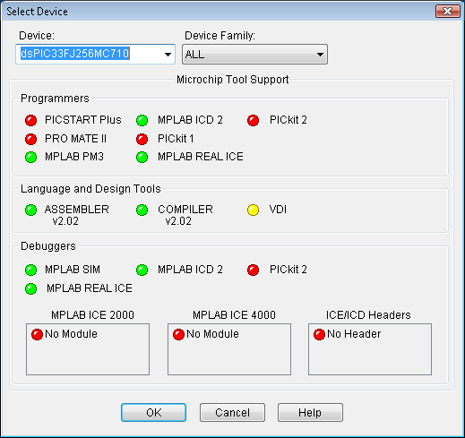](../files/File_Erikatutorial_mplab_selectdevice_dspic.png--1655.md)

Selecting the dsPIC MCU mounted on the FLEX boards.

The correct settings for the dsPIC on the FLEX Full and the FLEX Light is shown in Figure.

[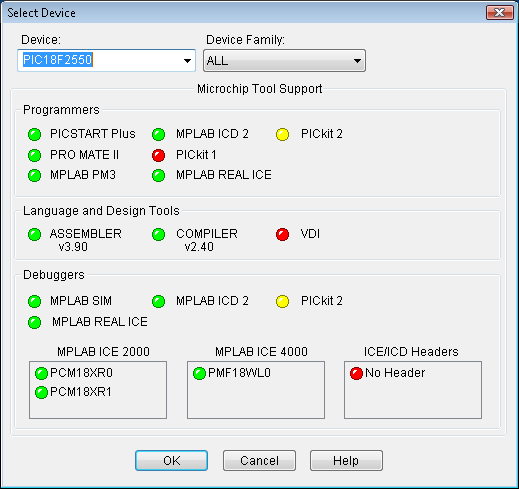](../files/File_Erikatutorial_mplab_selectdevice_pic18.png--1657.md)

Selecting the PIC18 MCU mounted on the FLEX Full boards.

The correct settings for the PIC18 on the FLEX Full.
<a id="Bleeding_edge"></a>

### Bleeding edge

It is possible to use the latest version of ERIKA by downloading the source code from the repository. See [ERIKA Enterprise and RT-Druid SVN Access](ERIKA_Enterprise_and_RT-Druid_SVN_Access--1464.md "ERIKA Enterprise and RT-Druid SVN Access") for instructions on how to download the code. For many architectures, you can use the code from the repository by defining the environment variable **ERIKA\_FILES**, which should point to the local copy of the *ee* directory (the one in *trunk*) in the repository. Please note that **ERIKA\_FILES** is defined using the host style, then on Windows must be specified as a windows-style path (e.g., `c:\erika\trunk\ee` or also `c:/erika/trunk/ee` on new windows versions). Almost all the architectures currently support the redefinition of **ERIKA\_FILES**.

See also  [Erika path in RT-Druid](Erika_path_in_RT-Druid--2141.md "Erika path in RT-Druid")

---

## Archive provenance

- [Original page](http://erika.tuxfamily.org/wiki/index.php?title=Tutorial%3A_PIC30_-_Installing_ERIKA_and_RT-Druid%2C_and_compile_your_first_application) · [Archived source revision 5492](http://erika.tuxfamily.org/wiki/index.php?oldid=5492)
- Last source edit: 2014-01-20T16:47:39Z. Source retrieved on 2026-11-06; Markdown conversion completed on 2026-11-07.
- Original contributors recorded in exported history: Pj, Nicola, Paolo.gai, Dibbe, WikiSysop.
- [Original MediaWiki source](../source/wikitext/1637.mediawiki) · [Original editing history](../source/history/batch-011.xml)
- [Attribution and licensing notice](../NOTICE.md). Original file-specific notices, where present, remain applicable.
