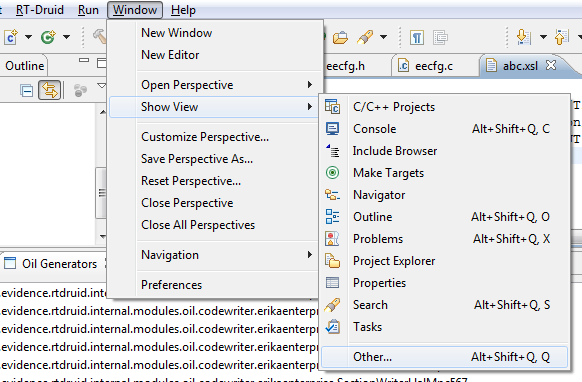
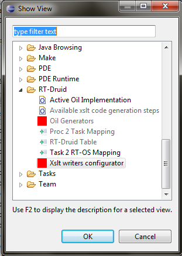
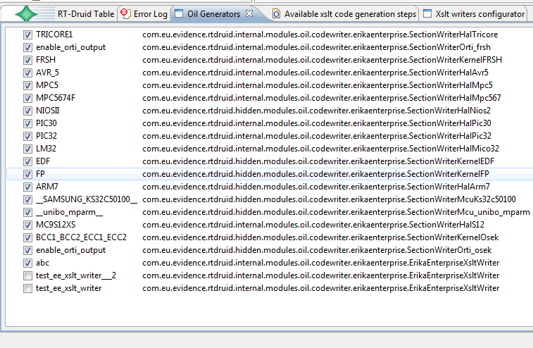
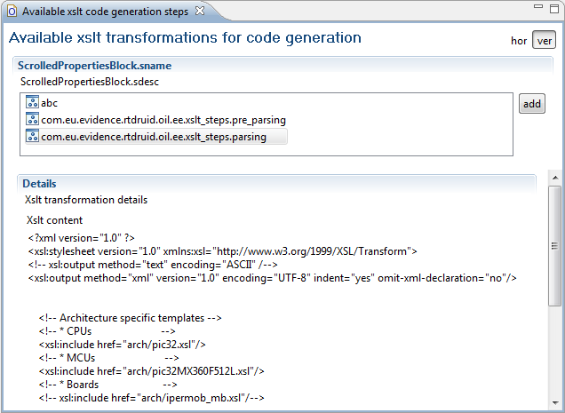
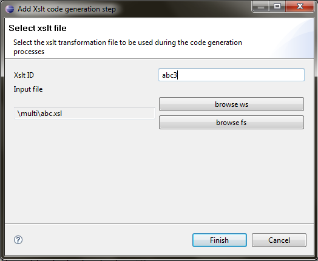
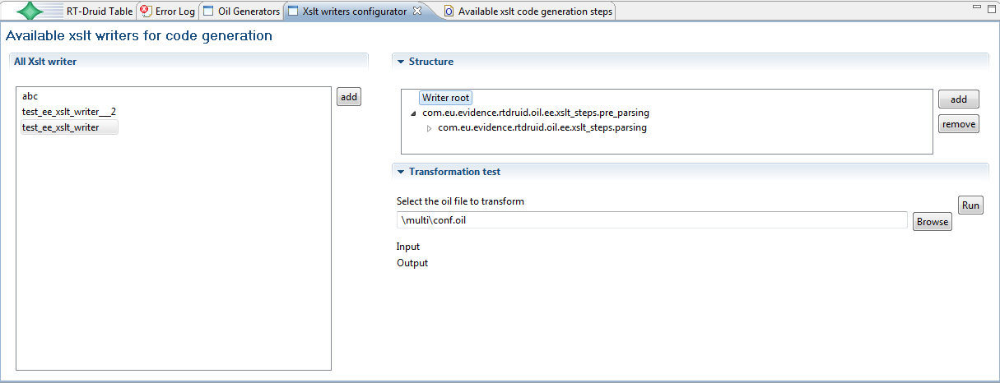
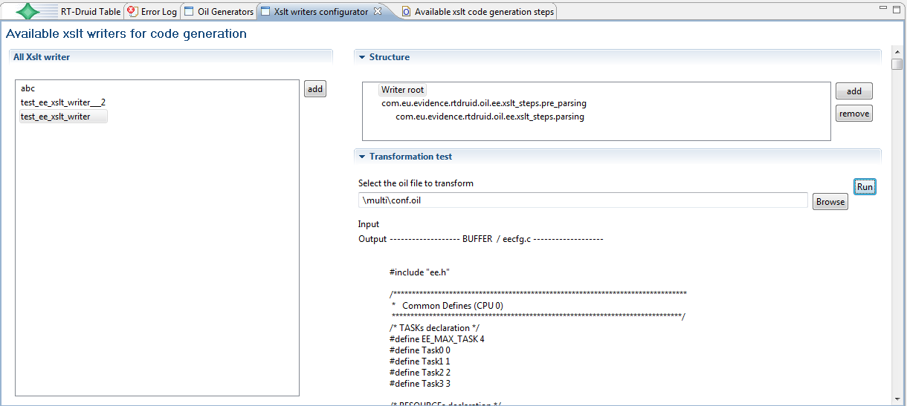
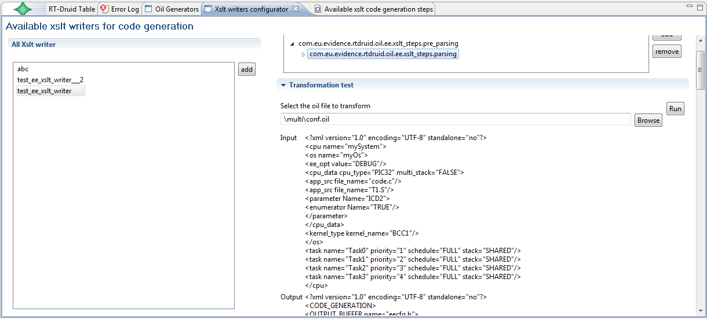

# Tutorial: RT-Druid and OIL code generation using XML and XSLT transformations

<a id="Acknowledgements"></a>

## Acknowledgements

The XSLT transformation engine was done by Nicola Serreli and Christian Nastasi in a few nights. PJ did the first version of this wiki page.

<a id="Rationale"></a>

## Rationale

The rationale behind the idea of using XSLT transformation to generate source code from OIL is the following:

- Many features related to the OIL code generation boils down to simple generated code.
  - as an example: many settings are just mapped to #defines.
- It may be difficult to write a JAVA plugin for generating code, because often one needs to know all the RT-Druid internals to do the job.

hence, the idea to:

- take the OIL file, parse it and put it into the RT-Druid internal data structure
- export the OIL internal data structure in XML form
- run a set of XSLT transformations on the XML until the system reaches the form of generated code
- old Java code generators plugin will remain available, so that one can add just XSLT transformations for the new modules which will be inserted from now on.

<a id="Current_status"></a>

## Current status

- There is some basic support in RT-Druid which enables the possibility to test the system
- The system is currently read-only, in the sense that the system does not save the XSLT transformation the user writes (to avoid damaging the current distribution)

Missing things:

- Save of the current settings: we leave this as the last thing to avoid that users change a working configuration ruining the code generation process.
  - Currently the settings are maintained until Eclipse is closed. At every start of Eclipse we start again from the same configuration saved in the plugins
- give the possibility to remove user XSLT transformation
  - not useful until the previous point is implemented
- make a better output view
  - adding search, copy, ...
- make a better error checking, putting the errors in the output
- make possible to transform a sequence of XSLT transformation in a plugin which can be sent to Nicola to be added to the RT-Druid distribution
- the OIl file which form the OIL implementation are currently scattered ine ach plugin. We should make them somehow selectable
- give the possibility to the user to directly change the OIL implementation definition by adding additional items
- give warnings when there is no writer enabled to handle specific Hwrdwares, kernels, ...
- we should add descriptions and tags to the writers to identify what they do
  - useful for the xslt composition views
  - useful for testing of the correctness (e.g., the scheduler section has not been generated....)

<a id="The_code_generation_process_using_XSLT"></a>

## The code generation process using XSLT

We name **writer** a piece of code that is used to parse the OIL file and generate code.

We name **writer XSLT**, or **XSLT writer** a sequence of XSLT transformation which have to be run in sequence to take the OIL and produce code.

The process used to run an XSLT writer is the following:

1. The OIL file is transformed by RT-Druid in an XML document
2. The XML file pass through a list of XSLT transformation until we obtain a simple XML file with the generated code, divided by CPU (in case of a multicore environment) and by file
3. The resulting XML is parsed by the system, and the content for each file is appended to the other files generated by all other writers.
   - Note that more than one writer (written in Java or using XSLT) may be active at the same time!

The result is that the user does not feel the difference between the code generators written in java or using XSLT.

<a id="RT-druid_views_specific_for_XSLT"></a>

## RT-druid views specific for XSLT

The system currently provides a set of Eclipse views which are able to work with the XSLT transformations.

To enable them, remember that **you need to update the plugins to the Nightly builds**.

The various views allows to:

- Enable and disable the various writers which are present in the current build (both java and XSLT)
- Show the current OIL IMPLEMENTATION which is used by the system to parse the OIL file.
- Add new XSLT transformations (which can be stored in the workspace or in a generic place in the filesystem) to the list of available transformations. All these files will be used to "compose" the XSLT writer.
- Add new XSLT writers as an ordered sequence (which can be also hyerarchical) of XSLT transformations added with the view listed at the previous bullet.
- Try an XSLT writer on a file on the workspace, being able to show:
  - the final result
  - the input and output at each step in the transformation
  - the error raised at each transformation (this feature is not yet available)

  it is possible to copy and paste the text for further manual processing.

Please note that nothing will change from the user point of view. in particular, the user will continue to use the "Build Project" commands to generate and compile the code.

As the first thing, all the views are available under "Windows/ Show views / Other..."

[](../files/File_Xslttutorial_menu1.png--1685.md)

The "Windows/ Show views / Other..." menu

[](../files/File_Xslttutorial_menu2.png--1686.md)

Available RT-Druid views

Then, the following figure shows the writers which are enabled. Checked lines means that the writer is enabled

[](../files/File_Xslttutorial_enabled_writers.png--1687.md)

The list of enabled writers

The following figure shows the list of current XSLT files in the system. On one side, there is the file list identified by a unique ID, whereas on the other side the file content is shown (Note that the view layout may be horizontal or vertical). There is an "add" button which can be used to add a new file to the list.

[](../files/File_Xslttutorial_availeble_xslt_files.png--1688.md)

Available XSLT transformations for code generation

the Add file wizard asks for the file ID and for the file itself (which can stay either in the file system or in the workspace). **Please note that this view needs to be redone to make it more user friendly**

[](../files/File_Xslttutorial_availeble_xslt_files_add.png--1689.md)

Adding a new XSLT transformation file

Then, using the views of the XSLT writer configurator (shown in the next pictures) it is possible to show the XSLT writers and their structure. On the left side, it is possible to add new writers, which can be added using the "add" button.

On the right side, the structure of the XSLT transformation is shown. the structure is as follows:

1. Writer root is used as a placeholder to mean that that is the end result of ll the transformation. **This will be changed in the next versions**
2. then there is a tree of transformations.
   - Each transformation tasks an input and produces an output.
   - The output is passed to the childs. All childs receive as input the output produced by the father.
3. Double clicking on an XSLT transformation open a view showing the specific file.

Moreover, on the right side the input and output part of each transformation is shown. Please note that the input and output shown depend on the transformation which is selected.

[](../files/File_Xslttutorial_xslt_chain.png--1690.md)

View used to configure XSLT transformation chains

[](../files/File_Xslttutorial_xslt_chain_output.png--1691.md)

Output of the XSLT writer obtained clicking on the writer root

[](../files/File_Xslttutorial_xslt_chain_step.png--1692.md)

Input and output at a specific step of the transformation

<a id="How_to_run_an_example_XSLT_transformation"></a>

## How to run an example XSLT transformation

As today (October 27th) the current distribution in the nightly builds contains two example writers, named:

- test\_ee\_xslt\_writer
  - Please look at this one.
- test\_ee\_xslt\_writer\_\_2
  - This is just a test to test the nesting of the XSLT transformation, and will be removed soon.

The steps to run a test transformation are:

- Please use the test named test\_ee\_xslt\_writer to do the test.
- Click on the writer on the left
- Open the "transformation test" part
- Add an OIL file clicking on the "browse" button.
  - I tried with the conf OIL of the template application named "pic30/Flex Demo Board/OO examples/Task demo"
- Click on the "Run" button
- The transformation is generated.
- Click on the com.eu.evidence.rtdruid.oil.ee\_xslt\_steps.pre\_parsing entry in the structure
  - the input part is the OIL file translated in XML which is given as input to the XSLT transformation.
  - this transformation is used to translate the input which comes from the RT-Druid internal data structure into a more human-readable form (this is why it is called **pre-"parsing**
  - the output part is a more human-readable form of the OIL file.
- Click on the com.eu.evidence.rtdruid.oil.ee\_xslt\_steps.parsing entry in the structure (it is a child of the one at the previous bullet!)
  - this transformation takes as input the output of its father (the "pre-parsing" transformation) and generates an output XML which is the result of the transformation
- Finally, the "Writer root" part takes the final output of each **LEAF** transformation. The output specifies some content for each file. If there are more than one leaf, then the result is CONCATENATED.

How to activate an XSLT writer:

- you have to select it into the list of generators shown before.

IMPORTANT NOTE: Please note that the "test\_ee\_xslt\_writer" XSLT writer is almost a replacement for all other Java writers. This means that, **if you enable that writer without disabling the other writers, then you will get double content in the generated files!!!**.

<a id="How_to_write_your_own_XSLT_transformation"></a>

## How to write your own XSLT transformation

The following steps describe shortly how you can test your XSLT transformation to add a new OIL extension to the system. The process is divided in a set of parts described below.

<a id="copying_from_an_existing_plugin"></a>

### copying from an existing plugin

Starting from release 1.6.0 of RT-Druid, there are a few architectures supporting OIL extensions using XSLT transformations.

We suggest to start from one of those. For that reason, as the first step:

1. go into the plugins directory
2. find one of the plugins using XSLT transformations.
   - Note: the **com.eu.evidence.rtdruid.oil.esirisc.core\_VERSION.DATE** plugin uses XSLT. You can use that one as a starting point. In the following of this document we will suppose that you are starting from the esirisc plugin.
3. copy the plugin into the **dropins** directory (at the same level of the **plugins** directory)
   - the dropins directory can be used to store plugins created by the user which are not part of the default installation
4. after copying the plugin, **change the name of the directory** to avoid conflicts

<a id="enhancing_the_OIL_implementation"></a>

### enhancing the OIL implementation

To support new OIL configurations, you need to specify them using the OIL specification for the implementation definition.

You do not need to list all the settings which already exist, but only the additional OIL variables that you are specifying.

For example, you should add your specific CPUs/MCU/BOARD sections for the relevant chip or evaluation board.

This will allow you to load your additional custom OIL specification in the system.

Finally, please rename the file with a meaningful name.

<a id="parsing_the_modified_OIL_implementation_using_XSLT"></a>

### parsing the modified OIL implementation using XSLT

Once you have modified your OIL implementation, you can parse it using the XSLT transformations.

The esi-risc has an existing XSLT file that you can use as a basis, which is contained into the xsltTransformations folder of the esi-risc plugin.

Please modify it as you need.

To test it rapidly, you can also use the following steps

- create an empty file for your XSLT transformation
  - create an empty project in the workspace
  - create an empty xslt file in the workspace (for example "my.xslt").
  - open the my.xslt file
- add the file in the workspace to the list of available XSLT tranformations. To do that:
  - go to the view "Available XSLT transformations for code generation"
  - click the "add" button
  - click on "browse ws" to select the "my.xslt" file just created
  - give an unique id to the transformation. For example: "mytransformation"
- add a new writer
  - go in the view named "Available xslt writers for code generation"
  - click on the "add" button on the left panel (the one listing the writers)
  - give a unique id, example "mywriter"
  - as a result, a new writers appears on the list. If you click on it, only the "Writer root" element is on the list on the right.
- add the XSLT transformations to the writer
  - click "add" on the "Structure" tab
  - select "com.eu.evidence.rtdruid.oil.ee.xslt\_steps.pre\_parsing", and click "Finish"
  - now we need to add the new XSLT transformation on the workspace as a sub-transformation of the one just inserted.
    - This because the pre\_parsing transformation is used as an initial "preprocessor" to make the XML coming out from RT-Druid more readable
  - to do this, select the pre\_parsing transformation you just added
  - click the "add" button again
  - select the "mytransformation" ID that you created at the previous step
  - click on "Finish"
  - note that the "mytransformation" XSLT transformation is now a child of the pre\_parsing transformation
- Run the writer
  - At this point, you do have your transformation ready, and you can try running it using the "Run" button available in the tool to test the transformation you have done!

<a id="change_the_plugin.xml"></a>

### change the plugin.xml

You need to edit and change the plugin.xml file into the root of the plugin directory.

In particular, you need to change the various files (.oil, .xslt) referenced in the xml file with the ones you just changed above.

Using the plugin.xml it is possible to set the phase where the writer is called. Here is the sequence:

```
 INIT -> CPU -> KERNEL -> BOARD -> HW -> OTHERS -> MAKEFILE -> END
```

Inside each phase, all writers have a priority value to sort them. Lower values are executed before greater values.

Here is an extract of plugin.xml with both phase and priority set.

```
 <extension
        point="com.eu.evidence.rtdruid.oil.ee.core.eeXsltSectionWriter">
     <xsltWriter
           enabled="true"
           id="xslt_writer_it"
           priority="50000000"
           type="MAKEFIE">
        <xsltStep
              xsltWriterStepId="first_step">
        </xsltStep>
     </xsltWriter>
  </extension>
```

If not specified, the priority is 1000.
RT-Druid standard makefile writers have the priority set to 10000000

```
Note: at this moment, it is possible to place the generated code only before or after the code produced by another writer.
```

<a id="change_the_Manifest"></a>

### change the Manifest

You need to change the META-INF/MANIFEST.MF file with the information about the new plugin.

<a id="add_some_examples..."></a>

### add some examples...

If you want to add examples about the extensions, you can use the examples folder. If you do not have examples, please remove all contents of the examples directory, and leave the directory empty.

<a id="How_to_put_an_XSLT_writer_in_production"></a>

## How to put an XSLT writer in production

Once done, please send: the modified plugins you now have in the dropins directory to Nicola Serreli (nicola "at" evidence "dot" eu "dot" com)

Enjoy!

Nicola, Christian, PJ

---

## Archive provenance

- [Original page](http://erika.tuxfamily.org/wiki/index.php?title=Tutorial%3A_RT-Druid_and_OIL_code_generation_using_XML_and_XSLT_transformations) · [Archived source revision 5604](http://erika.tuxfamily.org/wiki/index.php?oldid=5604)
- Last source edit: 2014-05-29T19:07:44Z. Source retrieved on 2026-11-06; Markdown conversion completed on 2026-11-07.
- Original contributors recorded in exported history: Paolo.gai, Steve, Nicola.
- [Original MediaWiki source](../source/wikitext/1684.mediawiki) · [Original editing history](../source/history/batch-011.xml)
- [Attribution and licensing notice](../NOTICE.md). Original file-specific notices, where present, remain applicable.
