# Tutorial: Running ERIKA on Mico32 and FPG-EYE

<a id="Introduction"></a>

## Introduction

This tutorial shows how to compile and program the webserver\_camera demo application on the FPG-EYE bord (the one that is pre-loaded on the board).

To begin with this tutorial:  [install Mico32/FPG-EYE development environment](Installation_of_Mico32_FPG-EYE_development_environment--2093.md "Installation of Mico32/FPG-EYE development environment"), get a  [local copy of ERIKA Enterprise repository](ERIKA_Enterprise_and_RT-Druid_SVN_Access--1464.md#Anonymous.2C_readonly_access "ERIKA Enterprise and RT-Druid SVN Access") and then follow the
[Tutorial: Building a Mico32 platform for FPG-EYE](Tutorial_Building_a_Mico32_platform_for_FPG-EYE--2100.md "Tutorial: Building a Mico32 platform for FPG-EYE").

Below mentioned paths are all relative paths of the local ERIKA Enterprise repository.

<a id="Create_Mico32_Library_for_fpg_eye_mico32_platform"></a>

## Create Mico32 Library for *fpg\_eye\_mico32* platform

After  [importing fpg\_eye\_mico32 platform](Tutorial_Building_a_Mico32_platform_for_FPG-EYE--2100.md#Import_platform_project_in_LatticeMico_System_IDE "Tutorial: Building a Mico32 platform for FPG-EYE") in [*LatticeMico System*](http://www.latticesemi.com/products/designsoftware/micodevelopmenttools/index.cfm) software, switch to **C/C++ Perspective**. Right click to open the C/C++ Project View and select **New->Mico32 Library Project** command:

[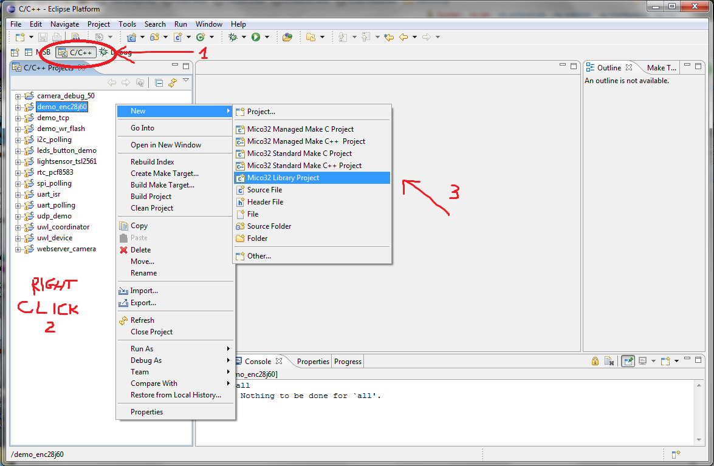](../files/File_New_mico32_library_C-C_.png--2115.md)

**C/C++** New Mico32 Library Project

Make sure to select the correct target hardware by selecting **ee\examples\mico32\demo\platforms\fpg\_eye\_isplever\msb\soc\fpg\_eye\_mico32.msb** if you are using ispLever tools else **ee\examples\mico32\demo\platforms\fpg\_eye\_diamond\msb\soc\fpg\_eye\_mico32.msb** if are using Diamond tools.
To compile the fpg\_eye\_mico32 demo without making any changes to the project files, select the follow directory as library location **ee\trunk\ee\examples\mico32\demo\platforms\fpg\_eye\_isplever\library** (if you use ispLever tools) while **ee\trunk\ee\examples\mico32\demo\platforms\fpg\_eye\_diamond\library** (if you use Diamond tools)

[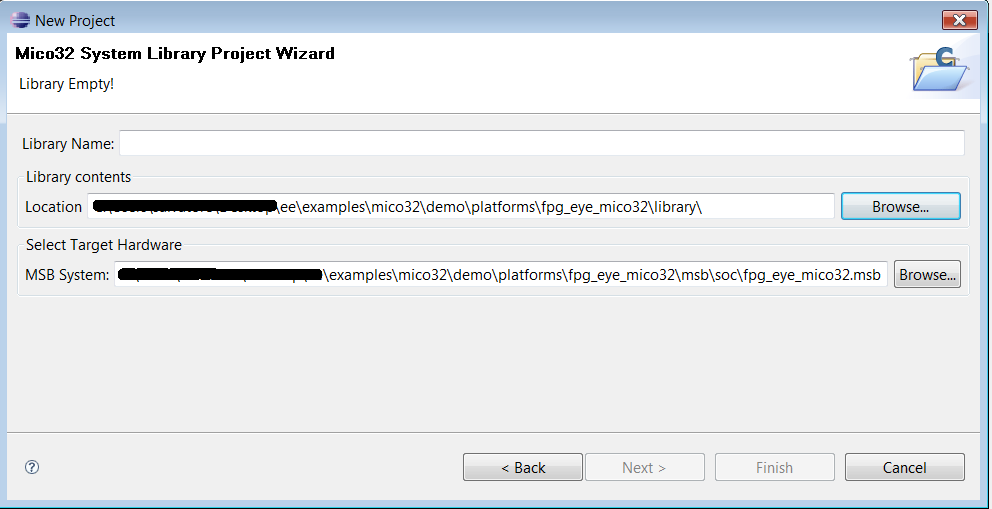](../files/File_Lib_fpg_eye_mico32_path.png--2180.md)

**C/C++** Mico32 System Library Project Wizard

and **fpg\_eye\_mico32** as project name:

[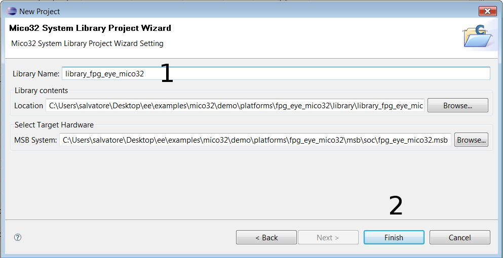](../files/File_Lib_fpg_eye_mico32_name.png--2181.md)

**C/C++** Mico32 System Library Project Wizard (Project name wrote)

Build the brand new project:

[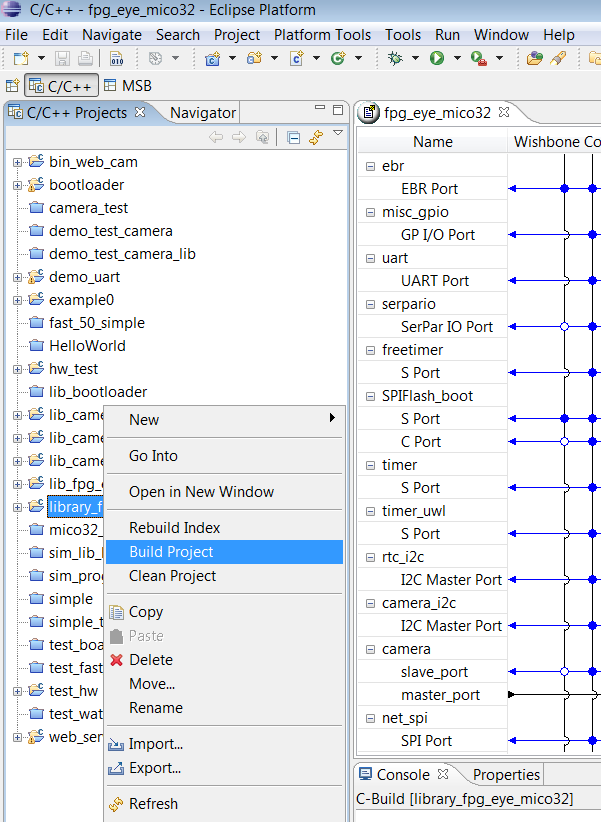](../files/File_Lib_fpg_eye_mico32_build.png--2182.md)

Compile the Mico32 library

<a id="Create_webserver_camera_demo_project"></a>

## Create webserver\_camera demo project

Create a *Mico32 Standard Make C Project* in **ee\examples\mico32\demo\sw\_projects\webserver\_camera** directory, and build it.

[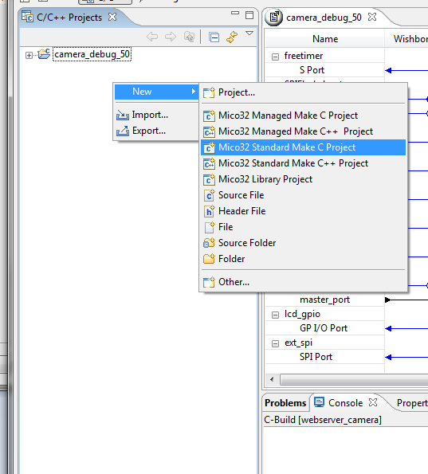](../files/File_New_mico32_standardmakec_.png--2120.md)

New C/C++ Mico32 Standard Make C Project

[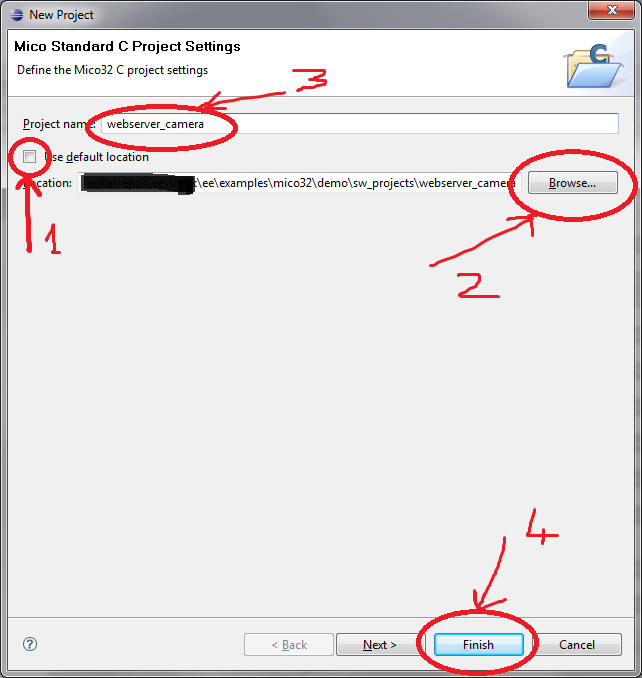](../files/File_Mico32_standardmakec_wizard.png--2119.md)

C/C++ Mico32 Standard Make C Project Wizard

```
 Please note that lm32-elf-objdump may fail with a segmentation fault. You can run make output/out.elf
 (where output is the output folder) instead of make all to avoid the execution of the objdump step.
```

<a id="Program_the_flash_with_send_prog.py_bootloader_script"></a>

## Program the flash with send\_prog.py bootloader script

Before flashing the application with send\_prog.py bootloader client script, you need to connect the FPG-EYE board with a serial cable too you computer. Use serial-to-usb coverter if required:

[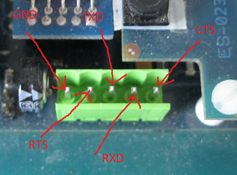](../files/File_Fpg-eye_connettore_seriale.png--2121.md)

FPG-EYE Board serial connector

[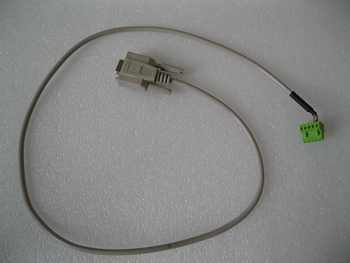](../files/File_Fpg-eye_cavo_seriale_custom.png--2122.md)

FPG-EYE custom serial cable

After connecting the board with serial cable, get the send\_prog.py script from [FPG-EYE Software Packet](../assets/linked/FPG-EYE_software_packet--117012d0f3aa1162.zip) and copy it in a directory under your cygwin environment path. Open a cygwin shell in webserver\_camera project directory output and execute the following command:

```
send_prog.py --flash /dev/comX out.elf
```

Note: Change the comX value to that of your actual com port value.

When the script is launched, it is not synchronized with the bootloader, and it should look like:

[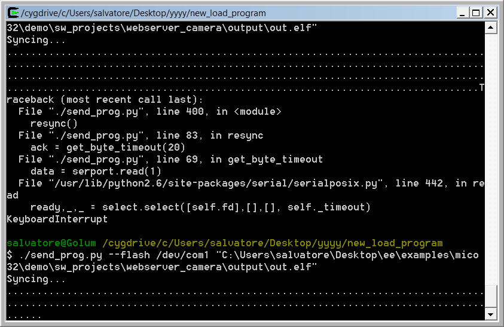](../files/File_FPG-EYE_bootloader-script_synchronization.png--2124.md)

Bootloader-script synchronization

To synchronize the script with the bootloader, hold down Button 1 and push the reset button.

[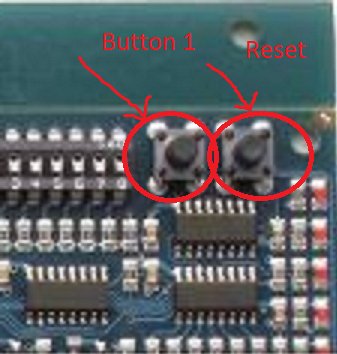](../files/File_FPG_EYE_Buttons.png--2123.md)

FPG-EYE Buttons

The application is saved on FPG\_EYE external flash as shown below, and the bootloader is ready to read and copy it in XP2 ram.

[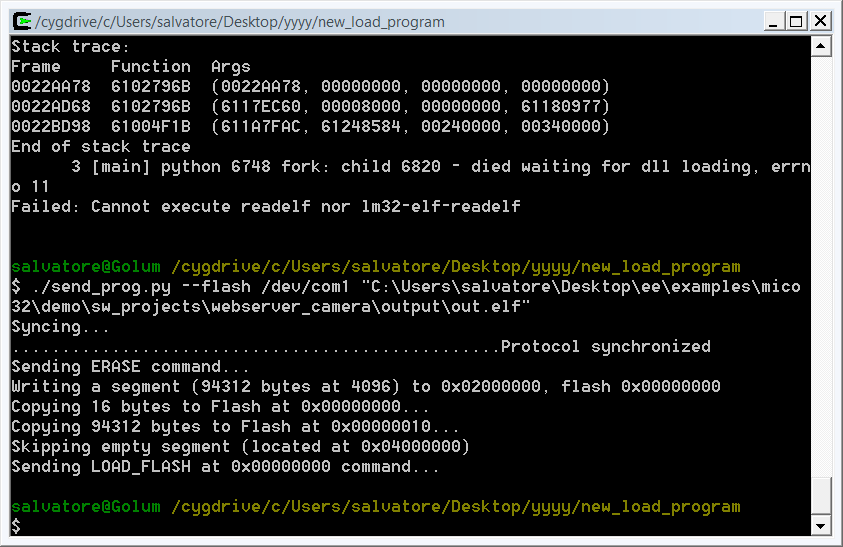](../files/File_FPG-EYE_FlashSuccess.png--2125.md)

FPG-EYE Application Flash Success

<a id="Test_webserver_camera_demo_application"></a>

## Test webserver\_camera demo application

Connect Ethernet cable to the FPG-EYE board. The webserver\_camera demo has ethernet address to 192.168.0.2. Change your local net address to the same subnet of the FPG-EYE board.

[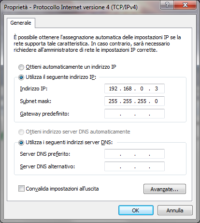](../files/File_How_change_ethernet_address.png--2126.md)

How Change LAN Address

Open a web browser window and type in the address bar **<http://192.168.0.2>**:

[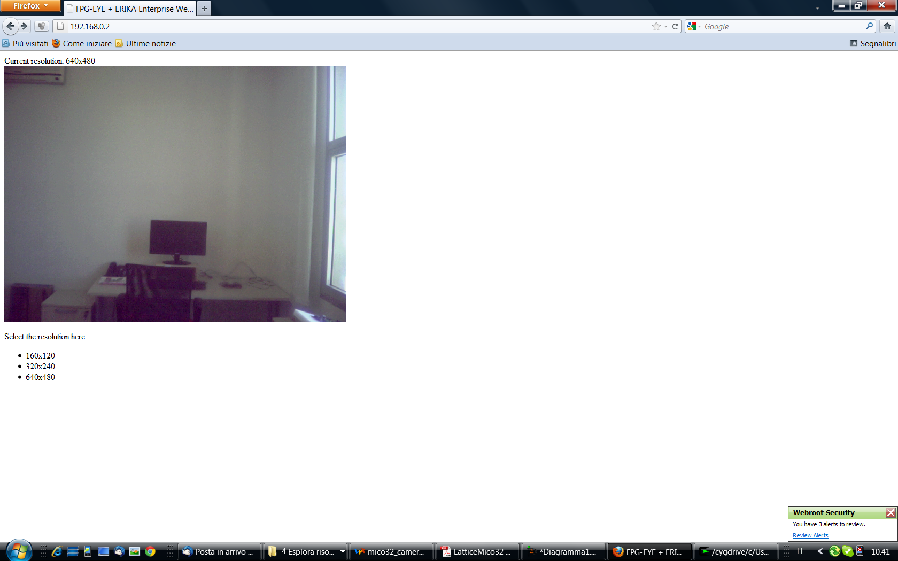](../files/File_Webserver_camera_demo_application.png--2127.md)

web\_server camera demo application screenshot

<a id="Test_demo_camera_application"></a>

## Test demo\_camera application

In the Erika repository you can find a application called *demo\_camera* more simpler than *web\_camera*. The demo uses the camera and the uart serial port without the ethernet interface. Its location, in the Erika repository, is as follows: */ee/examples/mico32/demo/sw\_projects/demo\_camera*.
To use this demo you have to follow the same steps described above about *web\_camera* application. The picture than you can downloading is in 640x480 b/w format. Once the program has been launched via *bootloader*, open *HyperTerminal* connection with 115200 bps, 8N1 (on the right serial port on your pc). Now a communications with the application is now possible. The program asks you if you want download the picture:

[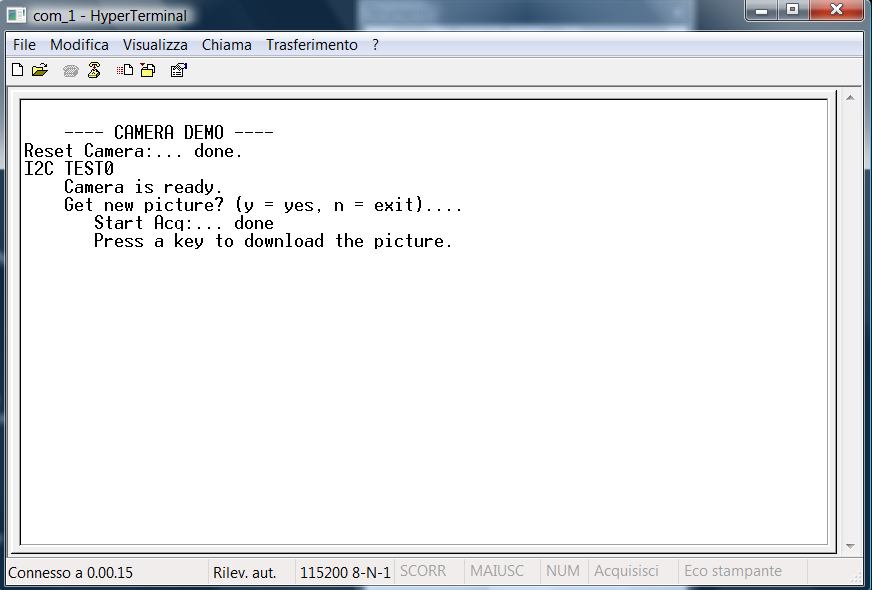](../files/File_Hyper_herminal_download_picture.png--2229.md)

*Press a key to download the picture*

Now click on *Text acquired...* in the *Transfer* menu voice.

[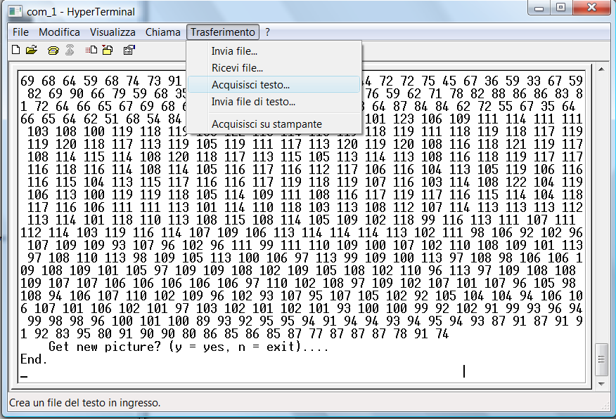](../files/File_Hyper_herminal_test_acquired.png--2227.md)

Please select *Text acquired...*

Now please select the place, in your file system, where you want storage the camera picture. Important: the file extension must be PMG!!! (something like this: <file\_name>.pmg).

[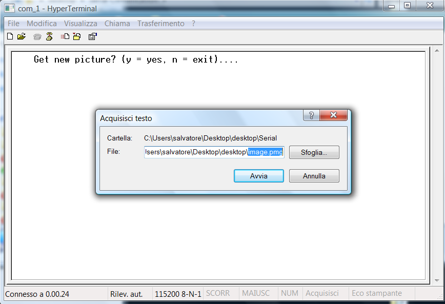](../files/File_Hyper_herminal_file_pmg.png--2228.md)

The file must has the PMG extension

After press any key on the keyboard, the picture downloading starts:

[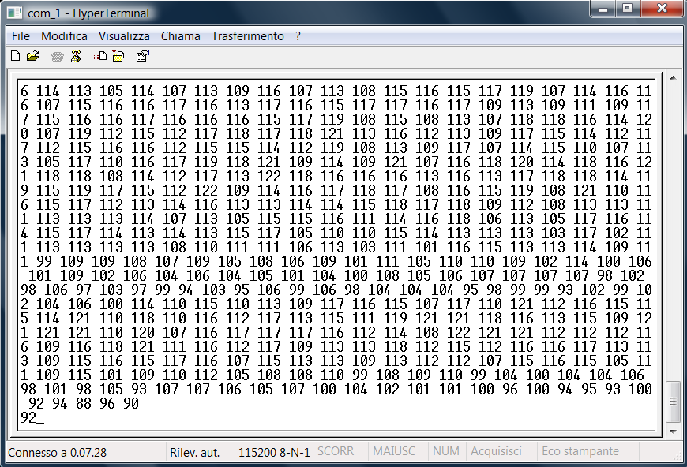](../files/File_Hyper_herminal_downloading.png--2230.md)

Picture downloading

At end of the downloading you can close the *Text acquired...*, and then with a program graphics open the picture (GIMP in this case):

[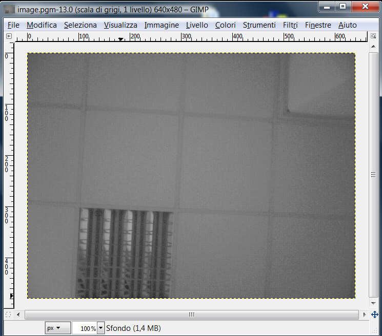](../files/File_Hyper_herminal_picture.png--2231.md)

Picture

If you're using Linux you not have available the program HyperTerminal. In this case you can use another good program called [*minicom*](http://alioth.debian.org/projects/minicom/). Minicom is a text-based modem control so, maybe, it's a bit more complicate to use than HyperTerminal. *Minicom* starts with the follow shell command (*sudo minicom*):

[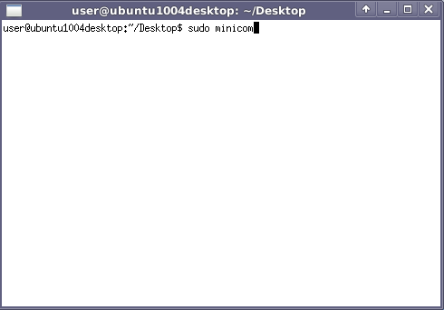](../files/File_Starting_minicom.png--2232.md)

*sudo minicom* on Desktop

After entering the password (evidence), *minicom* is ready to accept commands:

[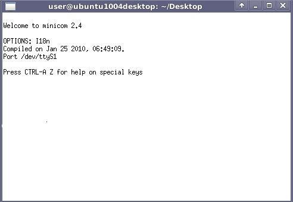](../files/File_Minicom.png--2233.md)

*minicom*

With *Ctrl-A* and *Z* the *Minicom* enters in menu configuration:

[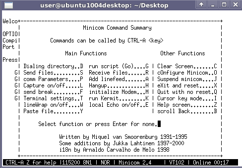](../files/File_Minicom_configure.png--2234.md)

*menu minicom*

Please press the *O* key for *cOnfigure minicom*:

[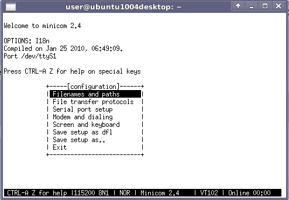](../files/File_Minicom_o_options.png--2235.md)

*cOnfigure minicom*

Now select the *serial port setup*:

[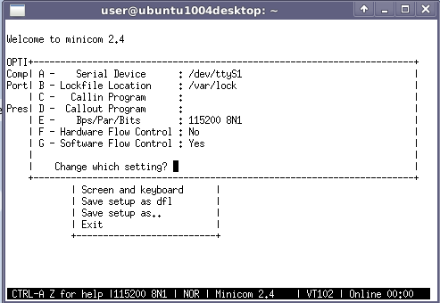](../files/File_Minicom_serial_port_setup.png--2236.md)

*serial port setup*

The *Bps/Par/Bits* must be value: *115200 8N1*, *Hardware Flow Control* value *No* and *Software Flow Control* value *Yes*. While for the *Serial Device* you have to see where your VM has connected to the serial port on your PC.

*Minicon* is configured and it is now possible to communicate with *fpg\_eye* application.

[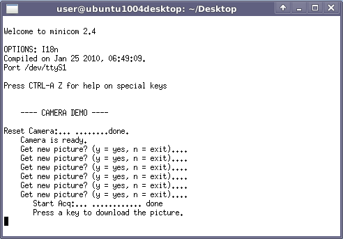](../files/File_Minicom_download_picture.png--2237.md)

*download picture*

To capture in the file the image, follow these steps. With *Ctrl-A* and *Z* the *Minicom* enters in menu configuration, then press the the *L* key (voice *Capture on/off .... L*).

[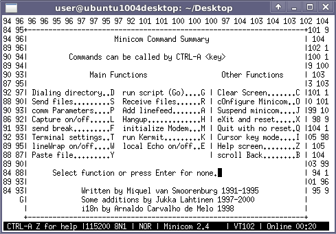](../files/File_Minicom_capture_on_off.png--2238.md)

*capture picture*

Now please the file name where you want storage the camera picture. Important: the file extension must be PMG!!! (something like this: <file\_name>.pmg).

[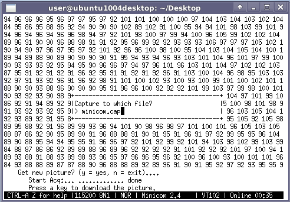](../files/File_Minicom_capture_which_file.png--2239.md)

*file name*

At end of the downloading you can close the *minicom*, and then with a program graphics open the picture (GIMP in this case):

[](../files/File_Hyper_herminal_picture.png--2231.md)

Picture

---

## Archive provenance

- [Original page](http://erika.tuxfamily.org/wiki/index.php?title=Tutorial%3A_Running_ERIKA_on_Mico32_and_FPG-EYE) · [Archived source revision 4375](http://erika.tuxfamily.org/wiki/index.php?oldid=4375)
- Last source edit: 2012-01-20T10:57:10Z. Source retrieved on 2026-11-06; Markdown conversion completed on 2026-11-07.
- Original contributors recorded in exported history: Eguidieri, Salva, Nicola.
- [Original MediaWiki source](../source/wikitext/2113.mediawiki) · [Original editing history](../source/history/batch-011.xml)
- [Attribution and licensing notice](../NOTICE.md). Original file-specific notices, where present, remain applicable.
