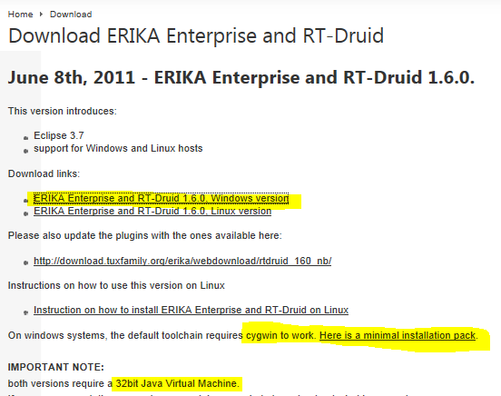
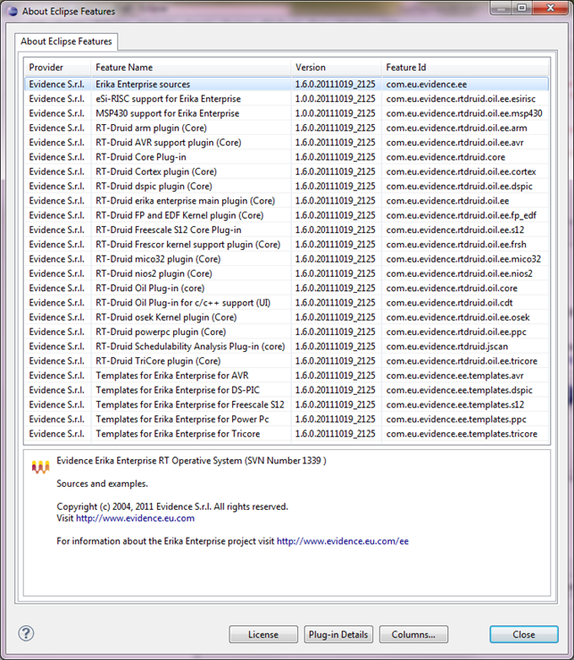
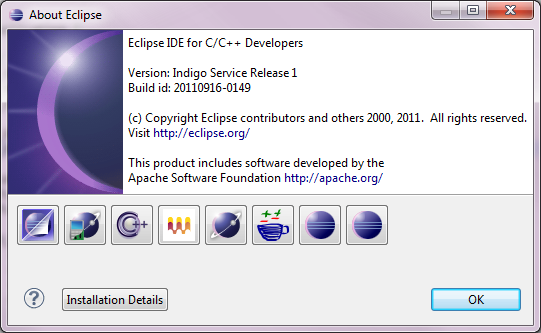
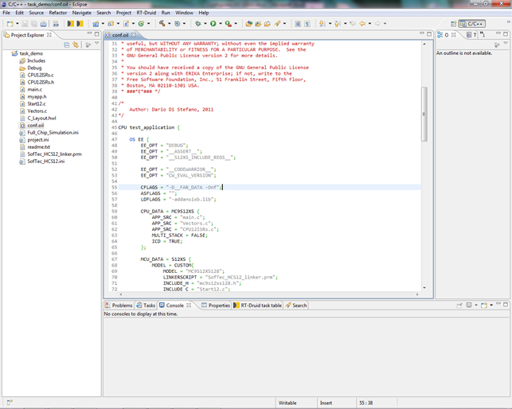
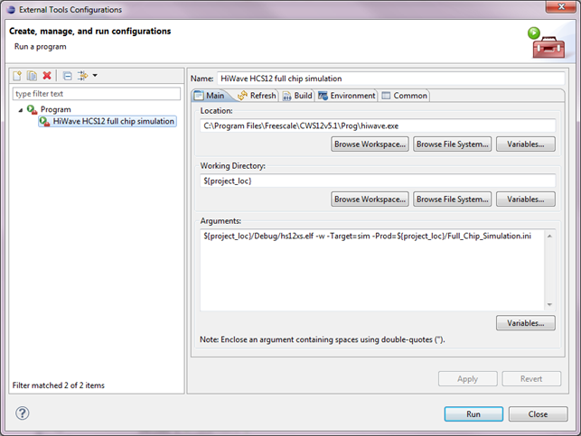
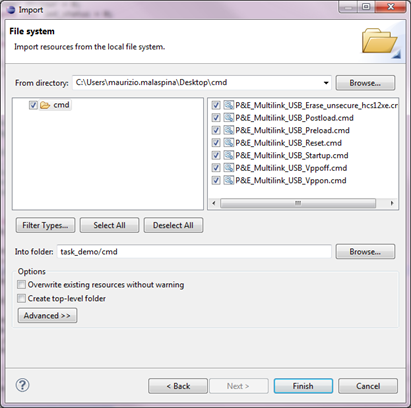
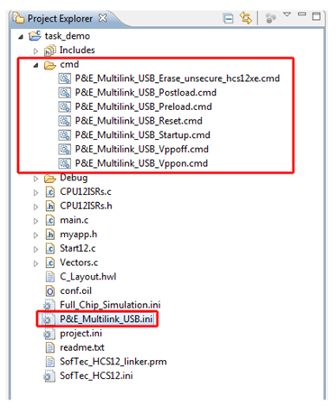
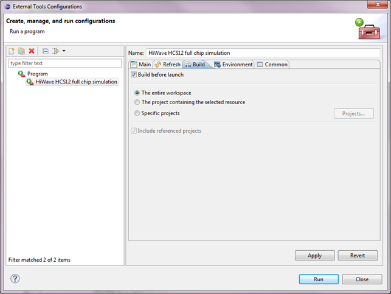

# Tutorial: S12XS - First installation and application compilation on Windows

<a id="Introduction"></a>

### Introduction

This small tutorial describes a set of steps needed to setup an Eclipse-based IDE for ERIKA targeted to Freescale MC9S12XS128 microcontroller.

A project for the DEMO9S12XSFAME evaluation board will be generated using the RT-Druid wizard.

In every way, at the end of this walk, you will be able to compile, link, and run your ERIKA application also on your custom hardware with a minimum effort, simply by remapping IO and peripherals.

<a id="Download_and_install_all_the_software"></a>

### Download and install all the software

Download the following softwares:

- **Java Virtual Machine 32 bit** (JRE package): link to italian version [[1]](http://www.java.com/it/download/).

*Note: the revision at the time of writing this tutorial was 1.6.0\_27 .*

```
 I suggest to visit www.java.com, your language will be automatically selected and you'll be able to download the proper version of the JVM.  
```

- **Erika enterprise and RT-Druid 1.6.0 Windows version** and **CYGWIN 1.7.9** following the links in the wiky [[2]](http://erika.tuxfamily.org/erika-for-multiple-devices.html), as shown in the following picture:

[](../files/File_Img1.png--2215.md)

This screenshot shows an extract of the "Download ERIKA Enterprise and RT-Druid" page.

Use the following installation paths (where 'C' is the example hard disk identifier):

```
   - For CYGWIN package: “C:\cygwin” 
   - For Eclipse with RT-Druid plugin: save all the package into the path “C:\Evidence\eclipse”, so that the main executable file "eclipse.exe" will be located in the pathname “C:\Evidence\eclipse\eclipse.exe".
```

- **Update RT-Druid plugin** following the instructions in this links [[3]](Tutorial_Update_ERIKA_and_RT-Druid--2049.md).

At the end of the updating process it's important to verify that the installed RT-Druid version will match with the 1.6.0.20111019\_2125 one or following as shown in the following picture (from the Eclipse IDE menu: "Help" -> "About Eclipse", click on "Evidence S.r.l." icon, the 4th starting from the left):

[](../files/File_Img2.png--2216.md)

...

- **Update Eclipse** acting on the menu "Help" -> "Check for updates".

At the end of the updating process verify that the installed RT-Druid version will match with the following or a more recent release (from the Eclipse IDE menu: "Help" -> "About Eclipse"):

[](../files/File_Img3.png--2217.md)

...

- Download and install **Freescale CodeWarrior Special Edition HCS12(X) Microcontrollers (Classic)**

rev. 5.1 **[[4]](http://www.freescale.com/webapp/sps/site/overview.jsp?code=CW_SPECIALEDITIONS).**

Use the following installation path: “C:\Program Files\Freescale\CWS12v5.1” and perform all the suggested updates.

- **Setup the paths** typing the installation paths.

From Eclipse "Windows -> Preferences -> Rt-Druid -> ..."

```
   - "Cygwin paths": i.e. "C:\cygwin\"
   - “Oil -> Freescale S12”: “C:\Program Files\Freescale\CWS12v5.1” (*)
```

*(\*)* Despite of the field is referenced as "Cosmic Compiler Path", RT-Druid will automatically detect the installed CodeWarrior, generating the proper symbols in the source code, in order to make the right conditional compilation.

Last, restart the PC and install the eventually proposed updates by Eclipse.

<a id="Setup_a_project_for_Freescale_MC9S12XS128"></a>

### Setup a project for Freescale MC9S12XS128

The main informations are stored in this page [[5]](Freescale_S12--1478.md#Download_and_install)
that link to this example [[6]](A_quick_tutorial_on_how_to_create_compile_and_debug_an_application_for_Freescale_S12XS--1520.md).

**Important note:** in order to use CodeWarrior SPECIAL EDITION it's necessary to manually define a symbol in the **conf.oil** file inside the created project. Follow this tutorial [[7]](Freescale_S12--1478.md) to understand how-to.

So define:

```
   EE_OPT = "CW_EVAL_VERSION";
```

immediately after

```
   EE_OPT = "__CODEWARRIOR__";
```

[](../files/File_Img4.png--2218.md)

...

(this will take into account the number of steps the compiler will perform, by eventually managing the generation of symbols such as the intermediate result at compile time).

<a id="Automating_the_external_HIWAVE_debugger_invocation"></a>

### Automating the external HIWAVE debugger invocation

- **Creating a new debugging profile.**

In the Eclipse menu, select “Run” -> “External Tools” -> “External Tools Configurations”, the "External Tools
Configurations” form will appear.

Create a new external debug configuration (HIWAVE) by clicking on the the button labeled "New launch configuration", located on the top-left.

Compile the fields as shown in the following picture to define the "Full chip simulation" profile:

[](../files/File_Img5.png--2219.md)

...

- A complete description on how to define three different debugging profiles modifying the "Arguments" field, follows:

1. **Full chip simulation** profile:

```
   ${project_loc}/Debug/hs12xs.elf -w -Target=sim -Prod=${project_loc}/Full_Chip_Simulation.ini
```

- “hs12xs.elf” it's the binary file built by the linker
- “-w” (Wait mode) it doesn't automatically run the program as soon as the debugger starts
- “-Target=sim” indicate the “Full chip simulation”
- “-Prod==${project\_loc}/Full\_Chip\_Simulation.ini” the startup project is Full\_Chip\_Simulation.ini (the configuration file produced by RT-Druid during the project generation process. It indicates the type of uC and its internal resources)

2. **Softech USB debugger** [[8]](http://www.smh-tech.com/site/products/indart-one.html) profile:

```
   ${project_loc}/Debug/hs12xs.elf -w -Prod=${project_loc}/SofTec_HCS12.ini -instance=softec
```

**IMPORTANT NOTE:** Softech's products aren't compatible with Windows Seven at the moment.

3. **P&E Multilink USB debugger** [[9]](http://www.pemicro.com/products/product_viewDetails.cfm?product_id=33&CFID=7628593&CFTOKEN=6c03f755af165928-58F8AE84-E829-B991-561544CCA769865B) profile:

```
   ${project_loc}/Debug/hs12xs.elf -w -Prod=${project_loc}/P&E_Multilink_USB.ini -instance=icd12
```

To use this HW it's necessary to generate a set of files needed to manage it. After they will be imported inside the RT-Druid project.
In order to reach the goal, launch CodeWarrior and generate a new project: "File -> New project".
In the dialog box opening, select "MC9S12XS128" as device and "P&E USB BDM Multilink" as default connection. Go ahead to the end of the wizard, without any change to the default settings.
Both “P&E\_Multilink\_USB.ini” and the "cmd" directory have to be imported in the project, inside Elipse IDE.
"cmd" contains a set of files with ".cmd" extension that are invoked as batch by HIWAVE, as described in the .ini content (really the only one command file not empty is “P&E\_Multilink\_USB\_Erase\_unsecure\_hcs12xe.cmd”).
In order to import these files in the project is necessary, first of all, to create a new folder inside the Eclipse project and rename it as "cmd" (right click on the root of the project in project explorer). Then from the Eclipse menu "File" -> "Import", in the next form "General" -> "File system" then set all the parameters as shown in the following picture (the field "From directory" has to reference to the "cmd" directory inside the ad-hoc created project with CodeWarrior):

[](../files/File_Img6.png--2220.md)

...

Repeat the same import operation for the .ini file that has to be imported in the project.
The final result should be as in the following picture:

[](../files/File_Img7.png--2221.md)

...

**IMPORTANT NOTE:** Only P&E Multilink USB rev. C is Windows Seven compatible. The device drivers could be downloaded here [[10]](http://www.pemicro.com/products/product_viewDetails.cfm?product_id=33&CFID=7628593&CFTOKEN=6).

**Windows seven workaround:** in the case you haven't got a P&E Multilink USB BDM rev. C, it's possible use it the same after installing a Win XP virtual machine in wich configure and run the development environment, as described in this document.

It's normally convenient to make a build of the project before launch the debugger. This behaviour is settable by configuring the "build" sheet as shown in the following picture:

[](../files/File_Img8.png--2222.md)

...

Finally, start debugging simply by clicking on the highlighted icon (see picture below) in the application bar!

[](../files/File_Img9.png--2223.md)

...

**NOTE:** So that the parameters passage will correctly happen, it's necessary that the main folder of the project has been selected in the project tree (because the evaluation of the environment variables for the launch of the external tools by Eclipse is performed on the basis of the currently selected object in the IDE).

---

## Archive provenance

- [Original page](http://erika.tuxfamily.org/wiki/index.php?title=Tutorial%3A_S12XS_-_First_installation_and_application_compilation_on_Windows) · [Archived source revision 4279](http://erika.tuxfamily.org/wiki/index.php?oldid=4279)
- Last source edit: 2012-01-09T15:52:36Z. Source retrieved on 2026-11-06; Markdown conversion completed on 2026-11-07.
- Original contributors recorded in exported history: Maurizio Malaspina.
- [Original MediaWiki source](../source/wikitext/2214.mediawiki) · [Original editing history](../source/history/batch-011.xml)
- [Attribution and licensing notice](../NOTICE.md). Original file-specific notices, where present, remain applicable.
