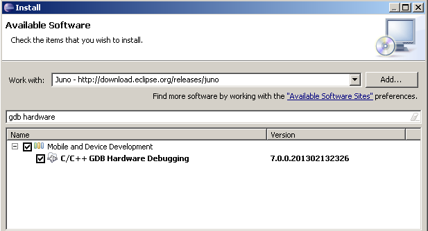
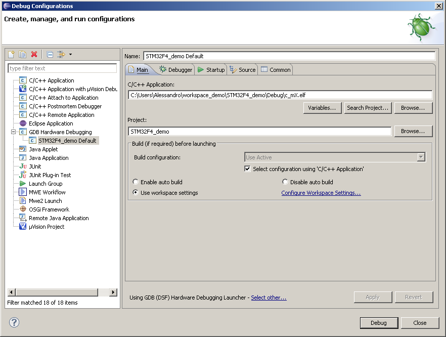
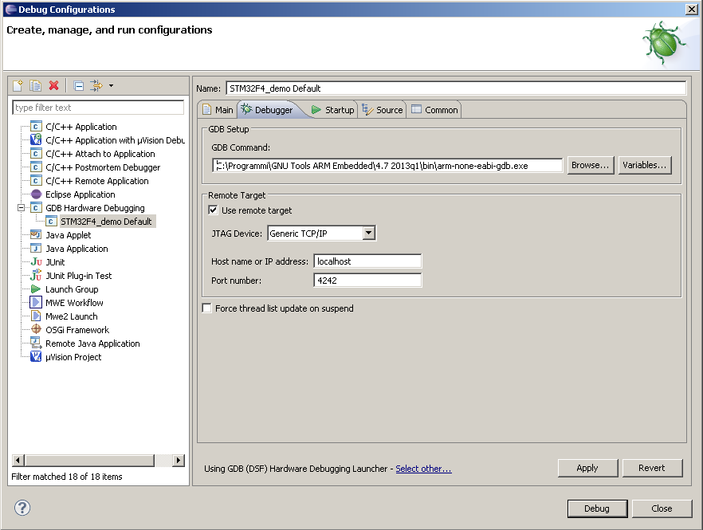
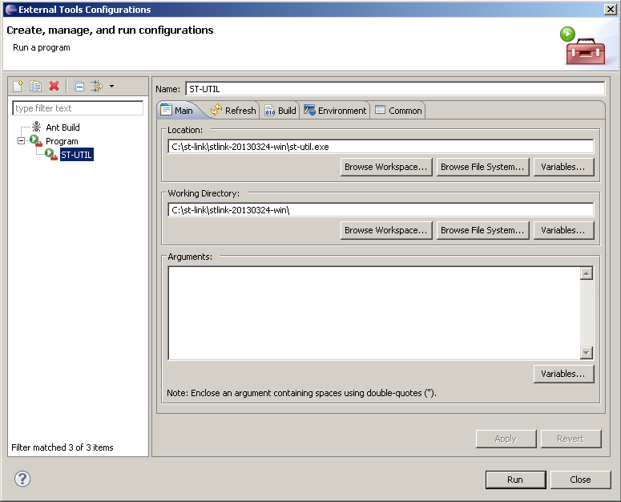
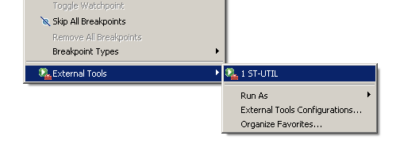
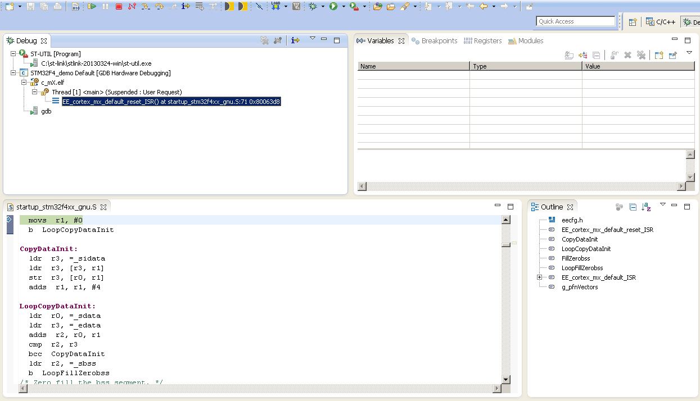

# Tutorial: STM32 - Integrated Debugging in Eclipse using GNU toolchain

## Introduction

This small tutorial describes the steps needed to configure the integrated Eclipse debugger for the ST DiscoveryF4 platform.
The ST DiscoveryF4 has an on-board debugger and programmer called ST-LINK/V2 which translates USB commands sent by the host PC into JTAG/SWD commands for the STM32F4 microcontroller.

The following steps have been tested on Microsoft Windows XP and Ubuntu 13.04 using the package ERIKA Enterprise and RT-Druid 2.1.0 (based on Eclipse Juno).

## Prerequisites

Before proceeding with the Eclipse configuration it must be necessary to setup a GDB server for the ST-LINK/V2.
There exist various alternatives concerning GDB servers for ST-LINK/V2: we consider to use the [Texane ST-UTIL](https://github.com/texane/stlink) since the tool is available under different operating systems and it is very simple to use it.

In the following we report the setup instructions depending on your operating system.

#### Microsoft Windows

First of all, you have to download ad install the [ST-LINK/V2 USB driver](http://www.st.com/web/en/catalog/tools/PF258167) and [STM32 ST-LINK Utility](http://www.st.com/web/en/catalog/tools/PF258168).

At [this page](http://www.emb4fun.de/archive/stlink/index.html) is provided a compiled version of Texane ST-UTIL for Windows, however it is possibile to compile Texane ST-UTIL using an environment like Cygwin.

#### Linux (Debian based)

Please follow [this](http://startingelectronics.com/tutorials/STM32-microcontrollers/programming-STM32-flash-in-Linux/) guide to setup Texane ST-UTIL.

#### MAC OSX

Please follow [this](http://cu.rious.org/make/getting-stlink-to-work-on-mac-os-x-with-macports/) guide to setup Texane ST-UTIL.

## Install GDB Hardware Debugging in Eclipse

Once opened Eclipse, click on **Help -> Install new software** from the main menu.
Then select *Juno - <http://download.eclipse.org/releases/juno>* from the **Work with** field and type "*gdb hardware*" in the search field in order to find the **GDB Hardware Debugging** package.

This screenshot shows how to install the GDB Hardware Debugging in Eclipse Juno.

Select the **GDB Hardware Debugging** package and click Next to install it.

## Create a Debug Configuration

To connect the Eclipse debugger with the ST-LINK/V2 GDB server it is necessary to create a Debug Configuration.
Such Debug Configuration has to be stricly linked to a project of the current workspace.

Please execute the following steps:

- To create a new Debug Configuration click on **Run -> Debug Configurations** from the main menu. Then double-click on **GDB Hardware Debugging**.

- In the **C/C++ Application** field select the elf file from the Debug folder of your project (the default filename is c\_mX.elf).

- Select the project to debug in the **Project** filed.

This screenshot shows how to configure the eclipse debugger for STM32F4.

- Click on Debugger under the name of the configuration. Specify your path for GDB (not the x86 version, but the ARM version) in the **GDB Command** field.

- Enable the checkbox **Use remote target** and specify 4242 as **Port Number** in the Remote target section. This port number is the default listening port for Texane ST-UTIL, you can change it using the *-p* command-line parameter.

This screenshot shows how to configure the eclipse debugger for STM32F4.

- Click on **Apply** to store the configuration.

## Launch ST-UTIL from Eclipse

The ST-UTIL GDB Server can be easily launched from a console but can be comfortable being able to launch it directly from Eclipse.

Click on **Run->External Tools->External tools configurations** from the main menu.
Then select your path for the ST-UTIL executable in the **Location** field.

This screenshot shows how to configure ST-UTIL as an external tool in Eclipse.

Now is possibile to launch ST-UTIL from **Run->External Tools** in the main menu.

This screenshot shows how to launch ST-UTIL as an external tool in Eclipse.

## Let's start debugging

First of all you to launch ST-UTIL as explained in the previous section.

Then click on **Run->Debug configurations** from the main menu and select your configuration under GDB Hardware Debugging.

Now you can start to debug by clicking on the **Debug** button.

This screenshot shows how to launch ST-UTIL as an external tool in Eclipse.

---

## Archive provenance

- [Original page](http://erika.tuxfamily.org/wiki/index.php?title=Tutorial%3A_STM32_-_Integrated_Debugging_in_Eclipse_using_GNU_toolchain) · [Archived source revision 5474](http://erika.tuxfamily.org/wiki/index.php?oldid=5474)
- Last source edit: 2013-09-13T14:42:53Z. Source retrieved on 2026-11-06; Markdown conversion completed on 2026-11-07.
- Original contributors recorded in exported history: Alessandro Biondi.
- [Original MediaWiki source](../source/wikitext/2459.mediawiki) · [Original editing history](../source/history/batch-011.xml)
- [Attribution and licensing notice](../NOTICE.md). Original file-specific notices, where present, remain applicable.
