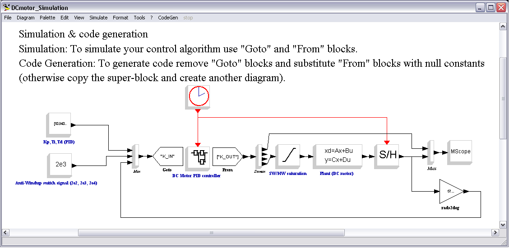
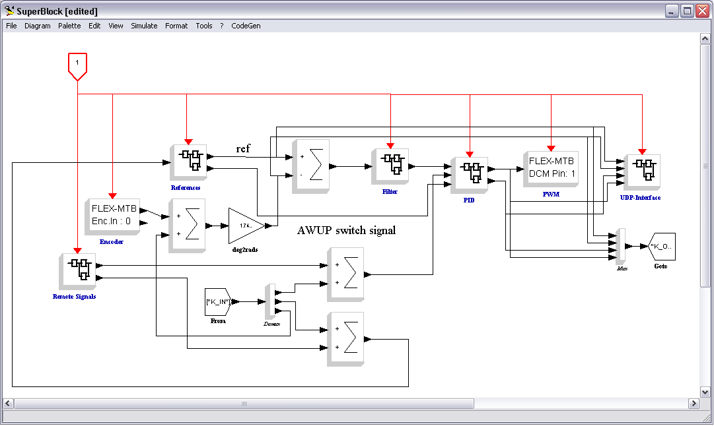
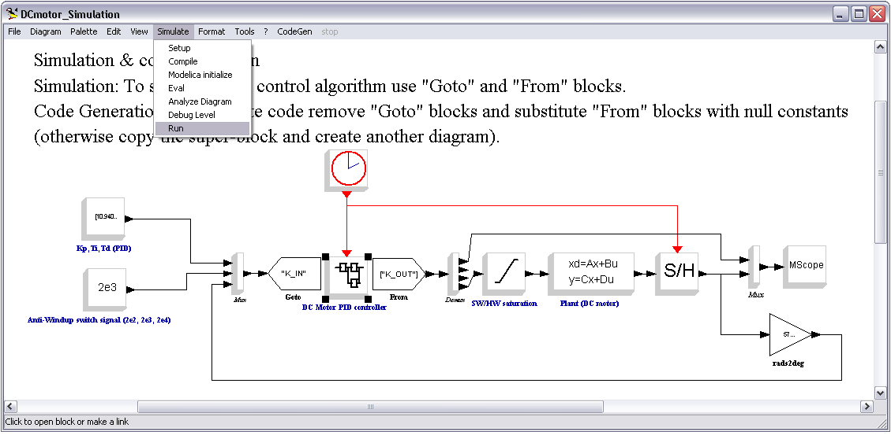
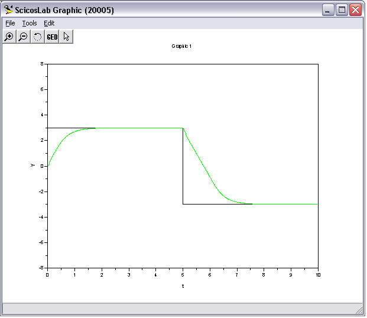
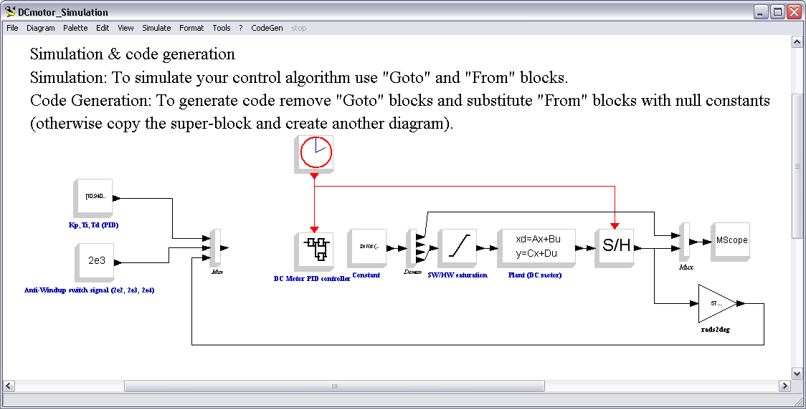
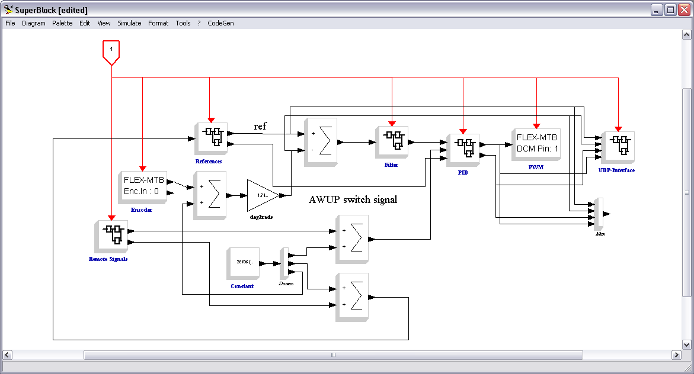
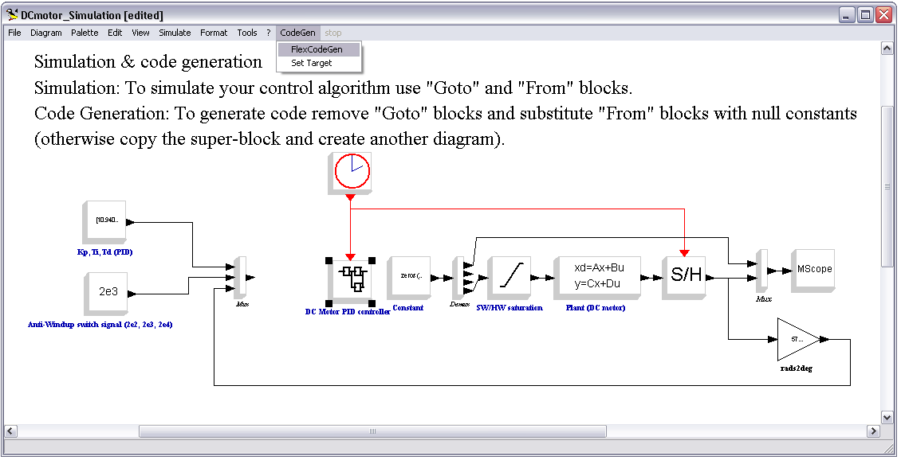

# Tutorial: Simulate and then generating code from a Scicos diagram

## Introduction

Before execute this simple tutorial follow installation procedure described in  [installig scicoslab tutorial](Tutorial_Installing_scicoslab_and_generating_code_from_a_Scicos_diagram--1428.md#Scicoslab_4.4.1_and_ScicosLab_Pack_10.0:_code_generator_for_FLEX_-_Installation_procedure "Tutorial: Installing scicoslab and generating code from a Scicos diagram")

## How to simulate and then generating code from a Scicos diagram

Note: The images showed below refer to the example for FLEX named DCmotor\_Simulation.cos in the 'DCMotor' folder.

To simulate a diagram and then use the same diagram to generate code is advisable to proceed in this way.

- Create your diagram using a superblock that contains the diagram of your embedded application.
- Outside the superblock put your simulation blocks.
- To link the outer blocks with the inner blocks you can use Goto and From blocks.

See the images below.

Outer blocks.

Inner blocks.

By clicking on Simulate menu and selecting Run you can start the simulation. In this case you obtain the graph showed below.

To start the simulation.

Results of the simulation.

To generate code there are two ways:

1. Copy the superblock and create another diagram to be used for code generation.
2. Remove Goto blocks and substitute From blocks with zero-constants source blocks.

The second approach is showed in the images below.

Outer blocks.

Inner blocks.

From the CodeGen menu, by clicking on the superblock, you can launch code generation.

Outer blocks.

---

## Archive provenance

- [Original page](http://erika.tuxfamily.org/wiki/index.php?title=Tutorial%3A_Simulate_and_then_generating_code_from_a_Scicos_diagram) · [Archived source revision 4129](http://erika.tuxfamily.org/wiki/index.php?oldid=4129)
- Last source edit: 2011-11-10T15:01:01Z. Source retrieved on 2026-11-06; Markdown conversion completed on 2026-11-07.
- Original contributors recorded in exported history: Erikadds.
- [Original MediaWiki source](../source/wikitext/2184.mediawiki) · [Original editing history](../source/history/batch-012.xml)
- [Attribution and licensing notice](../NOTICE.md). Original file-specific notices, where present, remain applicable.
