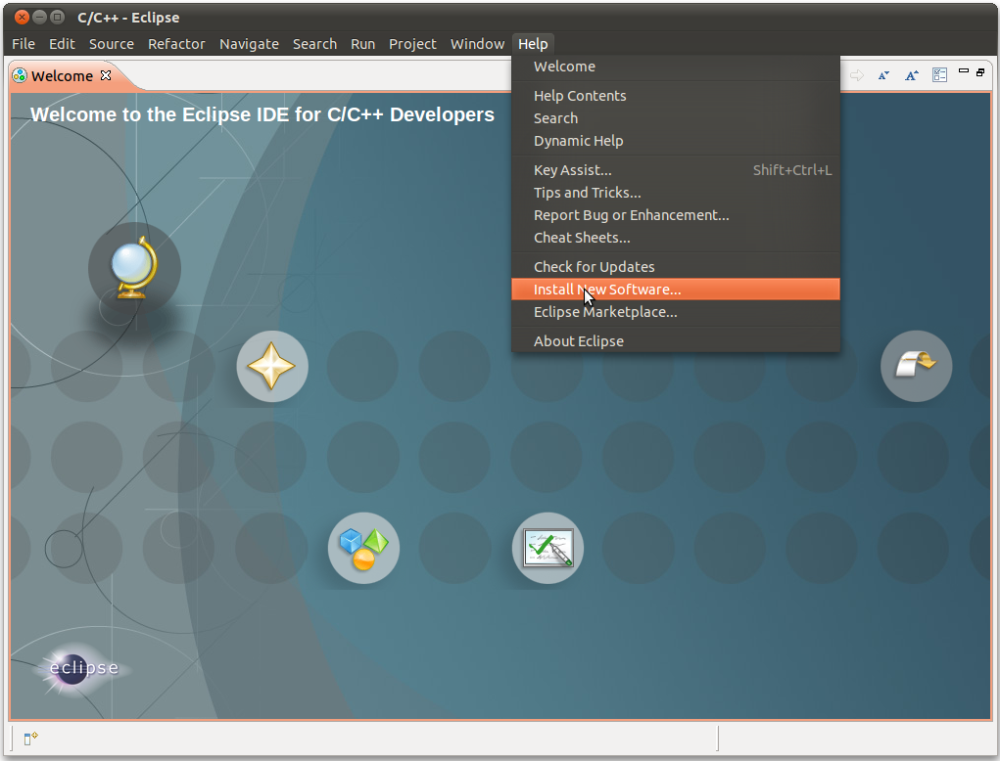
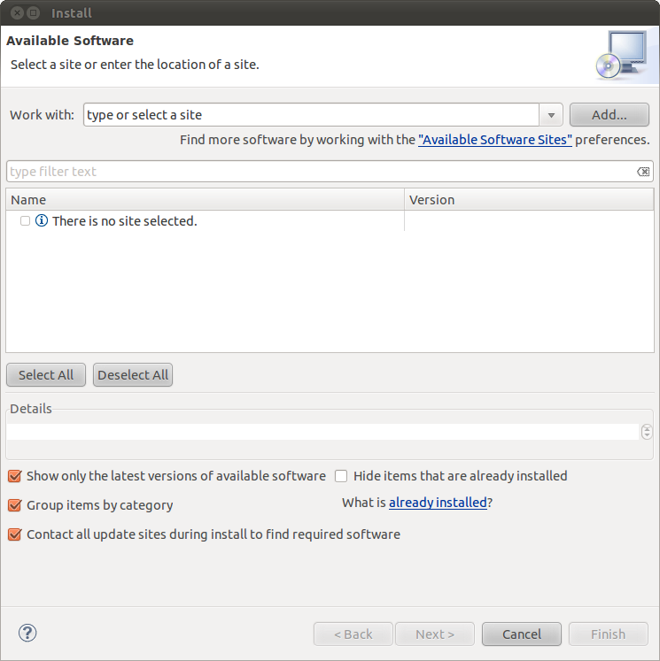
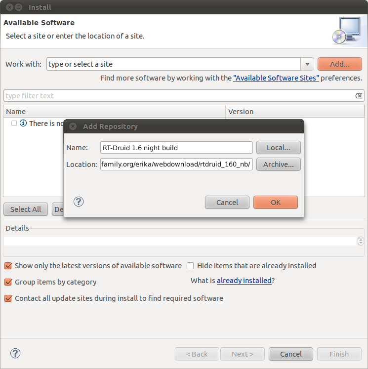
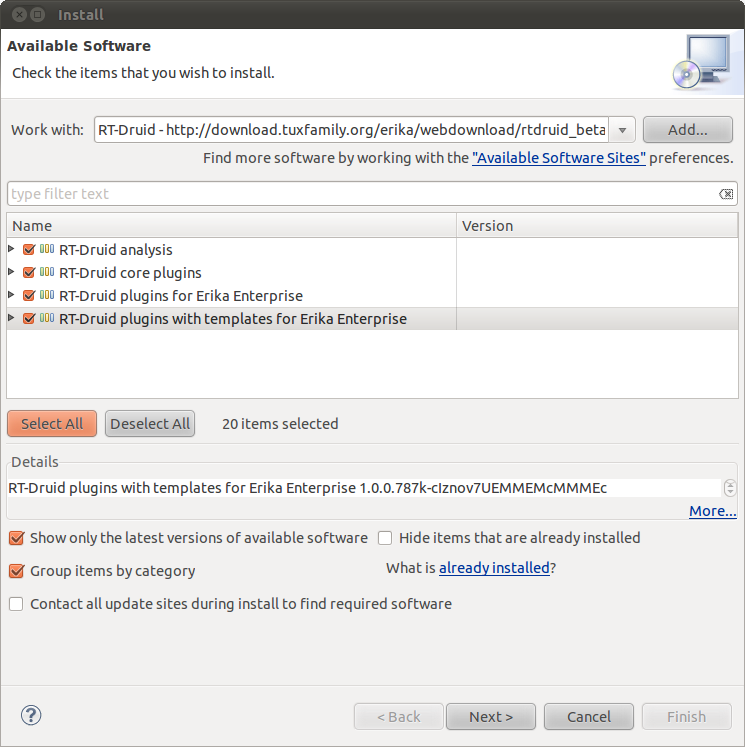

# Tutorial: Update ERIKA and RT-Druid

### Update Eclipse plugins

The update of RT-Druid and Erika plugins is done through eclipse standards update technologies.

To enable the updates of RT-Druid and its related distribution of Erika Enterprise select "Help -> Install New Software"

This screenshot shows how to select the "New Install Software".

In the "Install" window

This screenshot shows the Eclipse "Install" window.

  

The first time you update RT-Druid plugins, you need to select add and enter a reference name for the file repository (e.g. RT-Druid) and the link to the latest version:  
<http://www.evidence.eu.com/erika-builds/ee_240/rtdruid_240_nb/> and then select *OK*.

This screenshot shows the Eclipse "Add Repository" window with the correct parameters.

  

If you have already added the reference to the RT-Druid website, you can select it in the "Work with" box.  
If everything is fine, you will see the list of available plugins and then select all new RT-Druid plugins (or at least what you need).
To speedup the update process you can deselect the option "Contact all site during install to find required software".

This screenshot shows the Eclipse "Install" window with the correct parameters.

Along the update process you may be prompted for a "Security Warning" simply click on "Ok" to continue with the process.
Finally please restart Eclipse when asked by the installer.

For more links to RT-Druid and Erika websites, check <http://erika.tuxfamily.org/erika-for-multiple-devices.html>.

### Upgrading issues

RT-Druid 1.5.1 and newer are able to handle all version of eclipse from 3.3, while versions before 1.5.1 works only with eclipse 3.3 and eclipse 3.4.
Note that project created with eclipse 3.3 and 3.4 may have incompatibilities with the CDT present in the newer versions of eclipse. Moreover versions of RT-Druid older than 1.5 requires
evidencedir\bin\mymake\_cygwin.bat to run make through cygwin. This means that moving a project from an old installation to a new one "mymake\_cygwin.bat" may not exist or be in another position. To reduce this problem, RT-Druid 1.5.1 (and later) generates an equivalent file (called mymake.bat) inside the project itself with the right content for windows and for linux.

The easiest and safest way to update an old project to a new one, is to create a new project, move/copy all files in the new project and, if necessary, update project properties.

---

## Archive provenance

- [Original page](http://erika.tuxfamily.org/wiki/index.php?title=Tutorial%3A_Update_ERIKA_and_RT-Druid) · [Archived source revision 5644](http://erika.tuxfamily.org/wiki/index.php?oldid=5644)
- Last source edit: 2014-07-10T20:55:22Z. Source retrieved on 2026-11-06; Markdown conversion completed on 2026-11-07.
- Original contributors recorded in exported history: Nicola, Outlawch, Alessandro Biondi.
- [Original MediaWiki source](../source/wikitext/2049.mediawiki) · [Original editing history](../source/history/batch-012.xml)
- [Attribution and licensing notice](../NOTICE.md). Original file-specific notices, where present, remain applicable.
