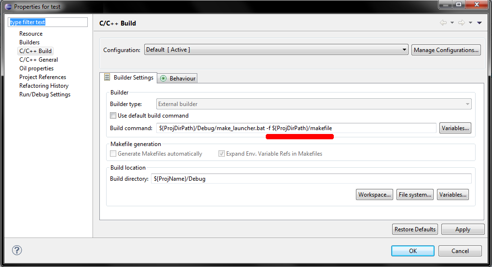

# Tutorial: Use a customized makefile

Here is some hint about write and use a customized makefile to compile erika.

<a id="Build_from_command_line"></a>

### Build from command line

Building erika from command line is just invoke make on the right makefile:

```
make -f path/makefile
```

or just *make* if you are in the same directory where the *makefile* file is located.

<a id="Build_inside_eclipse_environment"></a>

### Build inside eclipse environment

It is possible to use a customized makefile to build erika inside eclipse; to do that you need

1. write your own makefile file and place it inside the project to build
2. change project properties in order to use that makefile file

The first step can be easily achieved creating a new file from eclipse menu and editing it with eclipse editor.

To do the second step, open project properties (right clicking the project name and selecting the item  *properties*) and select the tab "C/C++ Build".   
Supposing the makefile file is placed in the project root, you should add "-f ${ProjDriPath}/makefile" to "build command" text box.

[](../files/File_Tutorial_proj_prop_add_custom_makefile.png--2053.md)

This screenshot shows where set the customized makefile file path.

In this way you ask make\_launcher.bat script to use your file. Note that *{ProjDirPath}* is a variable replaced by eclipse with the actual absolute path of the project.  
We suggest to do it in this way, because it allow you to move the location of your project and even change OS, without any change but just recompiling it.

- Note that *Build command* position may change a little on old version of eclipse.

After this two steps, every time you build your project, your makefile file is used.  
Note that RT-Druid will still try to configure the project, before the execution of make command. It is possible to enable/disable it, [de]selecting the RT-Druid builder in the Builders tab of project properties.

---

## Archive provenance

- [Original page](http://erika.tuxfamily.org/wiki/index.php?title=Tutorial%3A_Use_a_customized_makefile) · [Archived source revision 4719](http://erika.tuxfamily.org/wiki/index.php?oldid=4719)
- Last source edit: 2012-03-29T09:34:15Z. Source retrieved on 2026-11-06; Markdown conversion completed on 2026-11-07.
- Original contributors recorded in exported history: Nicola.
- [Original MediaWiki source](../source/wikitext/2051.mediawiki) · [Original editing history](../source/history/batch-012.xml)
- [Attribution and licensing notice](../NOTICE.md). Original file-specific notices, where present, remain applicable.
