# USB communication using FLEX FULL Demo Board and the Scilab/Scicos code generator

## USB Application

**DEMO BOARD: An example of USB-UDP communication with the FLEX Demo Daughter Board**

Prerequisites:

- ScicosLab v4.4.1
- ScicosLab Pack v10.0
- RT-Druid 1.6.0 (only if ScicosLab pack v9.3 or earlier is used)
- Cygwin (with libusb-win32)
- PIC18 USB driver for Windows
- A FLEX full base board and the DEMO daughter board

Note: To use USB communication you need a daughter board. If you don't have a daughter board, the only way to establish a connection between dsPIC and PIC18, is to make some connections manually as shown [here](FLEX_Demo_Daughter_Board--1604.md).

Step 1:

- Open ScicosLab v4.4.1, the Scicos-FLEX pack is recognized by ScicosLab (refer Fig. 1).

Change the working directory to “C:\Programmi\scilab\scicoslab-4.4.1\contrib\scicos\_ee\scicos\_flex\dspic”.

Type exec builder.sce to build any application of the pack.

[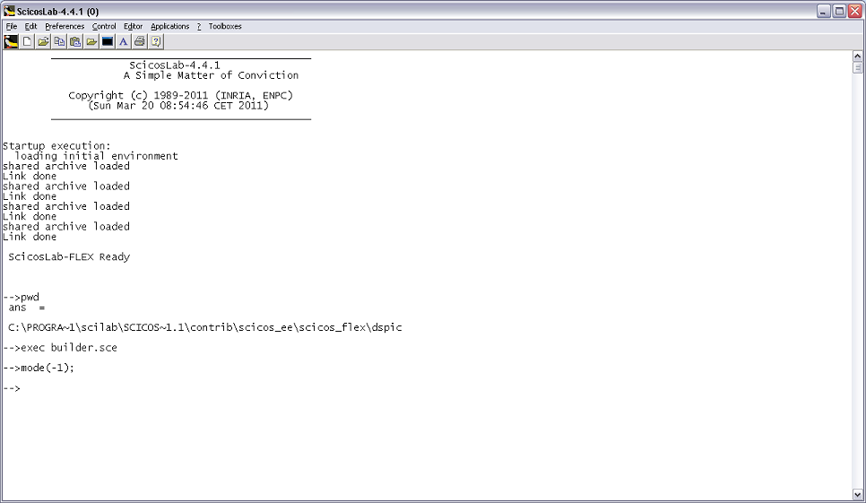](../files/File_Scilab.png--1571.md)

Figure 1 – ScicosLab

Step 2:

- Open file “demoboard\_example\_flexside.cos” (refer Fig. 2) in Scicos.

The .cos file is shown in Fig. 3 and contains the schematic for the generation

(with SCICOS) of the FLEX FULL board program.

- With this application the FLEX FULL board is able to:
  1. acquire data from the accelerometer and from the light sensor
  2. send the measures to a PC using the USB interface
  3. receive and display the USB data on the LCD screen
  4. perform elaborations for a pretty LEDs blinking

[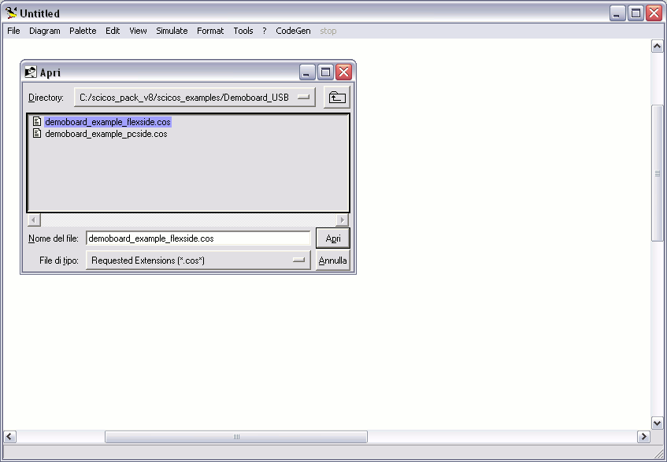](../files/File_Flexside_openfile.png--1572.md)

Figure 2 – Open the demo file

[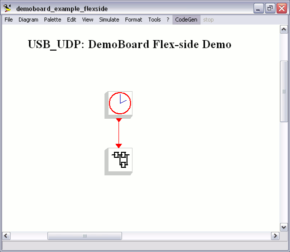](../files/File_Flexside_scheme.png--1573.md)

Figure 3 – Schematic

Step 3:

- Click menu CodeGen and select FlexCodeGen (refer Fig. 3)

Click on the super-block, the Embedded Code Generator's block property settings

window will appear (refer Fig. 4)

Provide path name and then press OK for code generation (refer Fig. 5)

[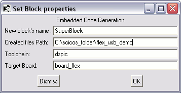](../files/File_Generator_folder.png--1574.md)

Figure 4 – Embedded Code Generator window

[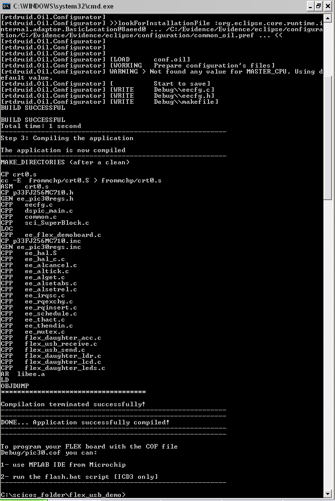](../files/File_Generator_result.png--1575.md)

Figure 5 – Code Generator results

Step 4:

- Open MPLAB IDE and import “pic30.cof” file created by the code generator

(refer Fig. 6) in Step 3

[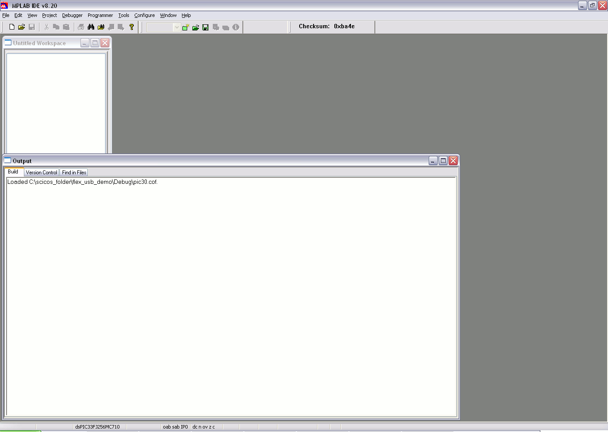](../files/File_Cof_import.png--1576.md)

Figure 6 – MPLAB IDE: pic30.cof file importing

Step 5:

- Connect the FLEX003 (FLEX Full Base Board) to ICD for programming the dsPic

(refer Fig. 7)

Click the release reset icon and execute the embedded program

(refer Fig. 8 and Fig. 9)

[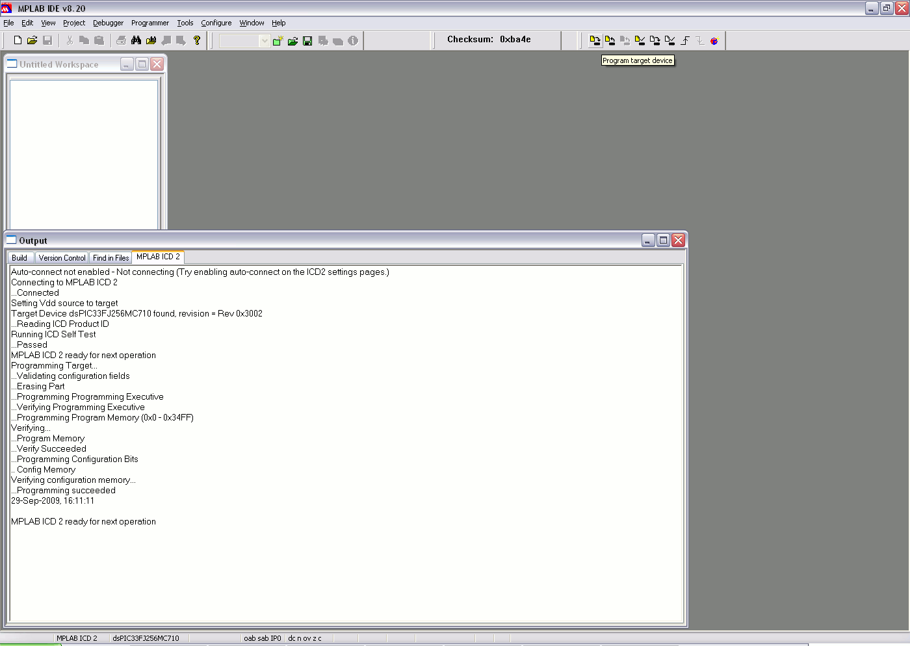](../files/File_Cof_program.png--1577.md)

Figure 7 - MPLAB IDE: target programming

[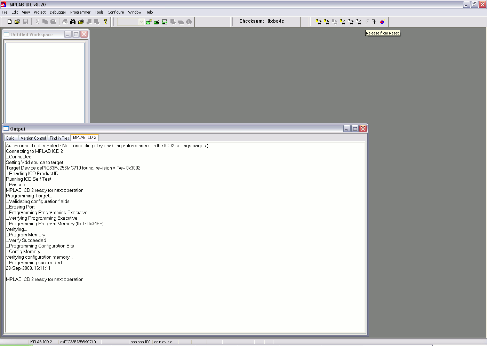](../files/File_Cof_release.png--1578.md)

Figure 8 - MPLAB IDE: release from reset

[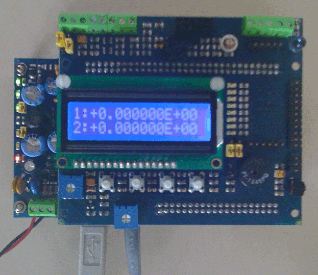](../files/File_Board_run1.png--1579.md)
  
Figure 9 – Device released from reset
  
Step 6:

- Open the PC-side file “demoboard\_example\_pcside.cos” in Scicos (refer Fig. 10)

The .cos file contains the schematic for the PC-side (refer Fig. 11).

The almost-real-time simulation runs in SCICOS environment. The application

shows the received USB data on the multiple scope and sends other data to the

FLEX FULL board.

[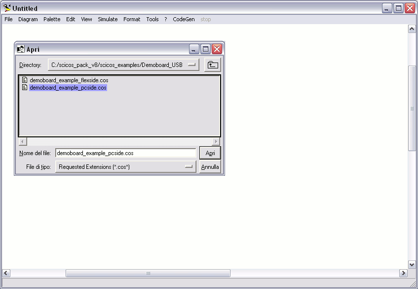](../files/File_Pcside_open.png--1580.md)

Figure 10 – Open the PC-side demo file

[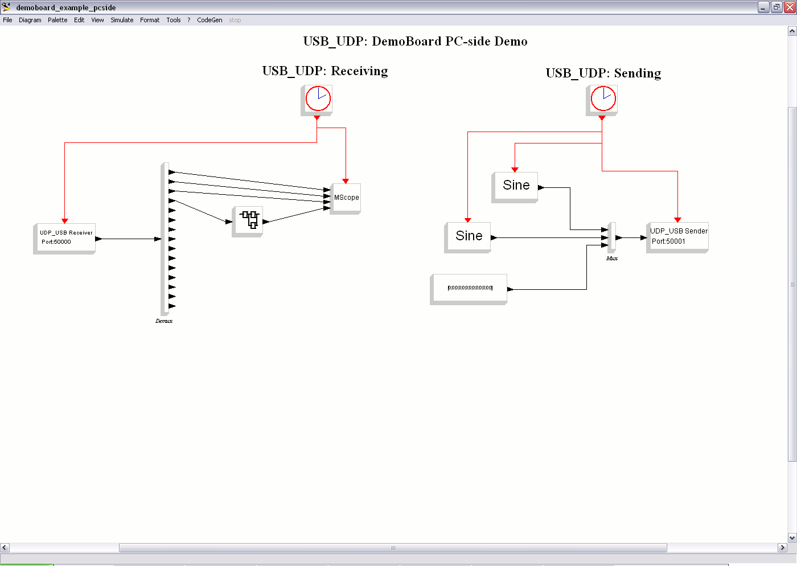](../files/File_Pc_side_scheme.png--1581.md)

Figure 11 – PC-side demo file

Step 7:

- Check the USB device recognition in the peripherals window (refer Fig. 12) and

execute the program "app\_flex\_scicos.exe" (refer Fig. 13)

Note1: The program "app\_flex\_scicos.exe" needs CygWin Win32 usb library.

Donwload and install "libusb-win32" using the utility "Setup.exe", download available from the Cygwin site (Cygwin Net Release Setup program).

Note2: After the program "app\_flex\_scicos.exe" is builded (using "make"), copy cygusb0.dll and cygwin1.dll into the program folder

before to launch it.

Note3: Download the FLEX USB drivers for Windows and the PIC18 firmware at:

[FLEX usb data communication using Scilab and Scicos](FLEX_usb_data_communication_using_Scilab_and_Scicos--1398.md "FLEX usb data communication using Scilab and Scicos")

[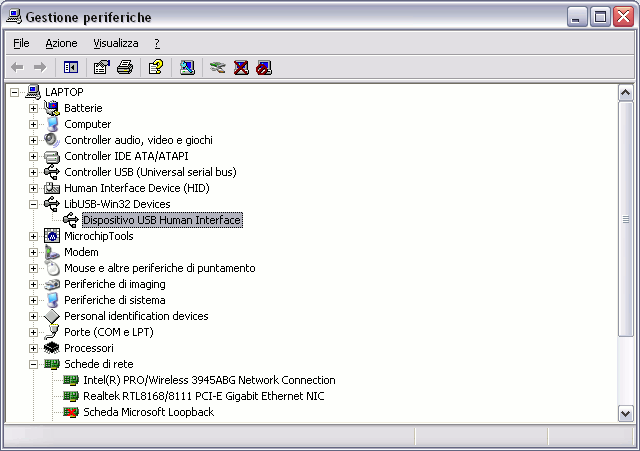](../files/File_Usb_recognition.png--1582.md)

Figure 12 – Check the USB device recognition

[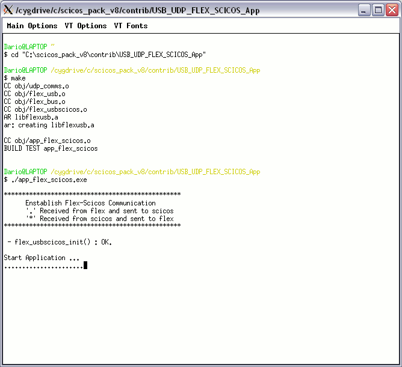](../files/File_App_compilation.png--1583.md)

Figure 13 – Compilation and start of the program;

Step 8:

- The simulation runs in almost-real-time, and the data received (acceleration on

X, acceleration on Y, acceleration on Y, modified light sensor output) can be

graphically seen in the Scicos Scope window (refer Fig. 14)

The demo results are shown in Fig. 15

[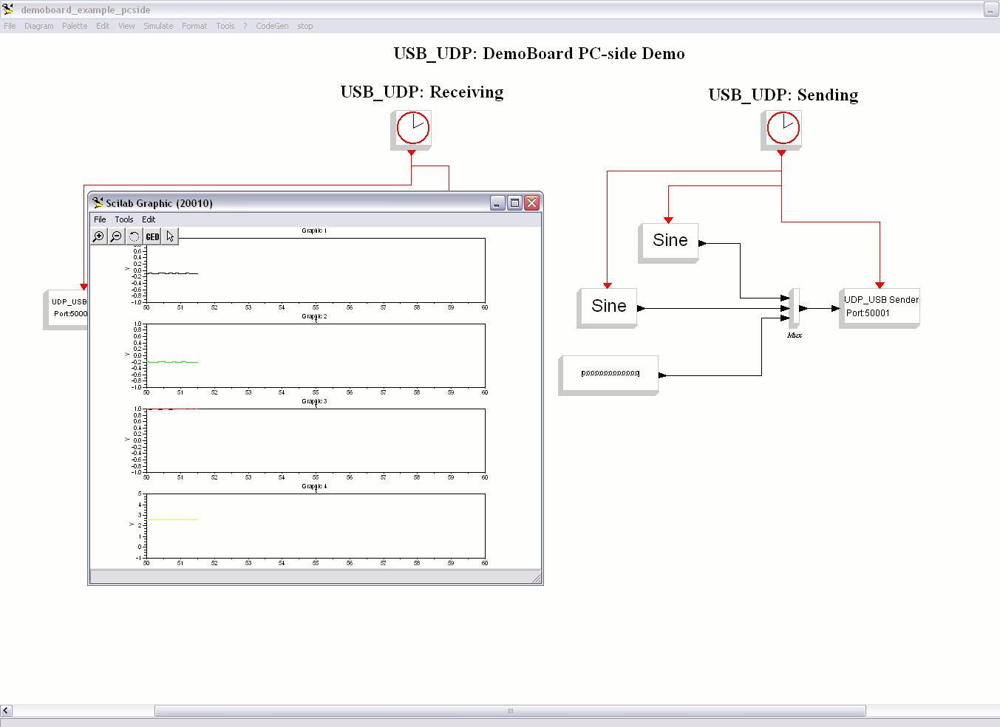](../files/File_Usb_run.png--1584.md)

Figure 14 – Simulation in running mode

[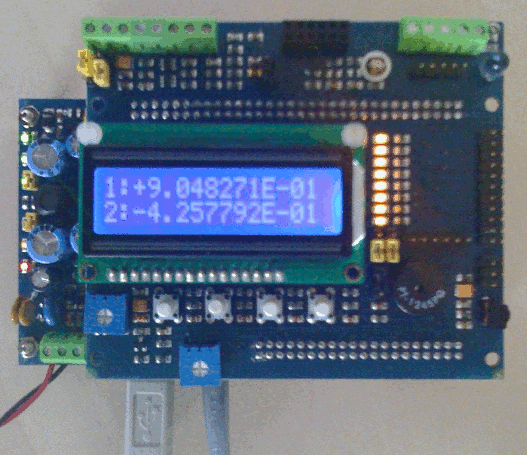](../files/File_Board_run2.png--1585.md)

Figure 15 – Demo results

|  |

---

## Archive provenance

- [Original page](http://erika.tuxfamily.org/wiki/index.php?title=USB_communication_using_FLEX_FULL_Demo_Board_and_the_Scilab%2FScicos_code_generator) · [Archived source revision 3252](http://erika.tuxfamily.org/wiki/index.php?oldid=3252)
- Last source edit: 2011-09-19T13:54:53Z. Source retrieved on 2026-11-06; Markdown conversion completed on 2026-11-07.
- Original contributors recorded in exported history: WikiSysop, Erikadds.
- [Original MediaWiki source](../source/wikitext/1539.mediawiki) · [Original editing history](../source/history/batch-012.xml)
- [Attribution and licensing notice](../NOTICE.md). Original file-specific notices, where present, remain applicable.
