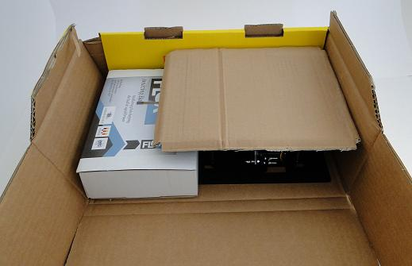
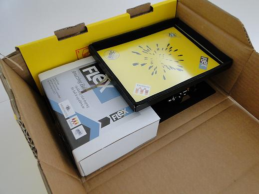
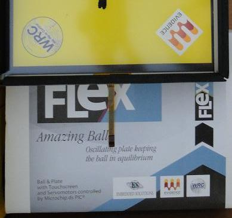
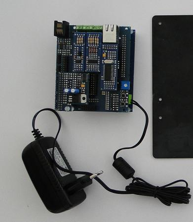
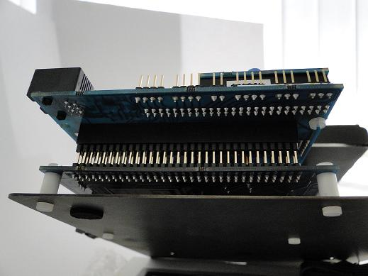
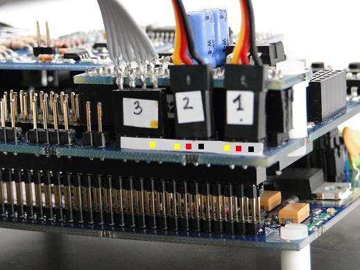
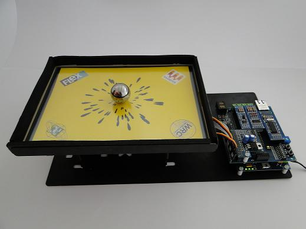

# Unpacking the Amazing ball package

This page shows the steps needed to unpack and mount the Amazing Ball.

You should have received the package containing the Amazing Ball mechanical parts and hardware.
Please open the lateral side to let the mechanical part and the electrobix be removed easily as shown below

Remove the coverage from the touch panel to simplify the extraction of the parts.

Inside the box, you will find a carton package similar to the typical Flex box, but with an "Amazing Ball" sticker on it.

...Open it, and you will find the electronic (already mounted), plus the iron ball.

Once opened, you should unscrew the four white plastic screws on the right of the picture below, and then fix the electronic on the holes on the bottom metal plate. The holes are of a size the fits either the FLEX Light or the FLEX Full.

Once the electronic is fixed to the metal plate, you should fix the connectors of the servo motors and of the touchscreen. Please note the numbers on each connector, as well as the colors of the cables in the picture below

Once done that, you should have the Amazing Ball mounted in a way similar to the following picture. (Please note that the power connector is not included in the package)

---

## Archive provenance

- [Original page](http://erika.tuxfamily.org/wiki/index.php?title=Unpacking_the_Amazing_ball_package) · [Archived source revision 4381](http://erika.tuxfamily.org/wiki/index.php?oldid=4381)
- Last source edit: 2012-01-24T15:10:13Z. Source retrieved on 2026-11-06; Markdown conversion completed on 2026-11-07.
- Original contributors recorded in exported history: WikiSysop, Erikadds.
- [Original MediaWiki source](../source/wikitext/1540.mediawiki) · [Original editing history](../source/history/batch-012.xml)
- [Attribution and licensing notice](../NOTICE.md). Original file-specific notices, where present, remain applicable.
