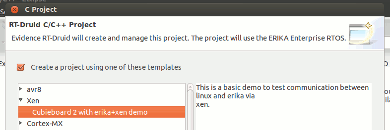
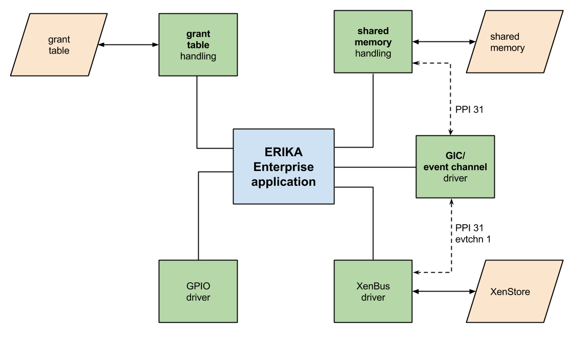
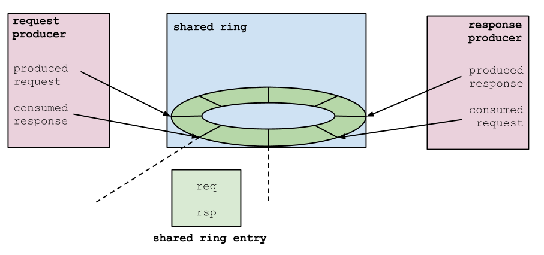

# Xen Hypervisor

<a id="Introduction"></a>

## Introduction

This page describes the current support of ERIKA Enterprise for the Xen Hypervisor.

In particular, ERIKA can be run as a guest operating system inside a Xen domU.

<a id="Quick_Guide"></a>

## Quick Guide

The following is a list of commands and actions that you can take on the [free Virtual Machine](http://www.erika-enterprise.com#VM) we made to simplify the testing of the Xen support.

Warning: We tried to make the following list rather complete... but there could be still some notes missing.

From inside the VM, you can recompile U-Boot:

```
cd ~/xen_linux_erika/u-boot-psci
make CROSS_COMPILE=arm-linux-gnueabihf- Cubieboard2_config 
make CROSS_COMPILE=arm-linux-gnueabihf-
```

Supposing the microSD mounted on /dev/mmcblock0, you can rewrite the U-Boot in the SDCard using

```
dd if=spl/sunxi­spl.bin of=/dev/mmcblk0 bs=1024 seek=8 
dd if=u-boot.img of=/dev/mmcblk0 bs=1024 seek=40 
```

You can recompile the Linux Kernel using:

```
cd ~/xen_linux_erika/linux-sunxi
make ARCH=arm CROSS_COMPILE=arm-linux-gnueabihf- cubie2_xen_defconfig
make ARCH=arm CROSS_COMPILE=arm-linux-gnueabihf- zImage dtbs -j4
```

As a result of the compilation you'll have two files:

- zImage on arch/arm/boot/zImage
- dtb on arch/arm/boot/dts/sun7i-a20-cubieboard2.dtb

Copy these two files in the root of the microSD.

- Also see [#Creating the root file system](#Creating_the_root_file_system)
- Also see [#Preparing the boot scripts](#Preparing_the_boot_scripts)

You can generate an ERIKA Enterprise executable named A20.bin from the RT-Druid machine pre-installed inside the VM. You need to create a new project, and select the template you can see in the figure below.

[](../files/File_Xen_erika_example.png--2505.md)

The A20.bin executable will be as usual inside the Debug directory

Then recompile the xen-tools:

```
cd ~/xen_linux_erika/xen
make XEN_TARGET_ARCH=arm32 CROSS_COMPILE=arm-linux-gnueabihf- CONFIG_EARLY_PRINTK=sun7i dist-xen
```

Copy the file xen/xen/xen in the root (/) of the uSD.

Then, power-on the board.

Check that the erika.cfg stored in the root of the SD card contains the following:

```
kernel = "A20.bin"
memory = 512
name = "ERIKA_Enterprise"
vcpus = 1
on_crash = 'destroy'
iomem = ["1c20,2"]
```

On the target, start the xen environment:

```
/etc/init.d/xencommons start
```

Start ERIKA inside Xen as a domU

```
xenstore-chmod /local b
xl create ./erika.cfg
```

To list the Xen domains:

```
xl list
```

The A20.bin application compiled before includes a minimal Linux driver for the communication of the two domains.

The following:

```
echo 1 > /proc/sys/erika-xen/pin_state 
```

sends a message to ERIKA that will raise a GPIO pin.

You can read the pin status using:

```
cat /proc/sys/erika-xen/pin_state 
```

The following:

```
echo 0 > /proc/sys/erika-xen/pin_state
```

sets the pin back to 0.

<a id="Requirements_for_the_working_environment"></a>

## Requirements for the working environment

The AllwinnerA20 CPU available in the cubieboard2 is directly supported by Xen; The [Xen Wiki](http://wiki.xenproject.org/wiki/Xen_ARMv7_with_Virtualization_Extensions/Allwinner) contains most of the documentation needed for building the software components.

This section summarizes the basic requirements of the development environment needed to start ERIKA Enterprise as a [domU over a Linux dom0](http://wiki.xenproject.org/wiki/Xen_ARM_with_Virtualization_Extensions#Requirements).

<a id="Firmware_Requirements"></a>

### Firmware Requirements

The Hypervisor boot must happen in [Hypervisor mode (EL2)](http://wiki.xenproject.org/wiki/Xen_ARM_with_Virtualization_Extensions_whitepaper#Xen_on_ARM:_virtualization_extensions) (non secure).

Dupport for the EL2 boot mode is in the official repository since January 2014.

Moreover, to correctly init both cores of an SMP Platform, the bootloader needs to correctly handle the Power State Coordination Interface ([PSCI](http://lxr.free-electrons.com/source/Documentation/devicetree/bindings/arm/psci.txt)); This support is not currently available in the official U-Boot repository, but a first working version is available [in the development branch wip/psci of this repository](https://git.kernel.org/cgit/linux/kernel/git/maz/uboot.git/log/?h=wip/psci).

<a id="dom0_requirements"></a>

### dom0 requirements

<a id="Device_tree."></a>

#### Device tree.

All the platform features must be enumerated in a device tree, which must be compiled in the device tree binary format (also called device tree blob).

Starting with kernel 3.14, it is no more needed the creation of a dedicated device tree for the Linux boot on top of an hypervisor: it is in fact sufficient to [<http://git.kernel.org/cgit/linux/kernel/git/torvalds/linux.git/tree/arch/arm/boot/dts/sun7ia20cubieboard2>.
dts use the device tree provided together with Linux]

In other words, the bootloader must provide to Xen a dtb for the dom0 kernel, plus an optional one for initramfs (in case the kernel needs it). The bootloader also needs to load the kernel and initramfs in memory, and also to note their location in the device tree blob; That information is included into a new node of the device tree, named **chosen**, that contains:

- the image location and a classification per compatibility
- additional parameters to be passed to the hypervisor or to the dom0 during boot.

The **chosen** node must be defined in the following way ([as specified in docs/misc/arm/devicetree/booting.txt](http://xenbits.xen.org/gitweb/?p=xen.git;a=blob;f=docs/misc/arm/device-tree/booting.txt;h=8da1e0b8fcf9c98888ed63cd45bd11f1a880288b;hb=HEAD):

```
chosen {
  bootargs = "$xen_cmdline";
  modules {
    module@0 { /* dom0 kernel */
      bootargs = "$dom0_cmdline";
      compatible = "xen,linuxzimage", "xen,multibootmodule";
      reg = <$kernel_addr $kernel_size>
    };
    module@1 { /* initramfs */
      compatible = "xen,linuxinitrd", "xen,multibootmodule";
      reg = <$initramfs_addr $initramfs_size>;
    };
  };
};
```

The **chosen** node can be manually added to the device tree (e.g., by changing the sources and recompiling), or can be created dynamically at boot time using the U-Boot command fdt.

<a id="domU_requirements"></a>

### domU requirements

<a id="domU_executable_format."></a>

#### domU executable format.

Xen uses the zImage format to load a ARM kernel. However, the image [should not be compressed](http://xenbits.xen.org/gitweb/?p=xen.git;a=blob;f=docs/misc/arm/booting.txt;h=9802e5e20fd8c7da94eaa7b639b7530b951760eb;hb=HEAD); the only needed operation is the [compilation of the kernel source code with a zImage header](http://www.simtec.co.uk/products/SWLINUX/files/booting_article.html#d0e309).

That header must have an offset 0x24 inside the zImage and must contain:

1. a magic number (0x016f2818) that identifies the file as zImage;
2. the starting address of the zImage;
3. The end address of the zImage.

The following is an header example:

```
_start:
  @ zImage header
.rept 8
  mov r0, r0
.endr
  b _start_cubieboard2
  .word 0x016f2818 @ Magic numbers to help the loader
  .word _start_0 @ absolute load/run zImage address
  .word _end _
  start @ zImage size
  @ end of zImage header
_start_cubieboard2:
```

Please remember the zImage should not be compressed. To obtain the executable in the required format you can use the command objcopy as done during the compilation of a normal application for Cortex Ax (the hypothesys is that the objcopy path is for the ARMv7 toolchain is in the environment variable EE\_OBJCOPY):

```
$(EE_OBJCOPY) -O binary myProject_master.elf myProject_master.bin
```

<a id="base_address_for_the_executable_image_of_the_domU"></a>

#### base address for the executable image of the domU

Th base address for the adress space reserved to a domU is 0x80000000.
The [xen/include/public/archarm.h:372 linker script] used for the compilation of the ERIKA source code must be adapted to that value.

<a id="Privileged_Instructions"></a>

#### Privileged Instructions

A non-privileged domain cannot access to the System Control Register to enable the memory management unit (by setting bit M); If done, a domU exception is raised.

Moreover, the hypervisor protects register CP15 c15 to non privileged guest domains. This because [on some ARM architectures using that register is possible to have a dump of caches L1/L2](http://lists.xenproject.org/archives/html/xenchangelog/201405/msg00004.html): having free access to that register would then bring memory isolation problems.

<a id="IMPORTANT:_Commit_to_be_reverted"></a>

#### IMPORTANT: Commit to be reverted

If you compile a Xen Repository including commit 878ff4fe1816d7f808f11254b555b9e9c2f121fa, this will provoke a critical shutdown of the ERIKA Enterprise domU at boot time. We did not yet understand why this happens. the only solution is currently to revert the commit.

<a id="Creating_a_working_system"></a>

## Creating a working system

The following steps will guide through the creation of a working system including a Linux dom0 and an ERIKA Enterprise domU that will be executed under the Xen hypervisor.

The hypothesis is that a armv7a (hardfloat) toolchain is installed in the system. That toolchain must include at least a gcc compiler, the ld linker as well as the objcopy tool. The hypothesis is that the executables will have a name starting with armv7a-hardfloat-linux-gnueabi- (Please note that this prefix is typical for the Gentoo distributions. Debian packages typically have the prefix arm-linux-gnueabihf-.).

The following sections describe how the environment can be installed into an SD card. Installing it over a USB flash drive is similar. This page does not contain instructions on using tftp or netboot.

<a id="Preparing_the_toolchain"></a>

### Preparing the toolchain

Debian distributions as well as other distributions typically provide pre-compiled toolchains (on Ubuntu the package name is gcc-arm-linux-gnueabi).

However, the suggested procedure in our case is to use the crossdev application to generate a toolchain for the specific architecture:

```
crossdev -t armv7a-hardfloat-linux-gnueabi
```

<a id="Compiling_and_installing_the_bootloader"></a>

### Compiling and installing the bootloader

Use the following command to download and compile the [U-Boot repository](http://linuxsunxi.org/Bootable_SD_card#Bootloader) with support for PSCI:

```
# git clone https://git.kernel.org/pub/scm/linux/kernel/git/maz/uboot.git u-boot-psci
# cd u-boot-psci
# git checkout origin/wip/psci
# make CROSS_COMPILE=armv7a-hardfloat-linux-gnueabi- Cubieboard2_config
# make CROSS_COMPILE=armv7a-hardfloat-linux-gnueabi-
```

The bootloader should be stored at an offset of 40KB, whereas the symbol table at an offset of 8KB.

Supposing we are using a Linux host, and that the SD card can be accessed using the device file /dev/mmcblk0, you can use the following commands:

```
# dd if=spl/sunxispl.bin of=/dev/mmcblk0 bs=1024 seek=8
# dd if=uboot.img of=/dev/mmcblk0 bs=1024 seek=40
```

<a id="Creating_the_root_file_system"></a>

### Creating the root file system

This section covers the creation of a single partition which will be formatted with an ext4 file system.

After that, an [Arch Linux file system](http://archlinuxarm.org/platforms/armv7/allwinner/cubieboard2) will be used for the partition (on a Debian host [you can use debootstrap as an alternative to the download of a preconfigured root file system](http://linux-sunxi.org/Bootable_SD_card#Rootfs)).

```
# fdisk /dev/mmcblk0
```

Then, you need to create a Linux partition. Please note that the first sector of the first partition in the SD card must be in a position after an offset of 40 KB (for the U-Boot installation) plus the size of the U-Boot image.

```
# mkfs.ext4 /dev/mmcblk0p1
# mount /dev/mmcblk0p1 /mnt
# wget http://archlinuxarm.org/os/ArchLinuxARM-sun7i-latest.tar.gz
# tar -xf ArchLinuxARM-sun7i-latest.tar.gz -C mnt
# umount /mnt
```

<a id="Compiling_and_installing_of_the_dom0_kernel"></a>

### Compiling and installing of the dom0 kernel

Download the sunxi-devel branch from the official sunxi repository. That branch contains the drivers for the SD, USB ed ethernet.

```
# mkdir sunxi-devel
# cd sunxi-devel
# git init
# git remote add -t sunxi-devel -f origin https://github.com/linux-sunxi/linux-sunxi.git
# git checkout sunxi-devel
```

After that, please go on with teh kernel compilation. In the default configuration for the architecture and platform you need to enable the Xen options, as well as the peripherals and drivers that we want to use.

A complete list of the needed configuration options is available on the [Mirage OS wiki](http://openmirage.org/wiki/xenoncubieboard2).

Since ours is a minimal configuration, we disabled the support for dynamic loading modules.

```
# make ARCH=arm multi_v7_defconfig
# make ARCH=arm menuconfig
# make ARCH=arm CROSS_COMPILE=armv7a-hardfloat-linux-gnueabi- zImage dtbs -j4
```

The dtbs target is needed to compile the device tree in the binary format used during boot. Once the compilation is terminated, the Linux zImage can be found as arch/arm/boot/zImage, whereas the binary device tree to be used is arch/arm/boot/dts/sun7i-a20-cubieboard2.dtb.

You need to copy both the zImage and the binary device tree in the root of the file system you created on the SD card containing the environment we are creating.

<a id="Validating_the_setup_with_only_the_Linux_Kernel"></a>

### Validating the setup with only the Linux Kernel

To validate that everything works correctly, at this point it is already possible to boot the dom0 kernel, using a serial connection between the host and the target board. Once obtained the U-Boot prompt, please use the following commands to boot Linux:

```
# setenv bootcmd "ext4load mmc 0 45000000 zImage; bootm 45000000"
# boot
```

<a id="Compiling_and_installing_the_hypervisor"></a>

### Compiling and installing the hypervisor

You need to download the latest Xen version using teh development repository, on the master branch.

```
# git clone git://xenbits.xen.org/xen.git
# cd xen
# git clean -xfd
```

You need to enable the diagnostic messages by modifying the Config.mk file, setting the option debug ?= y.

```
# make clean XEN_TARGET_ARCH=arm32 CROSS_COMPILE=armv7a-hardfloat-linux-gnueabi- CONFIG_EARLY_PRINTK=sun7i
# make dist-xen XEN_TARGET_ARCH=arm32 CROSS_COMPILE=armv7a-hardfloat-linux-gnueabi- CONFIG_EARLY_PRINTK=sun7i
```

If you want to run the ERIKA Enterprise domU with the GPIO driver, you need to apply the patchset that adds che hypercall XEN\_DOMCTL\_memory\_mapping for the ARM architecture;
That hypercall provides the complete access to an I/O memory region to a non-privileged domain.

Currently the patchset is not included in the Xen development repository, but is available in the mailing list archives ([currently it is at it eighth version](http://markmail.org/thread/wtevxxizyxjhvmg2)).

At the end of the compilation, the executable is the file xen/xen/xen.

You need to copy that file in the root of the SD card filesystem.

<a id="Preparing_the_boot_scripts"></a>

### Preparing the boot scripts

To correctly boot the dom0 on top of the Xen Hypervisor, we need to tell U-Boot the right locations where the hypervisor and the dom0 should be stored.

Moreover, we need to add the chosen node needed for the hypervisor to the device tree, either statically at compile time or (easier) dynamically at boot time.

With the hyphotesis of a Linux configuration without modules and without initramfs, on an ext4 filesystem, the boot script is the following one (taken from [this page](http://openmirage.org/wiki/xenoncubieboard2), section "UBoot configuration", with some modifications).

```
# SUNXI Xen Boot Script
# Addresses suitable for 1GB system, adjust as appropriate for a 2GB system.
# Top of RAM: 0x80000000
# Xen relocate addr   0x7fe00000
setenv kernel_addr_r  0x7f600000 # 8M
setenv ramdisk_addr_r 0x7ee00000 # 8M
setenv fdt_addr       0x7ec00000 # 2M
setenv xen_addr_r     0x7ea00000 # 2M

setenv fdt_high       0xffffffff # Load fdt in place instead of relocating

# Load xen to ${xen_addr_r}.
ext4load mmc 0 ${xen_addr_r} /xen
setenv bootargs "console=dtuart dtuart=/soc@01c00000/serial@01c28000 dom0_mem=256M"

# Load appropriate .dtb file to ${fdt_addr}
ext4load mmc 0 ${fdt_addr} /sun7i-a20-cubieboard2.dtb
fdt addr ${fdt_addr} 0x40000
fdt resize
fdt chosen
fdt set /chosen \#address-cells <1>
fdt set /chosen \#size-cells <1>

# Load Linux zImage to ${kernel_addr_r}
ext4load mmc 0 ${kernel_addr_r} /zImage
fdt mknod /chosen module@0
fdt set /chosen/module@0 compatible "xen,linuxzimage" "xen,multiboot-module"
fdt set /chosen/module@0 reg <${kernel_addr_r} 0x${filesize} >
fdt set /chosen/module@0 bootargs "console=hvc0,115200n8 debug ignore_loglevel rw root=/dev/mmcblk0p1 rootwait earlyprintk=xen clk_ignore_unused"

bootz ${xen_addr_r} ${fdt_addr}
```

Given the boot script named boot.cmd, the compilation is run using the following command:

```
# mkimage -C none - A arm -T script -d boot.cmd boot.scr
```

The resulting file (boot.scr) must be put in the root of the file system storing the OS environment on the SD card.

<a id="How_to_exclusively_assign_a_core_to_the_dom0"></a>

#### How to exclusively assign a core to the dom0

Xen allows to assign one or more corse exclusively to the dom0 (CPU pinning).

The configuration option needed (from [Xen Common problems](http://wiki.xen.org/wiki/XenCommonProblems#Can_I_dedicate_a_cpu_core_.28or_cores.29_only_for_dom0.3F)) must be added to the command line used by U-Boot to boot Xen.

```
# Load xen to ${xen_addr_r}.
ext4load mmc 0 ${xen_addr_r} /xen
setenv bootargs "console=dtuart dtuart=/soc@01c00000/serial@01c28000 dom0_mem=256M dom0_max_vcpus=X dom0_vcpus_pin"
```

<a id="Validating_the_setup_of_Xen_.2B_Linux_dom0"></a>

### Validating the setup of Xen + Linux dom0

To validate the work done so far, you can connect to the serial line of the target board.

the boot script will automatically start Xen and Linux. once you reach the login prompt of the Linux dom0, press three times "Ctrl + A" to switch from the Linux console to the Xen console, thus verifying that Linux is really working under Xen. Just repeat the three chars to go back to the Linux console.

<a id="Compiling_the_toolstack"></a>

### Compiling the toolstack

The following is the set of command needed to compile the toolstack directly on the target board. this is convenient when the environment is not Debian-based, without a debootstrap or other simple mechanisms to emulate an ARM system.

We suggest to use an external USB memory or a SATA hard disk to avoid burning the SD card due to the heavy disk load during the compilation process.

```
# git clone git://xenbits.xen.org/xen.git
# cd xen
# git clean -xfd
# make uninstall
# make clean
# ./configure
# make dist-tools
# make install-tools
```

Please note that the version of the toolstack must be the same of the hypervisor. Using different version may make the system unstable.

<a id="Validating_the_toolstack"></a>

### Validating the toolstack

To verify that the toolstack works correctly, just reboot the target board.

Once logged in, start the system daemons needed for Xen interfacing with the following command:

```
# /etc/init.d/xencommons start
```

Note that any message due to the absence of QEMU is correct, since the Xen toolstack for ARM is not based on QEMU emulation.

Finally use the xl command to list the domains which are currently active:

```
# xl list
```

The only active domain should be the Linux "Domain 0".

<a id="Creating_the_configuration_file_for_the_ERIKA_Enterprise_domU"></a>

### Creating the configuration file for the ERIKA Enterprise domU

The following is aminimal configuration needed to correctly boot an ERIKA Enterprise domU without GPIO drivers and without XenBus driver.

The file myProject.bin, output of the ERIKA Enterprise compilation phase, must be put into the same directory of the configuration files.

```
kernel = "myProject_master.bin"
memory = 512
name = "ERIKA_Enterprise"
vcpus = 1
on_crash = 'destroy'
```

You can use the following command to boot the guest operating system, described by a configuration file named "erika.cfg":

```
# xl create erika.cfg
```

Once back to the prompt, using the command "xl list" you should be able to see "ERIKA\_Enterprise" among the running domains.

Use the following command to stop the ERIKA Enterprise domU:

```
# xl destroy ERIKA_Enterprise
```

<a id="Changes_to_the_configuration_for_GPIO_and_XenBus_drivers"></a>

#### Changes to the configuration for GPIO and XenBus drivers

If you compiled ERIKA Enterprise with the GPIO drivers, you need to add to the configuration the possibility for the domain to access the GPIO controller register area.

The following line gives to the domU the access to two memory pages starting from page frame number 0x1c20 (Corresponding to address 0x01c20800 which is the start of the I/O memory as specified by sunxi in [this documentation](http://dl.linuxsunxi.org/A20/).)

```
iomem = ["1c20,2"]
```

Finally, if ERIKA Enterprise has been compiled with the XenBus driver, you need to assign the right read/write permissions to the space of the names in the XenStore hierarchy:

```
# xenstorechmod -r "/local" b
```

This command makes all the namespace available in R/W to every domain.

<a id="Statically_assigning_a_core_to_the_domU"></a>

#### Statically assigning a core to the domU

Xen allows to assign one or more core also to a domU (see [this link](http://oldlistarchives.xenproject.org/xenusers/200807/msg00233.html)).

To to that you need to add a line saying which core will be assigned to the domU:

```
cpus = "1"
```

In the case you need to assign more than one core, you can do the following:

```
vcpus = 2
cpus = ["1", "2"]
```

to say that the domain has two virtual CPUs assigned to it, and that the cores statically assigned to it are core 1 and 2.

To verify the correct assignments of teh cores you can use the following command once ERIKA Enterprise has booted:

```
# xl vcpu-list
```

<a id="An_example_ERIKA_application"></a>

## An example ERIKA application

The ERIKA Enterprise port as a domU Xen-on-ARM also includes a set of subsystems which can be used to interact with the hypervisor.

These subsystems are compiled together with the application (in general ERIKA does not need modifications to ruin on Xen other than those in the previous paragraphs).

The reference for this section is the [MiniOS ARM port](https://github.com/KarimAllah/xen/tree/miniosarmport), which has recently been completed and is a key component in disaggregated system designs.

The figure below depicts the architecture of the application with the relationship with the other modules.

[](../files/File_ERIKA-system-components.png--2509.md)

<a id="GPIO_Driver"></a>

### GPIO Driver

We started from the simplest peripheral, which is in this case the GPIO.

The driver is basically a port of the main functionalities of the [Linux port driver implemented by sunxi in Linux](http://linuxsunxi.org/GPIO).

<a id="Handling_the_Generic_Interrupt_Controller_and_the_event_channels"></a>

### Handling the Generic Interrupt Controller and the event channels

The Xen implementation on ARM handles in an unified way both interrupts (virtual timers, interprocessor and physical) and the Xen notification distribution mechanism (aka the [event channels](http://wiki.xen.org/wiki/Event_Channel_Internals)) .

The event channel is also a unified mechanism which implements communication between domains and also exports Xen services (for example, every interaction with the XenStore is implemented through event channels).

For that reason we implemented a modified GIC driver to handle in a better way the interrupt distribution as well as some other important Xen functionality.

The current implementation of the GIC includes:

- the enabling of the interrupt line used by Xen to signal events (PPI 31), as well as the interrupt line for the virtual timer (PPI 27).
- masking and binding of the event channels ([see this link](http://openmirage.org/wiki/xenevents)).

The functionalities currently supported include the mapping in the domain address space of the shared info page, which is a page shared between the domain and Xen. That page contains two bitmaps storing the state of each event channel. The bitmap evtchn\_pending has a bit with value 1 when Xen delivered an event to the domain, and the event is not yet handled; the bitmap evtchn\_mask, is a mask of which event channel are available to receive events.

Finally, the ERIKA Enterprise drive includes functions to hansle an interrupt handler and to mask/unmask the event channels used by the application.

<a id="Communication_with_the_XenBus"></a>

### Communication with the XenBus

The event channel mask driver allows an interaction with the XenBus, which is the communication mechanism to the hierarchical namespace stored in the XenStore. Basically, given a set of keys, it is possible to access to their values; this access is done using the shared page between the domain and the hypervisor (using a hypercall), which contains a data structure equivalent to a ring buffer.

Basically the domain synchronously inserts a request in the queue of the hypervisor. The hypervisor will process the request, and when done will notify it using the event channel (using a known id (1)).

The following is a generic scheme of the usage of the ringbuffer in the PV protocol.

[](../files/File_Prod-cons-ringbuffer.png--2508.md)

<a id="Shared_Memory_Handling"></a>

### Shared Memory Handling

One of the requirements of the porting of ERIKA as a domU was the possibility to share some memory between the Linux dom0 domain and the ERIKA domU domain.

The idea is then that on the Linux side there will be a device driver being able to access this shared memory, making the shared data available though the sysfs.

To implement this, the Linux and ERIKA driver need to perform the following operations:

- The first step is that ERIKA Enterprise needs to map the memory in its own grant table; the grant table is a a Xen data structure available for every domain storing which are the shared pages and which are the read/write permissions to them. In this way a non-privileged domain can export pages of its own address space to other domains in a safe way.

- The shared page is now exported in the ERIKA grant table. The Linux dom0 will access the grant table of the domU using an hypercall. In this way the hypervisor grants access to the page mapping it into the dom0 address space (this happens only if the requesting domain is listed in the domains allowed to access that page). Every subsequent access to the shared memory is done without hypervisor intervention.

<a id="Synchronization_between_domains"></a>

### Synchronization between domains

The Xen hypervisor does not provide any mechanism to synchronize the access to the sahared memory area between two domains.

For that reason, we implemented a synchronous notification mechanism that allows mutual exclusion in the access to the shared memory.

In our case, the mechanism works when Linux needs to ask some action to the ERIKA domain. The protocol implemented is similar to the one used for the access to the XenStore and for the communication between frontend e backend in the paravirtualized driver model used by Xen ([protocol PV](http://wiki.xen.org/wiki/PV_Protocol)):

1. The Linux dom0 writes in the Erika domU shared memory the action to be performed
2. The dom0 sends a notification to the domU through an event channel, signaling the command insertion in the queue.
3. The domU handles the interrupt, and executes the command.
   1. It process the command signalling in the shared memory about errors happened during the execution.
   2. the domU notifies the dom0 the execution of the command through an event channel (it can be the same event channel since the inter\_domain event channels are bidirectional).
4. The dom0 handles the interrupt and gets the response (or the error) due to the execution of the command.

The protocol can be paired with a mutual exclusion mechanism based on shared spin locks. However, the usage of spin locks is not suggested due to the fact that a domain holding a spin lock could be forced to halt before unlocking the spinlock, making the system halt on a spinlock that will never be released.

<a id="Publications_.40_CloudCon"></a>

## Publications @ CloudCon

[Arianna Avanzini, Integrating Linux and the Real-Time ERIKA OS Through the Xen Hypervisor - Arianna Avanzini, CloudCon 2014](http://lccoelce14.sched.org/event/050c1a83ded7822e39e6ef0c644f0438)

<a id="Acknowledgements"></a>

## Acknowledgements

This work has been done thanks to Arianna Avanzini as part of her Master Thesis done under the supervision of Prof. Paolo Valente of the University Modena Reggio Emilia. This page is mainly a translation of instructions coming from Arianna.

Special Thanks also to Bruno Morelli who provided the initial iMX6 support, as well as the integration of the complete package inside the ERIKA Enterprise virtual machine.

---

## Archive provenance

- [Original page](http://erika.tuxfamily.org/wiki/index.php?title=Xen_Hypervisor) · [Archived source revision 5985](http://erika.tuxfamily.org/wiki/index.php?oldid=5985)
- Last source edit: 2015-05-26T10:33:34Z. Source retrieved on 2026-11-06; Markdown conversion completed on 2026-11-07.
- Original contributors recorded in exported history: Pj, Arianna Avanzini.
- [Original MediaWiki source](../source/wikitext/2500.mediawiki) · [Original editing history](../source/history/batch-013.xml)
- [Attribution and licensing notice](../NOTICE.md). Original file-specific notices, where present, remain applicable.
