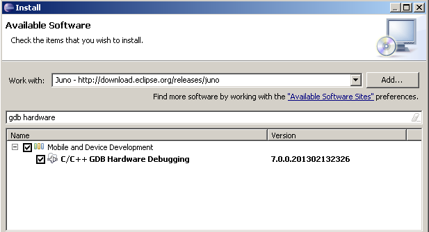

# File:1 - install gdb hw debug.PNG

[Download original file](../assets/uploads/1_-_install_gdb_hw_debug--5553b88fe6.png)

Original upload: **Alessandro Biondi**, 2013-09-13T12:57:19Z; 15,388 bytes; `image/png`.

Upload comment: This screenshot shows how to install the GDB Hardware Debugging in Eclipse Juno.

This screenshot shows how to install the GDB Hardware Debugging in Eclipse Juno.

---

## Archive provenance

- [Original page](http://erika.tuxfamily.org/wiki/index.php?title=File%3A1_-_install_gdb_hw_debug.PNG) · [Archived source revision 5447](http://erika.tuxfamily.org/wiki/index.php?oldid=5447)
- Last source edit: 2013-09-13T12:57:20Z. Source retrieved on 2026-11-06; Markdown conversion completed on 2026-11-07.
- Original contributors recorded in exported history: Alessandro Biondi.
- [Original MediaWiki source](../source/wikitext/2460.mediawiki) · [Original editing history](../source/history/batch-014.xml)
- [Attribution and licensing notice](../NOTICE.md). Original file-specific notices, where present, remain applicable.
