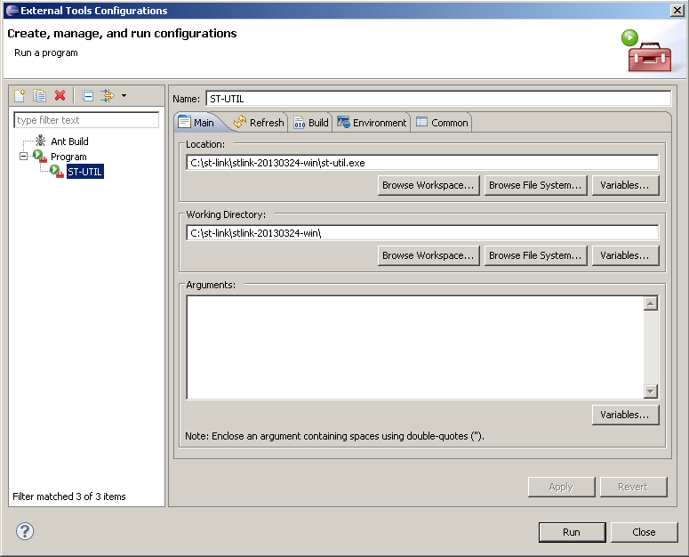

# File:2 - external tool.PNG

[Download original file](../assets/uploads/2_-_external_tool--0ba137eae3.png)

Original upload: **Alessandro Biondi**, 2013-09-13T13:51:48Z; 33,641 bytes; `image/png`.

Upload comment: This screenshot shows how to configure ST-UTIL as an external tool in Eclipse.

This screenshot shows how to configure ST-UTIL as an external tool in Eclipse.

---

## Archive provenance

- [Original page](http://erika.tuxfamily.org/wiki/index.php?title=File%3A2_-_external_tool.PNG) · [Archived source revision 5465](http://erika.tuxfamily.org/wiki/index.php?oldid=5465)
- Last source edit: 2013-09-13T13:51:49Z. Source retrieved on 2026-11-06; Markdown conversion completed on 2026-11-07.
- Original contributors recorded in exported history: Alessandro Biondi.
- [Original MediaWiki source](../source/wikitext/2463.mediawiki) · [Original editing history](../source/history/batch-014.xml)
- [Attribution and licensing notice](../NOTICE.md). Original file-specific notices, where present, remain applicable.
