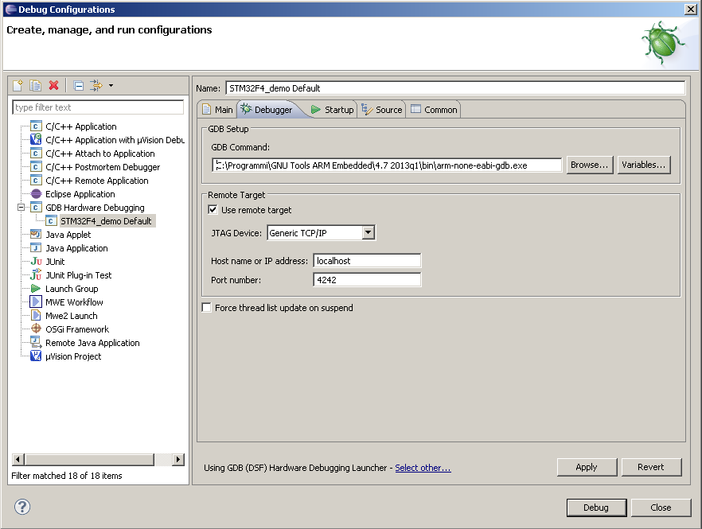

# File:4 - debug config (2).PNG

[Download original file](../assets/uploads/4_-_debug_config__2--3a71f0ef5b.png)

Original upload: **Alessandro Biondi**, 2013-09-13T13:34:00Z; 46,880 bytes; `image/png`.

Upload comment: This screenshot shows how to configure the eclipse debugger for STM32F4.

This screenshot shows how to configure the eclipse debugger for STM32F4.

---

## Archive provenance

- [Original page](http://erika.tuxfamily.org/wiki/index.php?title=File%3A4_-_debug_config_%282%29.PNG) · [Archived source revision 5457](http://erika.tuxfamily.org/wiki/index.php?oldid=5457)
- Last source edit: 2013-09-13T13:34:00Z. Source retrieved on 2026-11-06; Markdown conversion completed on 2026-11-07.
- Original contributors recorded in exported history: Alessandro Biondi.
- [Original MediaWiki source](../source/wikitext/2462.mediawiki) · [Original editing history](../source/history/batch-014.xml)
- [Attribution and licensing notice](../NOTICE.md). Original file-specific notices, where present, remain applicable.
