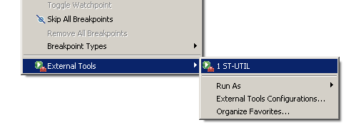

# File:5 - launch st-util.PNG

[Download original file](../assets/uploads/5_-_launch_st-util--424d516067.png)

Original upload: **Alessandro Biondi**, 2013-09-13T13:54:33Z; 6,386 bytes; `image/png`.

Upload comment: This screenshot shows how to launch ST-UTIL as an external tool in Eclipse.

This screenshot shows how to launch ST-UTIL as an external tool in Eclipse.

---

## Archive provenance

- [Original page](http://erika.tuxfamily.org/wiki/index.php?title=File%3A5_-_launch_st-util.PNG) · [Archived source revision 5468](http://erika.tuxfamily.org/wiki/index.php?oldid=5468)
- Last source edit: 2013-09-13T13:54:33Z. Source retrieved on 2026-11-06; Markdown conversion completed on 2026-11-07.
- Original contributors recorded in exported history: Alessandro Biondi.
- [Original MediaWiki source](../source/wikitext/2464.mediawiki) · [Original editing history](../source/history/batch-014.xml)
- [Attribution and licensing notice](../NOTICE.md). Original file-specific notices, where present, remain applicable.
