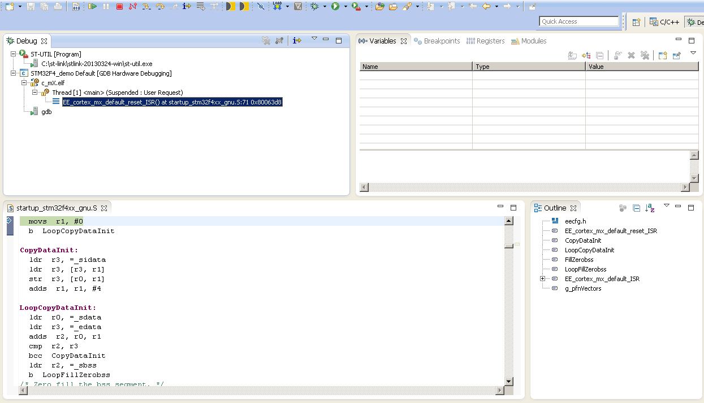

# File:6 - debug screenshot.PNG

[Download original file](../assets/uploads/6_-_debug_screenshot--707e551ec5.png)

Original upload: **Alessandro Biondi**, 2013-09-13T14:09:14Z; 54,819 bytes; `image/png`.

Upload comment: This screenshot shows the Eclipse integrated debugger in action.

This screenshot shows the Eclipse integrated debugger in action.

---

## Archive provenance

- [Original page](http://erika.tuxfamily.org/wiki/index.php?title=File%3A6_-_debug_screenshot.PNG) · [Archived source revision 5471](http://erika.tuxfamily.org/wiki/index.php?oldid=5471)
- Last source edit: 2013-09-13T14:09:15Z. Source retrieved on 2026-11-06; Markdown conversion completed on 2026-11-07.
- Original contributors recorded in exported history: Alessandro Biondi.
- [Original MediaWiki source](../source/wikitext/2465.mediawiki) · [Original editing history](../source/history/batch-014.xml)
- [Attribution and licensing notice](../NOTICE.md). Original file-specific notices, where present, remain applicable.
