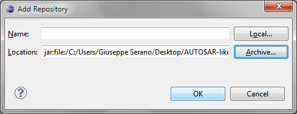

# File:Add Repository OK.png

[Download original file](../assets/uploads/Add_Repository_OK--f30da81ecd.png)

Original upload: **Eguidieri**, 2013-07-16T09:34:26Z; 16,887 bytes; `image/png`.

Upload comment: Add Repository OK

Add Repository OK

---

## Archive provenance

- [Original page](http://erika.tuxfamily.org/wiki/index.php?title=File%3AAdd_Repository_OK.png) · [Archived source revision 5159](http://erika.tuxfamily.org/wiki/index.php?oldid=5159)
- Last source edit: 2013-07-16T09:34:26Z. Source retrieved on 2026-11-06; Markdown conversion completed on 2026-11-07.
- Original contributors recorded in exported history: Eguidieri.
- [Original MediaWiki source](../source/wikitext/2359.mediawiki) · [Original editing history](../source/history/batch-015.xml)
- [Attribution and licensing notice](../NOTICE.md). Original file-specific notices, where present, remain applicable.
