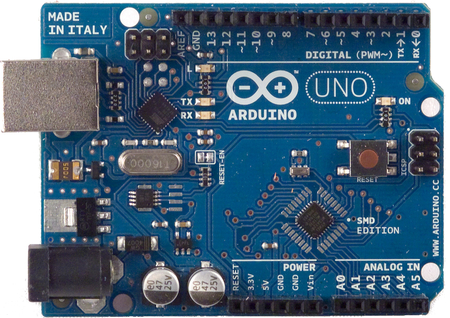

# File:Arduino uno.jpg

[Download original file](../assets/uploads/Arduino_uno--b3beb2c5f8.jpg)

Original upload: **Giuseppe Serano**, 2014-03-18T16:45:56Z; 246,759 bytes; `image/jpeg`.

---

## Archive provenance

- [Original page](http://erika.tuxfamily.org/wiki/index.php?title=File%3AArduino_uno.jpg) · [Archived source revision 5508](http://erika.tuxfamily.org/wiki/index.php?oldid=5508)
- Last source edit: 2014-03-18T16:45:56Z. Source retrieved on 2026-11-06; Markdown conversion completed on 2026-11-07.
- Original contributors recorded in exported history: Giuseppe Serano.
- [Original MediaWiki source](../source/wikitext/2468.mediawiki) · [Original editing history](../source/history/batch-016.xml)
- [Attribution and licensing notice](../NOTICE.md). Original file-specific notices, where present, remain applicable.
