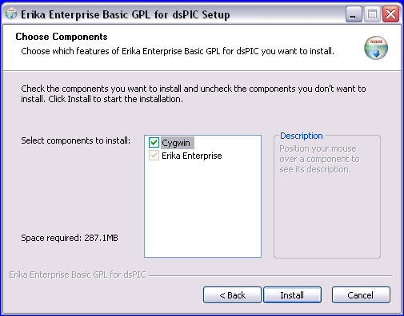

# File:Avr5tut installer options.png

[Download original file](../assets/uploads/Avr5tut_installer_options--0a368a33b7.png)

Original upload: **Shiva**, 2012-07-20T08:37:04Z; 14,358 bytes; `image/png`.

---

## Archive provenance

- [Original page](http://erika.tuxfamily.org/wiki/index.php?title=File%3AAvr5tut_installer_options.png) · [Archived source revision 4848](http://erika.tuxfamily.org/wiki/index.php?oldid=4848)
- Last source edit: 2012-07-20T08:37:05Z. Source retrieved on 2026-11-06; Markdown conversion completed on 2026-11-07.
- Original contributors recorded in exported history: Shiva.
- [Original MediaWiki source](../source/wikitext/2323.mediawiki) · [Original editing history](../source/history/batch-017.xml)
- [Attribution and licensing notice](../NOTICE.md). Original file-specific notices, where present, remain applicable.
