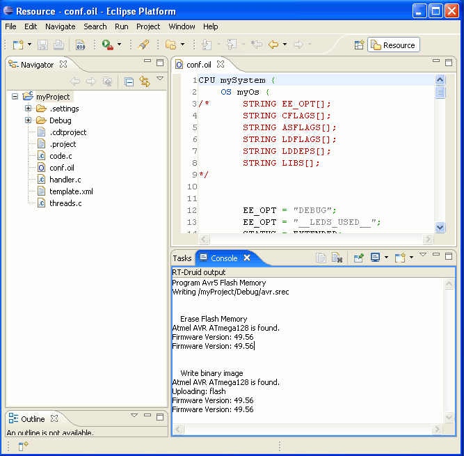

# File:Avr5tut program device2.png

[Download original file](../assets/uploads/Avr5tut_program_device2--359fc84523.png)

Original upload: **Shiva**, 2012-07-20T09:16:02Z; 16,782 bytes; `image/png`.

---

## Archive provenance

- [Original page](http://erika.tuxfamily.org/wiki/index.php?title=File%3AAvr5tut_program_device2.png) · [Archived source revision 4865](http://erika.tuxfamily.org/wiki/index.php?oldid=4865)
- Last source edit: 2012-07-20T09:16:02Z. Source retrieved on 2026-11-06; Markdown conversion completed on 2026-11-07.
- Original contributors recorded in exported history: Shiva.
- [Original MediaWiki source](../source/wikitext/2338.mediawiki) · [Original editing history](../source/history/batch-017.xml)
- [Attribution and licensing notice](../NOTICE.md). Original file-specific notices, where present, remain applicable.
