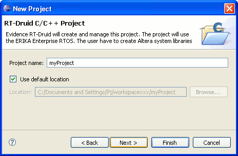

# File:Avr5tut project name.png

[Download original file](../assets/uploads/Avr5tut_project_name--7354afa6b3.png)

Original upload: **Shiva**, 2012-07-20T09:06:57Z; 7,369 bytes; `image/png`.

---

## Archive provenance

- [Original page](http://erika.tuxfamily.org/wiki/index.php?title=File%3AAvr5tut_project_name.png) · [Archived source revision 4858](http://erika.tuxfamily.org/wiki/index.php?oldid=4858)
- Last source edit: 2012-07-20T09:06:58Z. Source retrieved on 2026-11-06; Markdown conversion completed on 2026-11-07.
- Original contributors recorded in exported history: Shiva.
- [Original MediaWiki source](../source/wikitext/2331.mediawiki) · [Original editing history](../source/history/batch-017.xml)
- [Attribution and licensing notice](../NOTICE.md). Original file-specific notices, where present, remain applicable.
