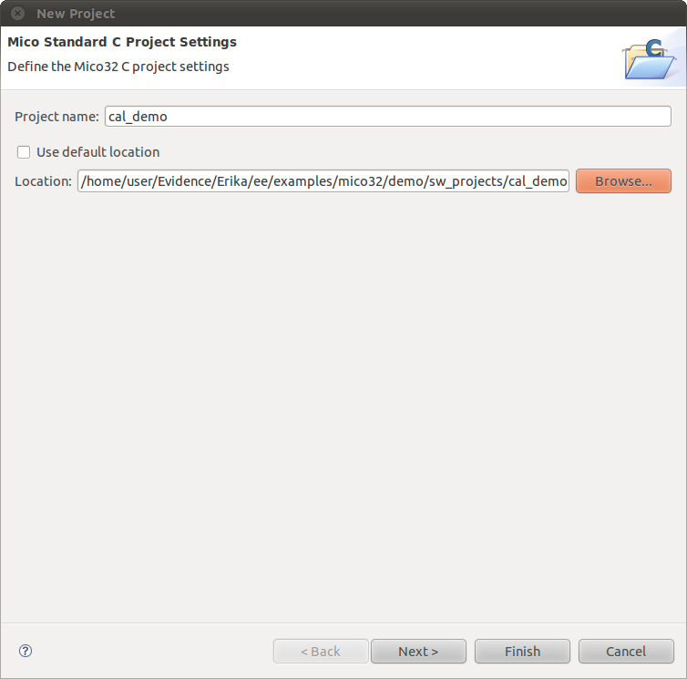

# File:Cal-demo-project-settings.png

[Download original file](../assets/uploads/Cal-demo-project-settings--6fc9c46c71.png)

Original upload: **Ryosab81**, 2011-02-08T13:48:51Z; 40,456 bytes; `image/png`.

Upload comment: This screenshot shows how to properly edit the project settings for the cal_demo project

This screenshot shows how to properly edit the project settings for the cal\_demo project

---

## Archive provenance

- [Original page](http://erika.tuxfamily.org/wiki/index.php?title=File%3ACal-demo-project-settings.png) · [Archived source revision 2386](http://erika.tuxfamily.org/wiki/index.php?oldid=2386)
- Last source edit: 2011-02-08T13:48:51Z. Source retrieved on 2026-11-06; Markdown conversion completed on 2026-11-07.
- Original contributors recorded in exported history: Ryosab81.
- [Original MediaWiki source](../source/wikitext/1761.mediawiki) · [Original editing history](../source/history/batch-018.xml)
- [Attribution and licensing notice](../NOTICE.md). Original file-specific notices, where present, remain applicable.
