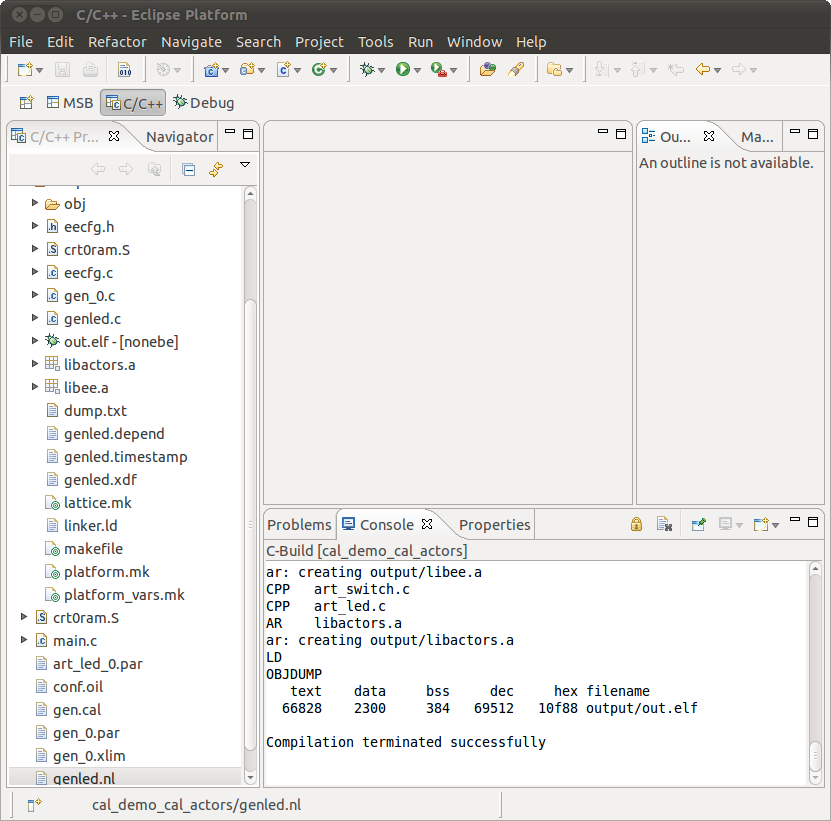

# File:Cal demo cal actors compilation successful.png

[Download original file](../assets/uploads/Cal_demo_cal_actors_compilation_successful--a83abd7a60.png)

Original upload: **Ryosab81**, 2011-02-14T11:15:19Z; 118,130 bytes; `image/png`.

Upload comment: This screenshot shows the results of a correct building process of the cal_demo_cal_actors project

This screenshot shows the results of a correct building process of the cal\_demo\_cal\_actors project

---

## Archive provenance

- [Original page](http://erika.tuxfamily.org/wiki/index.php?title=File%3ACal_demo_cal_actors_compilation_successful.png) · [Archived source revision 2527](http://erika.tuxfamily.org/wiki/index.php?oldid=2527)
- Last source edit: 2011-02-14T11:15:20Z. Source retrieved on 2026-11-06; Markdown conversion completed on 2026-11-07.
- Original contributors recorded in exported history: Ryosab81.
- [Original MediaWiki source](../source/wikitext/1771.mediawiki) · [Original editing history](../source/history/batch-018.xml)
- [Attribution and licensing notice](../NOTICE.md). Original file-specific notices, where present, remain applicable.
