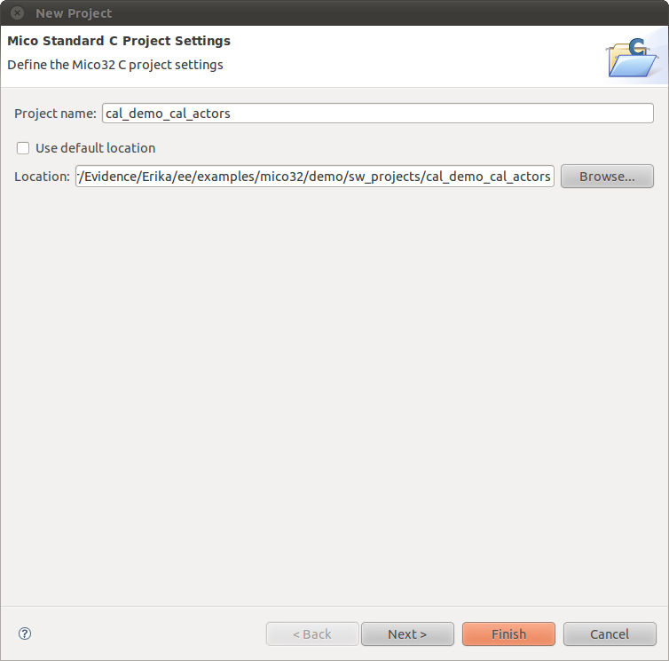

# File:Cal demo cal actors project settings.png

[Download original file](../assets/uploads/Cal_demo_cal_actors_project_settings--d4408b93c1.png)

Original upload: **Ryosab81**, 2011-02-08T14:51:18Z; 41,822 bytes; `image/png`.

Upload comment: This screenshot shows how to properly edit the project settings for the cal_demo_cal_actors project

This screenshot shows how to properly edit the project settings for the cal\_demo\_cal\_actors project

---

## Archive provenance

- [Original page](http://erika.tuxfamily.org/wiki/index.php?title=File%3ACal_demo_cal_actors_project_settings.png) · [Archived source revision 2400](http://erika.tuxfamily.org/wiki/index.php?oldid=2400)
- Last source edit: 2011-02-08T14:51:18Z. Source retrieved on 2026-11-06; Markdown conversion completed on 2026-11-07.
- Original contributors recorded in exported history: Ryosab81.
- [Original MediaWiki source](../source/wikitext/1764.mediawiki) · [Original editing history](../source/history/batch-018.xml)
- [Attribution and licensing notice](../NOTICE.md). Original file-specific notices, where present, remain applicable.
