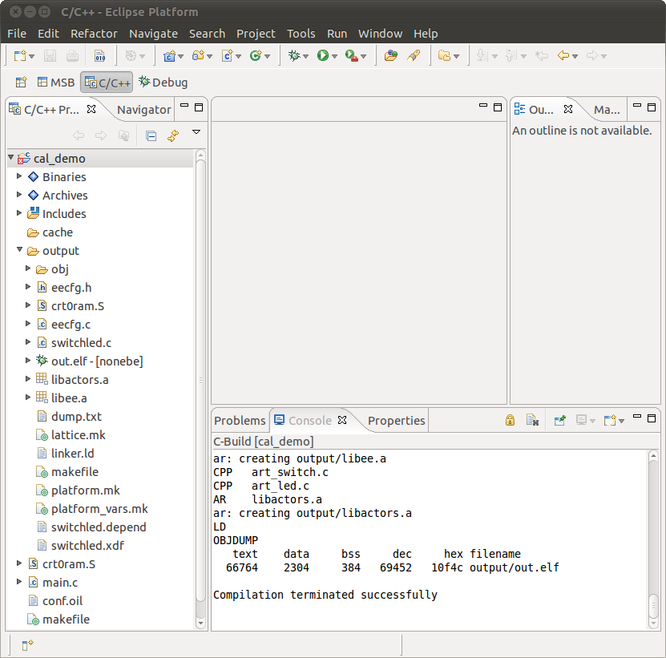

# File:Cal demo compilation successful.png

[Download original file](../assets/uploads/Cal_demo_compilation_successful--232e109060.png)

Original upload: **Ryosab81**, 2011-02-14T09:48:23Z; 115,260 bytes; `image/png`.

Upload comment: This screenshot shows the results of a correct building process

This screenshot shows the results of a correct building process.

---

## Archive provenance

- [Original page](http://erika.tuxfamily.org/wiki/index.php?title=File%3ACal_demo_compilation_successful.png) · [Archived source revision 2518](http://erika.tuxfamily.org/wiki/index.php?oldid=2518)
- Last source edit: 2011-02-14T09:48:23Z. Source retrieved on 2026-11-06; Markdown conversion completed on 2026-11-07.
- Original contributors recorded in exported history: Ryosab81.
- [Original MediaWiki source](../source/wikitext/1762.mediawiki) · [Original editing history](../source/history/batch-019.xml)
- [Attribution and licensing notice](../NOTICE.md). Original file-specific notices, where present, remain applicable.
