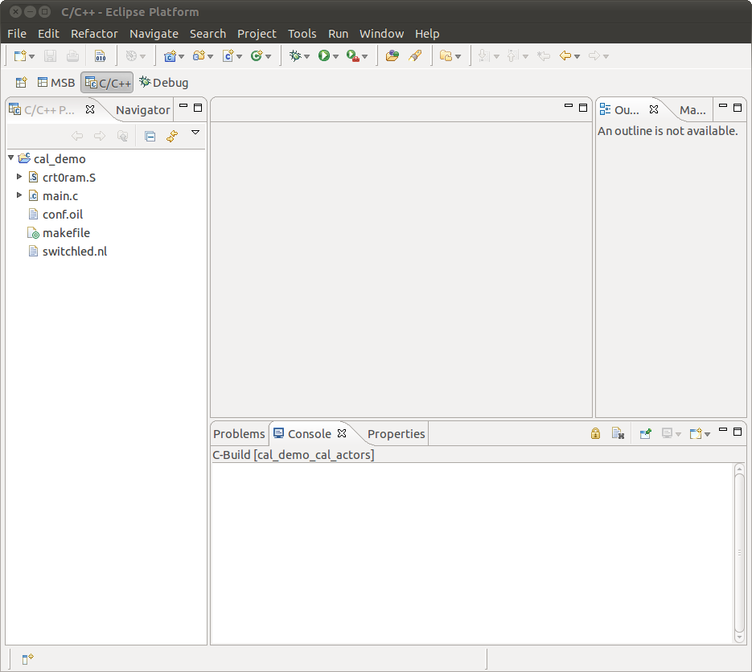

# File:Cal demo project created.png

[Download original file](../assets/uploads/Cal_demo_project_created--7717a56c02.png)

Original upload: **Ryosab81**, 2011-02-14T08:54:37Z; 60,458 bytes; `image/png`.

Upload comment: This screenshot shows the files you will find once created a new cal_demo project

This screenshot shows the files you will find once created a new cal\_demo project

---

## Archive provenance

- [Original page](http://erika.tuxfamily.org/wiki/index.php?title=File%3ACal_demo_project_created.png) · [Archived source revision 2515](http://erika.tuxfamily.org/wiki/index.php?oldid=2515)
- Last source edit: 2011-02-14T08:54:37Z. Source retrieved on 2026-11-06; Markdown conversion completed on 2026-11-07.
- Original contributors recorded in exported history: Ryosab81.
- [Original MediaWiki source](../source/wikitext/1769.mediawiki) · [Original editing history](../source/history/batch-019.xml)
- [Attribution and licensing notice](../NOTICE.md). Original file-specific notices, where present, remain applicable.
