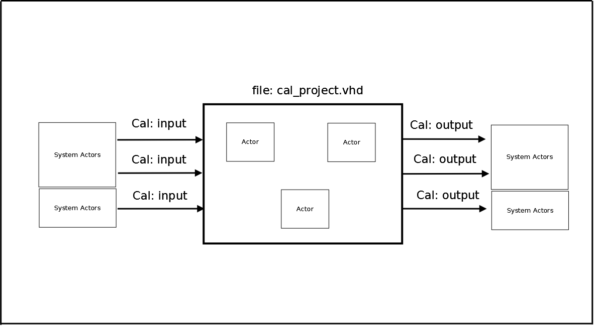

# File:Cal project wrapper.png

[Download original file](../assets/uploads/Cal_project_wrapper--af705a517d.png)

Original upload: **Salva**, 2011-02-24T11:37:15Z; 16,072 bytes; `image/png`.

Upload comment: Cal Project with wrapper and FPG-EYE System Actors

Cal Project with wrapper and FPG-EYE System Actors

---

## Archive provenance

- [Original page](http://erika.tuxfamily.org/wiki/index.php?title=File%3ACal_project_wrapper.png) · [Archived source revision 2756](http://erika.tuxfamily.org/wiki/index.php?oldid=2756)
- Last source edit: 2011-02-24T11:37:15Z. Source retrieved on 2026-11-06; Markdown conversion completed on 2026-11-07.
- Original contributors recorded in exported history: Salva.
- [Original MediaWiki source](../source/wikitext/1823.mediawiki) · [Original editing history](../source/history/batch-019.xml)
- [Attribution and licensing notice](../NOTICE.md). Original file-specific notices, where present, remain applicable.
