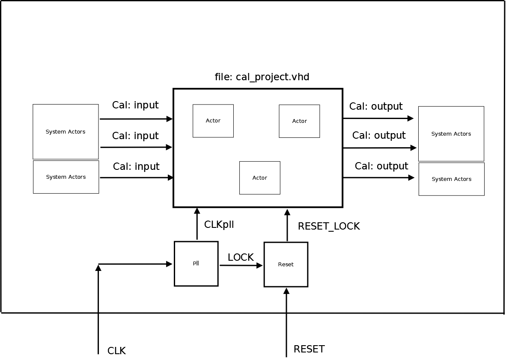

# File:Cal project wrapper pll rst.png

[Download original file](../assets/uploads/Cal_project_wrapper_pll_rst--82e3bcf63f.png)

Original upload: **Salva**, 2011-02-24T13:58:56Z; 22,793 bytes; `image/png`.

Upload comment: Wrapper with Pll and Reset.

Wrapper with Pll and Reset.

---

## Archive provenance

- [Original page](http://erika.tuxfamily.org/wiki/index.php?title=File%3ACal_project_wrapper_pll_rst.png) · [Archived source revision 2760](http://erika.tuxfamily.org/wiki/index.php?oldid=2760)
- Last source edit: 2011-02-24T13:58:56Z. Source retrieved on 2026-11-06; Markdown conversion completed on 2026-11-07.
- Original contributors recorded in exported history: Salva.
- [Original MediaWiki source](../source/wikitext/1824.mediawiki) · [Original editing history](../source/history/batch-019.xml)
- [Attribution and licensing notice](../NOTICE.md). Original file-specific notices, where present, remain applicable.
