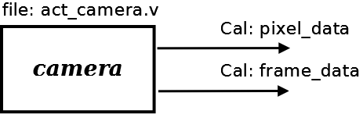

# File:Camera.png

[Download original file](../assets/uploads/Camera--fcddffd900.png)

Original upload: **Salva**, 2011-02-21T11:04:52Z; 4,942 bytes; `image/png`.

System Actor Camera structure

---

## Archive provenance

- [Original page](http://erika.tuxfamily.org/wiki/index.php?title=File%3ACamera.png) · [Archived source revision 2704](http://erika.tuxfamily.org/wiki/index.php?oldid=2704)
- Last source edit: 2011-02-21T11:04:53Z. Source retrieved on 2026-11-06; Markdown conversion completed on 2026-11-07.
- Original contributors recorded in exported history: Salva.
- [Original MediaWiki source](../source/wikitext/1776.mediawiki) · [Original editing history](../source/history/batch-019.xml)
- [Attribution and licensing notice](../NOTICE.md). Original file-specific notices, where present, remain applicable.
