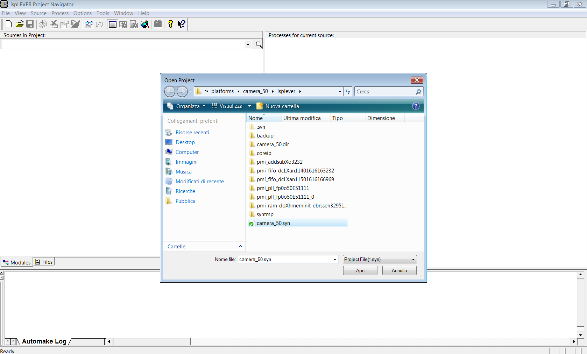

# File:Camera 50 from ispLever ide.png

[Download original file](../assets/uploads/Camera_50_from_ispLever_ide--c25e661577.png)

Original upload: **Salva**, 2011-10-04T10:25:15Z; 91,757 bytes; `image/png`.

---

## Archive provenance

- [Original page](http://erika.tuxfamily.org/wiki/index.php?title=File%3ACamera_50_from_ispLever_ide.png) · [Archived source revision 3609](http://erika.tuxfamily.org/wiki/index.php?oldid=3609)
- Last source edit: 2011-10-04T10:25:15Z. Source retrieved on 2026-11-06; Markdown conversion completed on 2026-11-07.
- Original contributors recorded in exported history: Salva.
- [Original MediaWiki source](../source/wikitext/2107.mediawiki) · [Original editing history](../source/history/batch-019.xml)
- [Attribution and licensing notice](../NOTICE.md). Original file-specific notices, where present, remain applicable.
