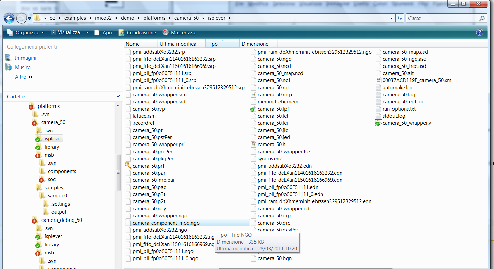

# File:Camera component mod in ispLever directory.png

[Download original file](../assets/uploads/Camera_component_mod_in_ispLever_directory--fe3347592f.png)

Original upload: **Salva**, 2011-10-04T14:50:04Z; 197,389 bytes; `image/png`.

---

## Archive provenance

- [Original page](http://erika.tuxfamily.org/wiki/index.php?title=File%3ACamera_component_mod_in_ispLever_directory.png) · [Archived source revision 3618](http://erika.tuxfamily.org/wiki/index.php?oldid=3618)
- Last source edit: 2011-10-04T14:50:04Z. Source retrieved on 2026-11-06; Markdown conversion completed on 2026-11-07.
- Original contributors recorded in exported history: Salva.
- [Original MediaWiki source](../source/wikitext/2109.mediawiki) · [Original editing history](../source/history/batch-019.xml)
- [Attribution and licensing notice](../NOTICE.md). Original file-specific notices, where present, remain applicable.
