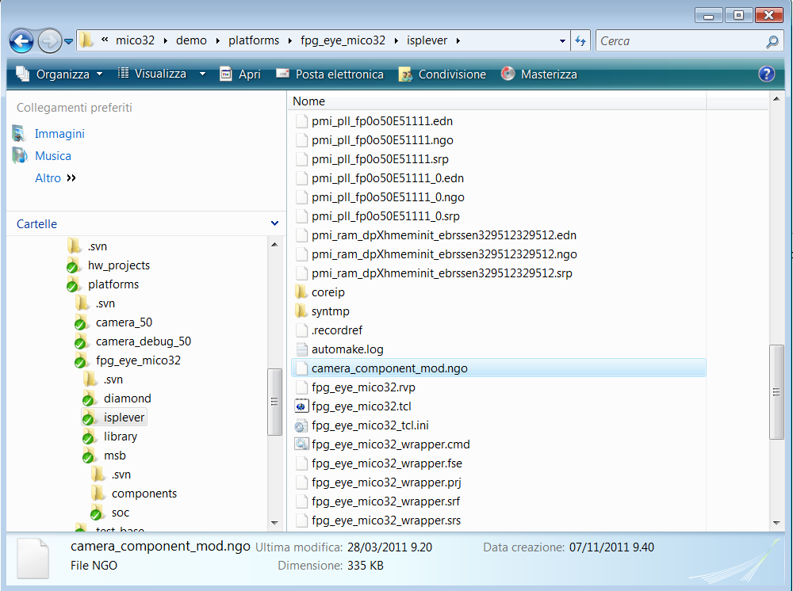

# File:Camera component ngo in ispLever.png

[Download original file](../assets/uploads/Camera_component_ngo_in_ispLever--bc859e7c0a.png)

Original upload: **Salva**, 2011-11-07T14:06:16Z; 113,035 bytes; `image/png`.

---

## Archive provenance

- [Original page](http://erika.tuxfamily.org/wiki/index.php?title=File%3ACamera_component_ngo_in_ispLever.png) · [Archived source revision 4058](http://erika.tuxfamily.org/wiki/index.php?oldid=4058)
- Last source edit: 2011-11-07T14:06:16Z. Source retrieved on 2026-11-06; Markdown conversion completed on 2026-11-07.
- Original contributors recorded in exported history: Salva.
- [Original MediaWiki source](../source/wikitext/2167.mediawiki) · [Original editing history](../source/history/batch-019.xml)
- [Attribution and licensing notice](../NOTICE.md). Original file-specific notices, where present, remain applicable.
