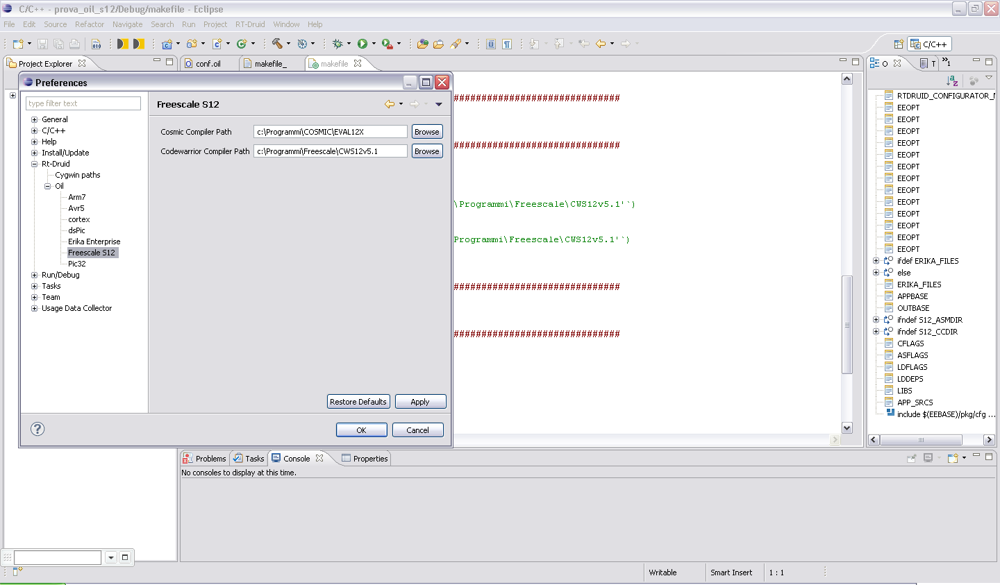

# File:Compiler preferences.PNG

[Download original file](../assets/uploads/Compiler_preferences--f4d6bd0ecf.png)

Original upload: **Erikadds**, 2011-12-12T17:23:10Z; 83,934 bytes; `image/png`.

---

## Archive provenance

- [Original page](http://erika.tuxfamily.org/wiki/index.php?title=File%3ACompiler_preferences.PNG) · [Archived source revision 4206](http://erika.tuxfamily.org/wiki/index.php?oldid=4206)
- Last source edit: 2011-12-12T17:23:11Z. Source retrieved on 2026-11-06; Markdown conversion completed on 2026-11-07.
- Original contributors recorded in exported history: Erikadds.
- [Original MediaWiki source](../source/wikitext/2204.mediawiki) · [Original editing history](../source/history/batch-021.xml)
- [Attribution and licensing notice](../NOTICE.md). Original file-specific notices, where present, remain applicable.
