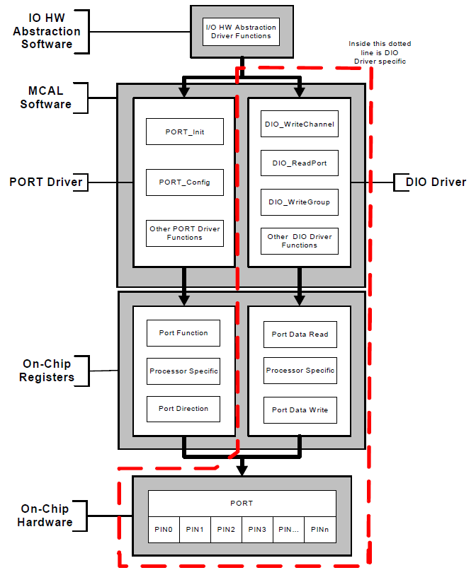

# File:DIO-PORT.png

[Download original file](../assets/uploads/DIO-PORT--9b8750ddc0.png)

Original upload: **Giuseppe Serano**, 2013-07-16T17:42:01Z; 45,781 bytes; `image/png`.

Upload comment: DIO PORT

DIO PORT

---

## Archive provenance

- [Original page](http://erika.tuxfamily.org/wiki/index.php?title=File%3ADIO-PORT.png) · [Archived source revision 5225](http://erika.tuxfamily.org/wiki/index.php?oldid=5225)
- Last source edit: 2013-07-16T17:42:01Z. Source retrieved on 2026-11-06; Markdown conversion completed on 2026-11-07.
- Original contributors recorded in exported history: Giuseppe Serano.
- [Original MediaWiki source](../source/wikitext/2390.mediawiki) · [Original editing history](../source/history/batch-021.xml)
- [Attribution and licensing notice](../NOTICE.md). Original file-specific notices, where present, remain applicable.
