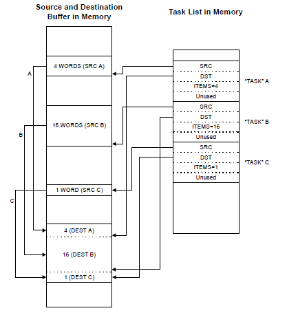

# File:DMA Memory Scatter Gather.png

[Download original file](../assets/uploads/DMA_Memory_Scatter_Gather--cbc21984a6.png)

Original upload: **Giuseppe Serano**, 2013-07-17T15:11:59Z; 17,464 bytes; `image/png`.

---

## Archive provenance

- [Original page](http://erika.tuxfamily.org/wiki/index.php?title=File%3ADMA_Memory_Scatter_Gather.png) · [Archived source revision 5302](http://erika.tuxfamily.org/wiki/index.php?oldid=5302)
- Last source edit: 2013-07-17T15:11:59Z. Source retrieved on 2026-11-06; Markdown conversion completed on 2026-11-07.
- Original contributors recorded in exported history: Giuseppe Serano.
- [Original MediaWiki source](../source/wikitext/2428.mediawiki) · [Original editing history](../source/history/batch-022.xml)
- [Attribution and licensing notice](../NOTICE.md). Original file-specific notices, where present, remain applicable.
