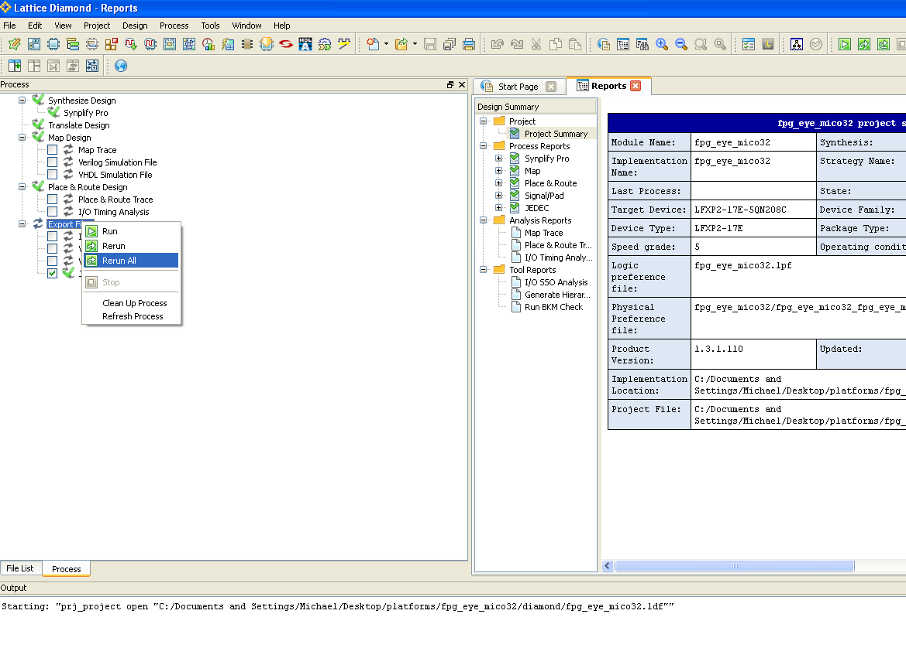

# File:Diamond compile fpg eye mico32.png

[Download original file](../assets/uploads/Diamond_compile_fpg_eye_mico32--ed7a53831f.png)

Original upload: **Salva**, 2011-11-07T15:26:51Z; 95,308 bytes; `image/png`.

---

## Archive provenance

- [Original page](http://erika.tuxfamily.org/wiki/index.php?title=File%3ADiamond_compile_fpg_eye_mico32.png) · [Archived source revision 4090](http://erika.tuxfamily.org/wiki/index.php?oldid=4090)
- Last source edit: 2011-11-07T15:26:51Z. Source retrieved on 2026-11-06; Markdown conversion completed on 2026-11-07.
- Original contributors recorded in exported history: Salva.
- [Original MediaWiki source](../source/wikitext/2176.mediawiki) · [Original editing history](../source/history/batch-022.xml)
- [Attribution and licensing notice](../NOTICE.md). Original file-specific notices, where present, remain applicable.
