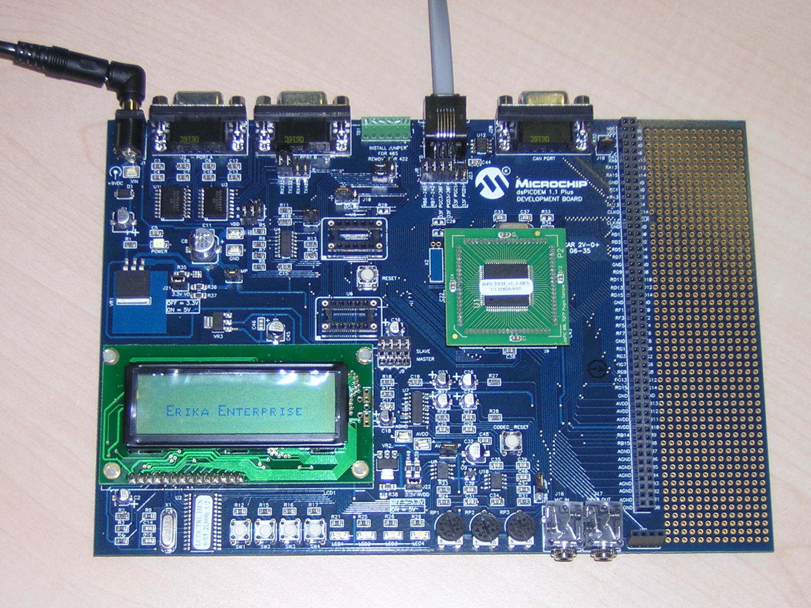

# File:Dspicdemrunning.jpg

[Download original file](../assets/uploads/Dspicdemrunning--db5cfa8f4f.jpg)

Original upload: **Paolo.gai**, 2011-09-21T06:38:27Z; 425,113 bytes; `image/jpeg`.

Upload comment: The Microchip dsPICDEM 1.1 Plus board running Erika Enterprise.

The Microchip dsPICDEM 1.1 Plus board running Erika Enterprise.

---

## Archive provenance

- [Original page](http://erika.tuxfamily.org/wiki/index.php?title=File%3ADspicdemrunning.jpg) · [Archived source revision 3271](http://erika.tuxfamily.org/wiki/index.php?oldid=3271)
- Last source edit: 2011-09-21T06:38:29Z. Source retrieved on 2026-11-06; Markdown conversion completed on 2026-11-07.
- Original contributors recorded in exported history: Paolo.gai.
- [Original MediaWiki source](../source/wikitext/2068.mediawiki) · [Original editing history](../source/history/batch-023.xml)
- [Attribution and licensing notice](../NOTICE.md). Original file-specific notices, where present, remain applicable.
