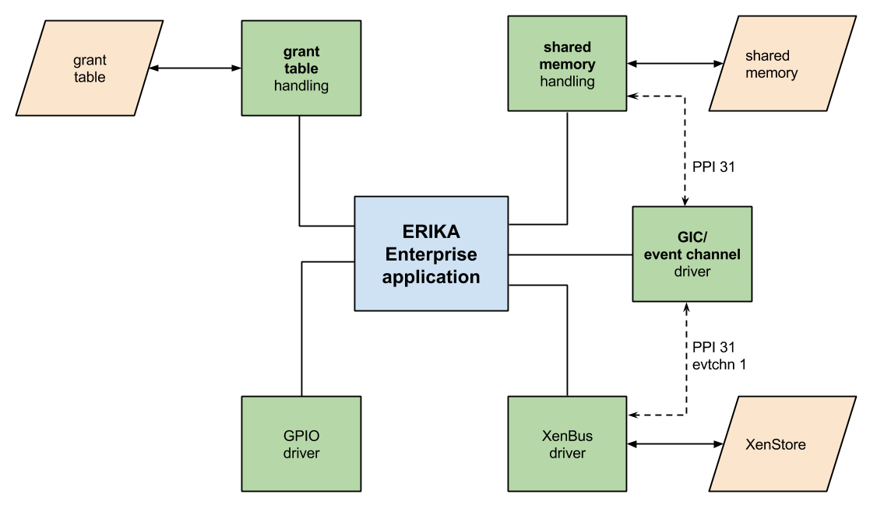

# File:ERIKA-system-components.png

[Download original file](../assets/uploads/ERIKA-system-components--83cdc96209.png)

Original upload: **Arianna Avanzini**, 2015-02-02T17:08:24Z; 37,369 bytes; `image/png`.

Upload comment: Schematic of the components of a Xen-compatible ERIKA Enterprise application.

Schematic of the components of a Xen-compatible ERIKA Enterprise application.

---

## Archive provenance

- [Original page](http://erika.tuxfamily.org/wiki/index.php?title=File%3AERIKA-system-components.png) · [Archived source revision 5981](http://erika.tuxfamily.org/wiki/index.php?oldid=5981)
- Last source edit: 2015-02-02T17:08:24Z. Source retrieved on 2026-11-06; Markdown conversion completed on 2026-11-07.
- Original contributors recorded in exported history: Arianna Avanzini.
- [Original MediaWiki source](../source/wikitext/2509.mediawiki) · [Original editing history](../source/history/batch-023.xml)
- [Attribution and licensing notice](../NOTICE.md). Original file-specific notices, where present, remain applicable.
